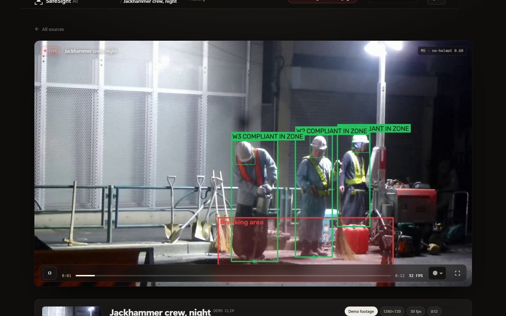
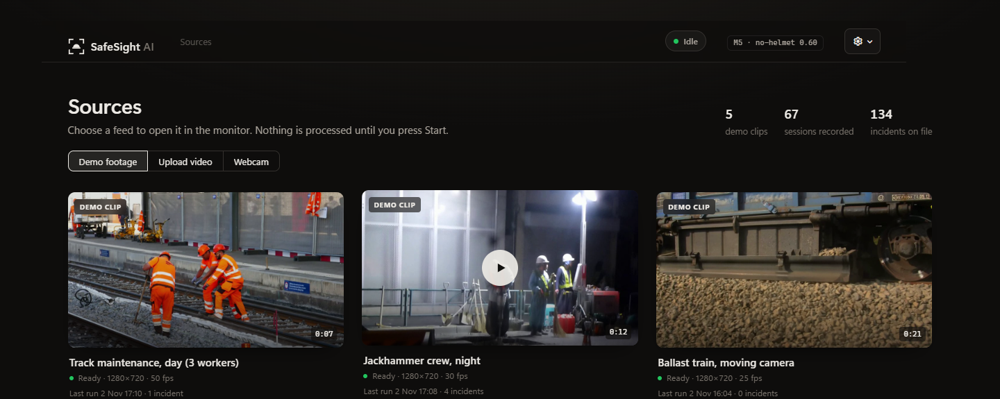
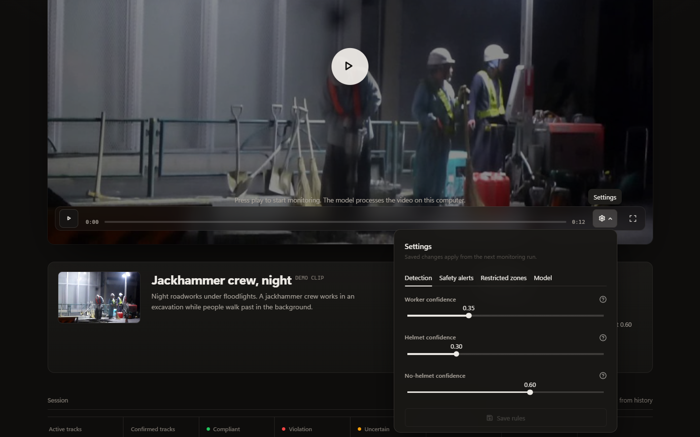
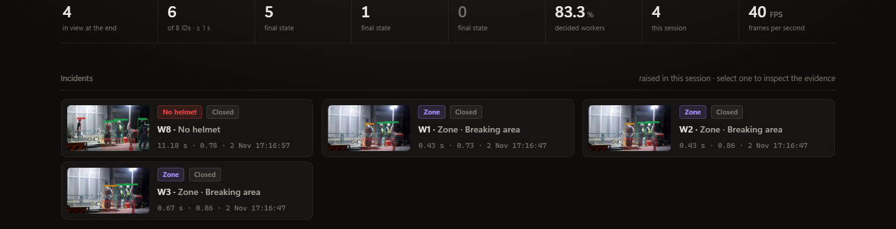
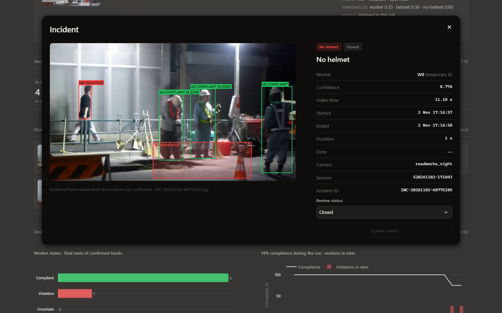
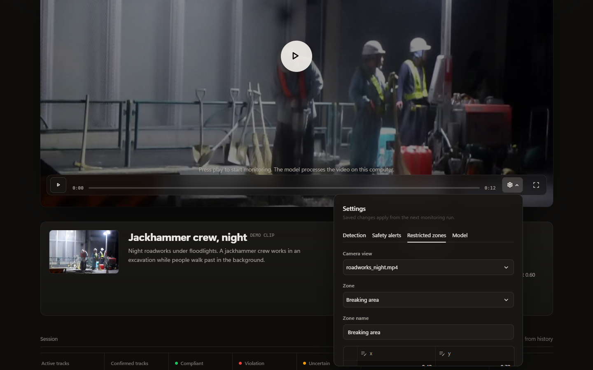
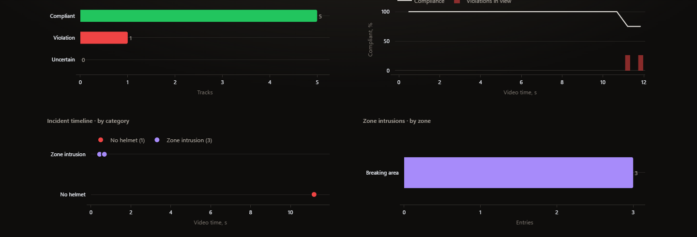
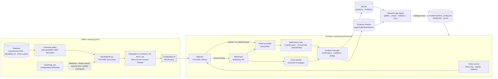

<p align="center">
  <picture>
    <source media="(prefers-color-scheme: dark)" srcset="assets/project_identity/wordmark-light.svg">
    
  </picture>
</p>

<h3 align="center">Industrial worker-safety monitoring through computer vision</h3>

<p align="center">
  Hard-hat (PPE) compliance · worker tracking · restricted-zone intrusion · incident management with evidence
</p>

<p align="center">
  
  
  
  
  
  
  <a href="LICENSE"></a>
</p>

<p align="center">
  <a href="#overview">Overview</a> ·
  <a href="#features">Features</a> ·
  <a href="#architecture">Architecture</a> ·
  <a href="#model">Model</a> ·
  <a href="#evaluation">Evaluation</a> ·
  <a href="#installation">Installation</a> ·
  <a href="#usage">Usage</a> ·
  <a href="docs/README.md">Documentation</a> ·
  <a href="#limitations">Limitations</a> ·
  <a href="#licensing">Licensing</a>
</p>

<p align="center">
  
  <br><sub>Live monitoring on a public Wikimedia Commons clip (roadworks at night, Nesnad, CC BY-SA 3.0). Boxes, IDs, states and the zone are drawn by the system.</sub>
</p>

> [!IMPORTANT]
> **SafeSight AI is a research prototype and academic demonstration.** It is not a certified safety system, and it has not been validated on a real site's cameras. The code is open source under AGPL-3.0, but **trained model weights are not included** for third-party licensing reasons. See [Limitations](#limitations) and [Licensing](#licensing).

---

## Overview

**The problem.** Head injuries remain a leading cause of serious harm on construction and industrial sites, and hard-hat rules are only as good as their enforcement. Supervisors cannot watch every camera continuously. Manual review of recorded footage is slow, inconsistent and happens after the fact, and it does not scale across many cameras or shifts.

**The approach.** SafeSight AI watches a video feed and does four things automatically:

- **Finds workers** and gives each one a temporary track ID. It does not identify people.
- **Decides whether each worker wears a hard hat**, but only after several frames agree. When the head is not seen clearly, the worker stays *uncertain* rather than being guessed.
- **Raises an alert** when a worker enters a configured restricted area.
- **Records every confirmed event** as an incident with a timestamp, a confidence score and an evidence frame, ready for review and CSV export.

**Who it is for:**

- **Safety officers and site supervisors** who want a second pair of eyes on camera feeds.
- **Engineers and researchers** evaluating how far a small, fast detector can go on realistic worksite footage.

Everything runs locally on one workstation, with no cloud services.

## Features

All of these are implemented and were exercised in browser-based tests (see [docs/design/REDESIGN_QA.md](docs/design/REDESIGN_QA.md)).

| | Capability | Notes |
|---|---|---|
| 🎯 | **Custom PPE detector** | YOLO26n fine-tuned to detect `person`, `helmet` and `no_helmet` (frozen model "M5") |
| 🧭 | **Worker tracking** | ByteTrack on person boxes, with temporary IDs and tuned tracker settings |
| ⛑️ | **Helmet compliance** | Head-to-worker association, then a multi-frame vote: COMPLIANT, VIOLATION or UNCERTAIN |
| 🔄 | **State transitions** | A worker who puts a helmet on goes from VIOLATION to COMPLIANT with the same ID, and the incident closes itself |
| 🚧 | **Restricted zones** | Polygon zones per camera view, tested on the worker's foot point, with entry/exit debouncing |
| 🧾 | **Incidents with evidence** | Cooldown, duplicate suppression for broken tracks, and an annotated evidence frame per incident |
| 🗄️ | **SQLite incident store** | Sessions and incidents persist across runs; review statuses (Open, Closed, Reviewed, False alarm) |
| 📤 | **CSV export** | One row per incident |
| 📊 | **Monitoring app** | Source gallery, cinematic player, live session figures, incident inspector, session and history analytics |
| 🛡️ | **Single-run lock** | Prevents two browser tabs from running the shared tracker at once |
| 🐕 | **Training watchdog** | Independent process: heartbeat and health checks, verified checkpoints, bounded automatic recovery |

## Screenshots

<table>
  <tr>
    <td width="50%"><br><sub><b>Source gallery.</b> Real frames from each clip; nothing runs until Start.</sub></td>
    <td width="50%"><br><sub><b>Settings inside the player.</b> Detection thresholds, alert rules, zones, model information.</sub></td>
  </tr>
  <tr>
    <td><br><sub><b>Session figures and incidents.</b> Final state of confirmed tracks; one card per incident.</sub></td>
    <td><br><sub><b>Incident inspector.</b> Evidence frame, details and review status.</sub></td>
  </tr>
  <tr>
    <td><br><sub><b>Restricted zones.</b> Polygon editor per camera view.</sub></td>
    <td><br><sub><b>Session analytics.</b> Worker states, compliance during the run, incident timeline, zone entries.</sub></td>
  </tr>
</table>

<sub>All screenshots show the CC BY-SA 3.0 Wikimedia Commons clip "Jackhammer-japan-july2013" by Nesnad, processed by SafeSight AI, and are shared under the same licence ([details](assets/screenshots/README.md)). The violation-to-compliant demo uses a Mixkit clip whose standalone redistribution is unconfirmed, so it is not pictured here.</sub>

## Architecture



| Component | Location | Role |
|---|---|---|
| Detector | `inference/detector.py` | Runs YOLO26n once per frame at 640 px. Person boxes go to ByteTrack; helmet and no_helmet boxes are filtered by class-specific confidence (no_helmet 0.60). |
| Tracker | `inference/bytetrack_safesight.yaml` | ByteTrack, tuned on the demo clips (new-track threshold 0.6, match threshold 0.9, buffer 60) to reduce ID fragmentation |
| PPE association | `inference/ppe_association.py` | Assigns each head box to at most one worker, using the upper body region. A vote over about 0.5 s decides the state. |
| Zone monitor | `inference/zone_monitor.py` | Normalised polygons per camera view, tested on the worker's foot point (bottom-centre of the box), with debounced entry and exit |
| Incident manager | `inference/incident_manager.py` | Opens one incident per episode, applies the cooldown, suppresses duplicates from broken tracks, saves the annotated evidence frame and closes incidents when the state clears |
| Pipeline | `inference/tracker.py` | Wires the above per frame; records the session summary |
| Storage | `database/database.py` | SQLite tables `sessions` and `incidents`; CSV export |
| App | `app/` | Source gallery, player, settings menu, analytics; single-run lock (`app/runlock.py`) |
| Watchdog | `watchdog_svc/` | Supervises training jobs: liveness, heartbeat age, finite loss, disk/RAM/GPU, checkpoint verification, recovery with bounded retries |

More diagrams, including the state machine, incident lifecycle and watchdog recovery, are in **[docs/architecture.md](docs/architecture.md)**.

## Technology

| Area | Technology |
|---|---|
| Language | Python 3.11 |
| Deep learning | PyTorch 2.14.1 (CUDA 12.6 build) |
| Detection | Ultralytics 8.4.197, YOLO26n |
| Tracking | ByteTrack (Ultralytics implementation, `lap` for assignment) |
| Vision and video | OpenCV 5 |
| App and charts | Streamlit 1.66, Plotly 7 |
| Storage | SQLite (standard library) |
| Data processing | NumPy, pandas |
| Process supervision | psutil; Windows Task Scheduler and WMI for the watchdog keeper |
| Development | pytest, Ruff |

Development hardware: Windows 11, NVIDIA RTX 2000 Ada (16 GB VRAM).

## Model

| | |
|---|---|
| Name | **M5** (frozen 2 November 2026) |
| Architecture | YOLO26n: 2,534,858 parameters (about 2.53 M; 2.39 M after layer fusion), 5.4 GFLOPs at 640 px |
| Classes | `person`, `helmet`, `no_helmet` |
| Training | Transfer learning from COCO YOLO26n. M2 was trained first (up to 120 epochs). It was then fine-tuned twice, to M4 (box-style harmonisation) and to M5 (audited SH17 subset), with AdamW, lr0 5e-4, up to 40 epochs and patience 15. Seed 42 throughout. |
| Training data | Construction-PPE (boxes harmonised to full heads), Mendeley PPE v6, an audited 1,819-image SH17 subset with derived `no_helmet` labels, plus pose-teacher person pseudo-labels |
| Tracking | ByteTrack on person boxes only |
| Application thresholds | person 0.35, helmet 0.30, **no_helmet 0.60** |
| Weights | `models/best.pt`, SHA-256 `E9B2583DCAE39613FFD94B907FB216A07C7039C304AC026700BCC364CC3C7534`. **Not distributed**; see [why](#why-no-model-weights-are-included) and [models/README.md](models/README.md). |

Full model card: **[docs/model_card.md](docs/model_card.md)**.

## Evaluation

Every number below comes from the frozen reports in [`reports/`](reports/), mainly [`reports/final_report.md`](reports/final_report.md). Each table says which data split it uses.

> [!NOTE]
> **How to read these numbers.**
> - **AP is threshold-free.** It is averaged over all confidences. Precision (P) and recall (R) in validation tables are taken at the evaluator's best-F1 confidence, unless a table names a threshold.
> - **The common validation set has partial labels**, so its precision is a lower bound. **SH17 validation is fully labelled.**
> - Precision is **not** accuracy.

### SH17 validation: M5 (1,618 images, complete labels)

| Metric | Result |
|---|---:|
| no_helmet AP50 | **0.827** |
| no_helmet precision / recall (best-F1 confidence) | 0.944 / 0.704 |
| no_helmet precision / recall at the **application threshold 0.60** | 0.981 / 0.615 |
| person AP50 | 0.859 |
| mAP50 / mAP50-95, all classes | 0.770 / 0.526 |

### Common validation set (308 images: Construction-PPE + Mendeley, partial labels)

| Model | mAP50 | mAP50-95 | no_helmet AP50 | person AP50 |
|---|---:|---:|---:|---:|
| M2 (previous model) | **0.703** | **0.489** | **0.579** | 0.939 |
| M5 (selected) | 0.656 | 0.449 | 0.545 | **0.942** |

### Held-out test (run once, after M5 was selected)

| Test set | M5 mAP50 | M2 mAP50 | M5 mAP50-95 | M2 mAP50-95 |
|---|---:|---:|---:|---:|
| Construction-PPE official test (141 images) | 0.427 | **0.583** | 0.177 | **0.278** |
| Mendeley PPE v6 test (360 images) | **0.671** | 0.667 | 0.478 | **0.482** |

### Why M5 despite lower common-validation and Construction-PPE scores

- **The Construction-PPE gap is mostly label style.** Construction-PPE draws helmet-only boxes, while M5 learned full-head boxes. On validation with Construction-PPE boxes extended to full heads, M5 scores 0.649 mAP50 against M2's 0.406.
- **M5 is much better at the class that matters.** It is clearly better on the fully labelled SH17 bare-head set, and level with or better than M2 on Mendeley.
- **On unseen worksite footage with the full pipeline**, M5 was the only model that caught a real violator without false alarms. M2 missed the violator; M3 raised 2–3 false alarms on hard hats.

### Two thresholds, two purposes

| Threshold | Value | Set how | Used for |
|---|---|---|---|
| Comparison | 0.50 for M5 (M2 0.65, M3 0.50) | One fixed rule on SH17 validation: the lowest confidence reaching 0.95 precision | Comparing models fairly |
| Application | **0.60** | Chosen before the comparison, from validation data and the demo clips. At 0.50, M5 raised 2 false alarms on those clips; at 0.60 it raised none. | The running app |

### Runtime (measured 2 November 2026, RTX 2000 Ada)

| Measure | Value |
|---|---|
| Model inference, 1280×720 frames at 640 px | about 9.5–10 ms per frame (plus about 1 ms pre-processing and about 1.3 ms post-processing) |
| Full pipeline without the interface | about 52–82 FPS, depending on the clip |
| Full pipeline in the app with a browser attached | about 41–60 FPS in the readiness audit; lower (20–40 FPS) when the GPU was not boosting fully |
| Peak PyTorch GPU memory | 64 MB allocated |

Details, the experiment history (B0–M5) and the unseen-footage study are in **[docs/evaluation.md](docs/evaluation.md)**.

## Datasets

| Dataset | Licence | Used for | Notes |
|---|---|---|---|
| [Construction-PPE](https://docs.ultralytics.com/datasets/detect/construction-ppe/) (Ultralytics) | AGPL-3.0 | Train, validation, official test | Official splits leaked near-duplicates: 509 train/val images removed; the test set is kept verbatim |
| [PPE dataset v6](https://data.mendeley.com/datasets/zkzghjvpn2/6) (Mendeley Data) | CC BY 4.0 | Train, validation, test | Split by near-duplicate cluster; no person class |
| [SH17](https://github.com/ahmadmughees/SH17dataset) (Ahmad et al.) | **CC BY-NC-SA 4.0** | 1,819-image audited training subset; official val as a fully labelled check | `no_helmet` labels **derived** from head/helmet overlap and audited by eye; ambiguous images rejected |
| SHWD | MIT; SCUT-HEAD parts have their own terms | Experiment M3 only | **Not in the final model** |

**Not included:** raw data, processed data and weights. Full provenance, derivation rules and attribution are in **[docs/datasets_and_licensing.md](docs/datasets_and_licensing.md)**.

## Installation

Tested on **Windows 11**, **Python 3.11**, with an **NVIDIA GPU and CUDA 12.6 drivers**. A CPU-only install works for the app, but slowly.

```powershell
git clone https://github.com/nj-codes-24/SafeSight-AI.git
cd SafeSight-AI
py -3.11 -m venv .venv
.venv\Scripts\Activate.ps1
python -m pip install --upgrade pip
pip install -r requirements.txt          # CUDA 12.6 build of PyTorch; see docs/installation.md for CPU-only
```

1. **Model weights.** The app expects weights at `models\best.pt`. M5 is **not distributed** (see [Licensing](#licensing)). If you lawfully hold the M5 file, place it there and verify its checksum ([models/README.md](models/README.md)). Otherwise, train your own model with [docs/training.md](docs/training.md).
2. **Demo footage** (optional). Fetch and prepare the clips into `data\demo\`; see [data/README.md](data/README.md).
3. **Check:**

   ```powershell
   python scripts\verify_installation.py
   ```

Step-by-step instructions, CPU-only setup and dataset preparation for retraining are in **[docs/installation.md](docs/installation.md)**. Common problems are covered in **[docs/troubleshooting.md](docs/troubleshooting.md)**.

## Usage

```powershell
python launch.py
```

Then open **http://localhost:8501**.

1. **Choose a source:** a demo clip, an uploaded video (saved to `data\demo\uploads`) or a webcam (device 0).
2. **Press play.** The model runs locally, and workers, IDs, states and zones appear on the video.
3. **Watch the session figures and alerts.** Active tracks, confirmed tracks, compliant, violation and uncertain counts, compliance and FPS.
4. **Inspect incidents.** Click a card to see the evidence frame and details, and set a review status.
5. **Review analytics.** Session charts below the player, and all-session history further down.
6. **Export** the incident log as CSV from the Results tab.

The **gear icon** inside the player opens the settings: detection thresholds, alert confirmation time and cooldown, restricted-zone polygons, and model information. Saved settings apply from the next run.

**Headless multi-camera runtime (no browser).** To monitor several cameras or video files continuously in a background process, independent of the dashboard:

```powershell
python -m runtime run --config config/runtime.demo.yaml
```

See **[docs/runtime_getting_started.md](docs/runtime_getting_started.md)**. RTSP support is implemented but has not been tested against a real camera stream.

The runtime also checks that each camera still shows its registered view: if a camera is moved, zoomed, switched to another scene or covered, its open incidents end at the last reliable observation (never as "resolved"), the camera stops analysing, and zones need an operator to revalidate a new view ([details](docs/product_research/21_CAMERA_VIEW_CHANGE_DETECTION.md)). This has been tested with simulated camera movements only.

A scripted 4-minute demonstration is in **[docs/demo_guide.md](docs/demo_guide.md)**.

## Repository layout

```
app/                 Streamlit app: gallery and player views, settings, analytics, design system
inference/           Runtime pipeline: detector, tracking, PPE association, zones, incidents, config
intelligence/        Hazard taxonomy, risk policy engine, event-level validation metrics
runtime/             Headless multi-camera service: sources, camera workers, shared inference, health, CLI
config/              Runtime configurations: a runnable demo and a documented site template
database/            SQLite incident and session store
training/            Data preparation, audits, training entry point, evaluation, experiment configs
watchdog_svc/        Training watchdog, supervisor and health checks
scripts/             Evaluation studies, browser QA, installation check, training monitor
tests/               Unit tests, watchdog drills, integration tests (skipped without weights or data)
reports/             Frozen evaluation results (JSON, charts, final report)
docs/                Architecture, model card, datasets, evaluation, training, deployment, demo, limitations
assets/              Screenshots and project identity
models/ data/        Configuration and manifests only; weights and data are obtained separately
launch.py            Starts the app
```

## Testing

```powershell
python -m pytest -rs        # unit tests, watchdog drills, and integration tests if weights and data are present
ruff check .
```

With weights, demo clips and processed data present, the full suite has **32 tests**, all passing on the development machine. On a clean CPU machine, 21 run, and the integration module is skipped with a stated reason. That is also what continuous integration runs ([`.github/workflows/ci.yml`](.github/workflows/ci.yml)).

## Limitations

- **Never validated on a real site's cameras.** All evaluation footage is public.
- **Distant, small or low-quality workers are missed.** On one distant rooftop clip, no model found any of the 5–7 bare-headed workers.
- **No sense of context.** Any bare head is flagged, including people in offices or films.
- **Track IDs can split** after occlusion, so counts are tracks, not people.
- **Cross-domain gaps.** Results depend strongly on label conventions and footage style.
- **Thresholds were tuned on little footage.** A site should re-tune them.
- **No fairness analysis** by skin tone, hair or headwear type.

Full list: **[docs/limitations.md](docs/limitations.md)**.

## Licensing

**SafeSight AI's own source code and documentation are licensed under the [GNU AGPL-3.0](LICENSE)** (AGPL-3.0-only). Copyright (C) 2026 nj-codes-24 and SafeSight AI contributors.

> [!IMPORTANT]
> **The AGPL-3.0 licence covers this project's original work only.** It does not relicense the datasets, footage, screenshots, dependencies or trained models listed below; each keeps its own licence.

| Material | Licence | In this repository |
|---|---|---|
| Original source code, docs, configuration, evaluation results | **AGPL-3.0-only** | Yes |
| Ultralytics library and YOLO26n base weights | AGPL-3.0 | No: installed separately |
| M5 and all other trained checkpoints | Not licensed by this project | **No: not distributed** |
| Construction-PPE dataset | AGPL-3.0 (Ultralytics) | No |
| Mendeley PPE v6 dataset | CC BY 4.0 | No |
| SH17 dataset | CC BY-NC-SA 4.0 | No |
| SHWD (experiment M3 only) | MIT; SCUT-HEAD parts have their own terms | No |
| Screenshots in `assets/screenshots/` | CC BY-SA 3.0 / 4.0, inherited from the Wikimedia Commons footage; **not AGPL** | Yes, with attribution |
| Demo videos | CC BY-SA (Commons); Mixkit Free License | No: fetched by scripts |
| Python dependencies | Their own licences | No: installed by the user |

### Why no model weights are included

**Pretrained and fine-tuned checkpoint files are not included, and there is no download link, because of third-party licensing considerations.**
- **Ultralytics** states that models trained with its code fall under **AGPL-3.0**.
- **M5 was also fine-tuned on SH17,** whose **CC BY-NC-SA 4.0** licence requires adaptations to stay non-commercial and ShareAlike. Creative Commons recognises no non-CC licence as compatible with that.
- **So M5 cannot safely be released under either licence alone.**

Publishing this project's code under AGPL-3.0 while not distributing the weights avoids the conflict. The architecture, training method, model card and every evaluation result are documented in full, and the training pipeline is included so that you can train your own model.

The analysis, the official sources it relies on, and the open questions for Ultralytics and the SH17 authors are in **[LICENSING_DECISION.md](LICENSING_DECISION.md)**. Attributions are in **[THIRD_PARTY_NOTICES.md](THIRD_PARTY_NOTICES.md)**.

## Documentation

| Document | Contents |
|---|---|
| [docs/architecture.md](docs/architecture.md) | Components, pipelines, state machine, incident lifecycle, storage, watchdog |
| [docs/model_card.md](docs/model_card.md) | Model identity, intended use, results, limitations |
| [docs/datasets_and_licensing.md](docs/datasets_and_licensing.md) | Provenance, derivation, splits, licences |
| [docs/evaluation.md](docs/evaluation.md) | Methodology, experiments M2–M5, thresholds, unseen footage |
| [docs/training.md](docs/training.md) | Configurations, checkpoints, watchdog, reproduction |
| [docs/installation.md](docs/installation.md) | Setup on Windows, CPU-only setup, data preparation |
| [docs/deployment.md](docs/deployment.md) | Current deployment and what real deployment would need |
| [docs/demo_guide.md](docs/demo_guide.md) | Reproducible demonstration |
| [docs/limitations.md](docs/limitations.md) | Known limitations |
| [docs/troubleshooting.md](docs/troubleshooting.md) | CUDA, weights, footage, Streamlit |
| [docs/product_research/](docs/product_research/README.md) | Product research and strategy: industries, hazards, competitors, papers, datasets, architecture, validation, compliance, roadmap |
| [docs/runtime_getting_started.md](docs/runtime_getting_started.md) | Headless multi-camera runtime: commands, configuration, credentials, status |

## Citation

If you refer to this work, please cite it using [CITATION.cff](CITATION.cff), and cite the datasets listed in [THIRD_PARTY_NOTICES.md](THIRD_PARTY_NOTICES.md).
