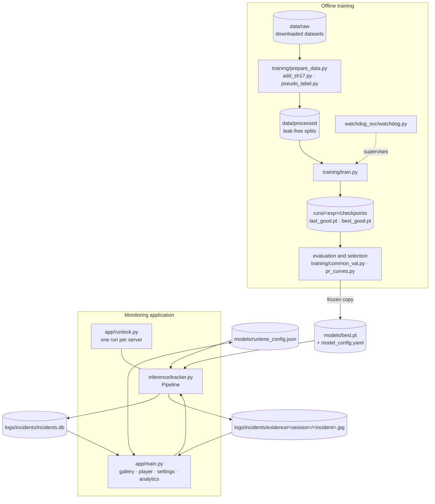
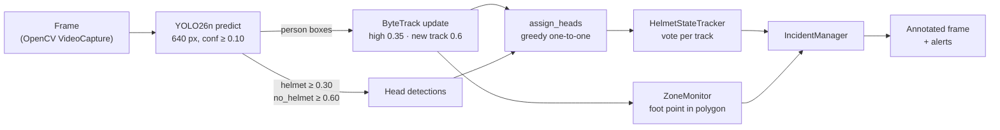
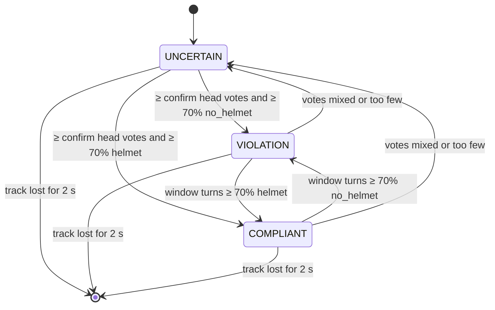
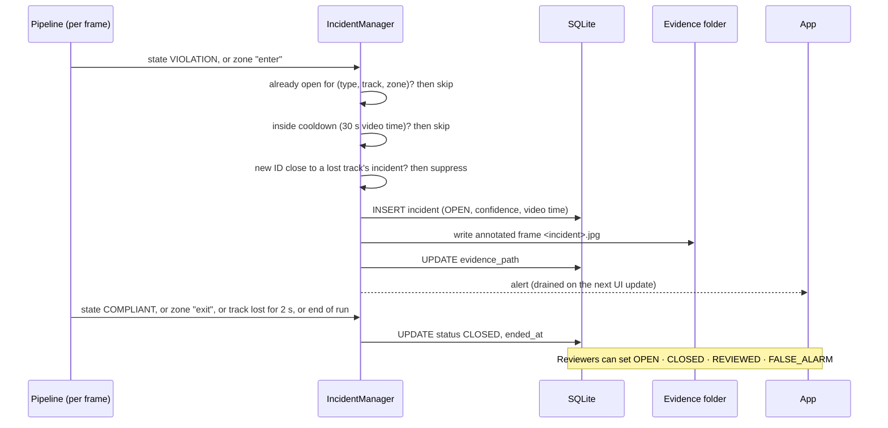
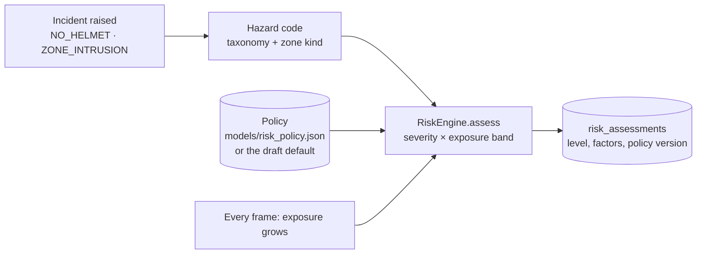
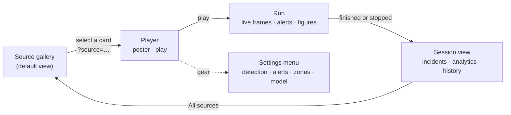
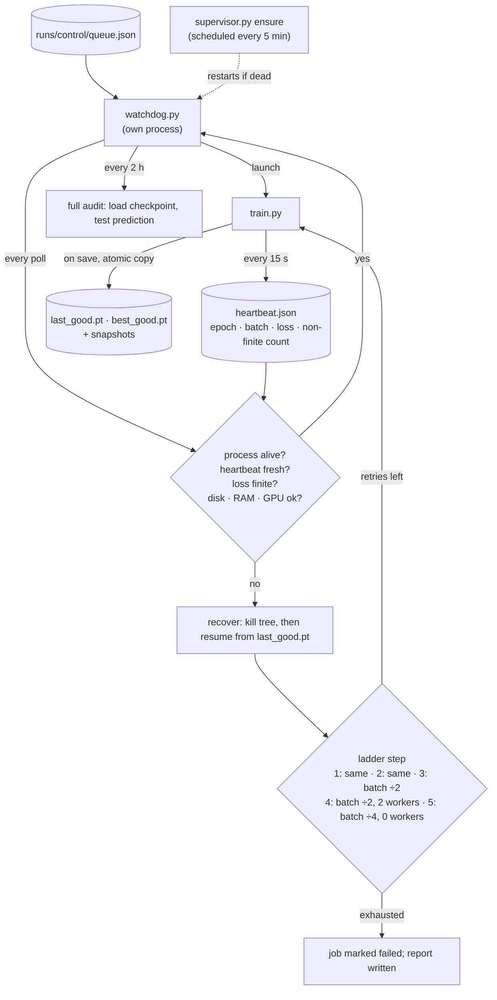

# Architecture

SafeSight AI has four parts that meet only through files:

| Part | Folders | When it runs |
|---|---|---|
| **Offline training** | `training/`, `watchdog_svc/` | On a GPU workstation, once per experiment |
| **Runtime inference** | `inference/` | For every frame of a monitored video |
| **Monitoring application** | `app/`, `launch.py` | A local Streamlit server, viewed in a browser |
| **Persistent storage** | `database/`, `logs/incidents/`, `models/` | SQLite, evidence images, weights and runtime configuration |

## 1. System overview

**What each part does:**
- **Training** produces checkpoints. One checkpoint is copied, frozen and recorded with its SHA-256 as `models/best.pt`.
- **The app** never trains. It loads the frozen weights once per server process (`st.cache_resource`) and only when a run starts, so the gallery opens without importing PyTorch.
- **The app and the pipeline share two files:** the runtime configuration, and the SQLite database with its evidence folder.

## 2. Computer-vision pipeline (per frame)

**Detection** (`inference/detector.py`). One `YOLO.predict` call per frame at 640 px, with a low floor confidence (0.10) so that ByteTrack can use low-score boxes to keep tracks alive.
- **Person boxes** go to the tracker.
- **Head boxes** are kept when they reach the class-specific threshold: helmet 0.30, no_helmet 0.60.

**Tracking** (`inference/bytetrack_safesight.yaml`). ByteTrack runs on person boxes only.

| Setting | Value |
|---|---|
| `track_high_thresh` | 0.35 at runtime (the person threshold) |
| `track_low_thresh` | 0.10 |
| `new_track_thresh` | 0.6 |
| `match_thresh` | 0.9 |
| `track_buffer` | 60 frames |

These were swept on the demo clips. They cut the IDs issued across five clips from 33 to 23, while tracked person-frames fell by 2.3%.

**PPE association** (`inference/ppe_association.py`):
- A head can belong to a worker only if its centre lies within the worker box widened by 10% and in its **top 40%**.
- Candidate pairs are scored by how well the head sits at the top-centre, weighted by confidence. They are matched greedily, best first.
- Each head serves **at most one worker**, so one helmet cannot make two overlapping workers compliant.

## 3. Safety-state machine

Each track keeps a rolling window of head evidence:
- **Window:** `max(3 × confirm, 15)` frames.
- **confirm:** `max(2, confirm_seconds × fps)`. With the default 0.5 s at 30 fps, that is 15 frames.

A state needs at least `confirm` head observations, and at least **70%** of them must agree.

**Missing evidence never produces a violation.** A worker whose head is not visible stays UNCERTAIN, and no alert is raised.

## 4. Restricted zones

- **Zones are stored per camera view,** as polygons with normalised (0–1) coordinates, in `models/runtime_config.json`. They therefore survive a change of resolution.
- **The test point is the foot point,** the bottom-centre of the worker box, checked with `cv2.pointPolygonTest`. Using the feet rather than the box centre avoids false entries when a worker merely stands in front of a zone.
- **Entry and exit are debounced:** entry needs `confirm` consecutive frames inside, and exit needs `2 × confirm` frames outside.
- **Validation** (`validate_polygon`): at least 3 points, coordinates within 0–1, and a non-zero area.

## 5. Incident lifecycle

- **Cooldown** is measured in **video time**, so results do not depend on processing speed. It restarts when an incident closes.
- **Broken-track suppression.** If a track that is no longer visible raised the same type of incident within the cooldown, and the new ID is within one box height of it, the new alert is treated as the same worker under a new ID.
- **Evidence** is the annotated frame at the moment of confirmation, so it shows the boxes, IDs and zone that led to the decision.

### 5.1 Hazard typing and risk assessment (`intelligence/`)

Every incident is also typed and risk-assessed. This does not change when incidents open or close.

- **Hazard code.** `NO_HELMET` maps to `PPE.HEAD.MISSING`. `ZONE_INTRUSION` maps by the zone's optional `kind`: `restricted` (the default) to `ZONE.ENTRY`, `machine_exclusion` to `MACH.ZONE.ENTRY`, and so on (`intelligence/taxonomy.py`). Zones of kind `pedestrian_only` and `keep_clear` do not raise person-entry incidents.
- **Risk level** is read from the policy's severity × exposure matrix. Exposure starts at the confirmation time and grows while the incident is open; a rise in level is recorded as an escalation.
- **Model confidence never lowers risk.** It only sets the evidence quality (strong, moderate, weak), and weak evidence is marked for human review.
- **Unknown context never lowers risk,** and a draft policy never applies reductions. The shipped policy is a draft example; a competent person must approve a site policy.
- **Validation** of incidents against labelled episodes: `scripts/evaluation/event_metrics.py` (see `docs/product_research/09_SAFETY_VALIDATION_FRAMEWORK.md`).

### 5.2 Headless multi-camera runtime (`runtime/`)

The same pipeline can also run without the dashboard, for several cameras at once (`python -m runtime run --config …`). Each camera has a capture thread, a bounded frame queue and a processing thread with its own `Pipeline`, tracker and database connection; one model is shared through a batched inference thread. Design: [product_research/15](product_research/15_HEADLESS_RUNTIME_ARCHITECTURE.md); operation and measurements: [product_research/16](product_research/16_HEADLESS_RUNTIME_IMPLEMENTATION.md); commands: [runtime_getting_started.md](runtime_getting_started.md).

**Camera view monitoring.** Before a frame reaches the pipeline, the camera's view guard (`runtime/view.py`, using `inference/view_monitor.py`) checks every 0.5 s that the camera still shows its registered reference view. A confirmed move, cut or blockage ends open incidents at the last reliable observation (`camera_view_changed`, `camera_scene_switched`, `camera_blocked`), resets tracks and suspends analysis until the registered view returns or an operator accepts a new one; zones of an unverified view raise nothing. The view state is reported beside the connection state. Details: [product_research/21_CAMERA_VIEW_CHANGE_DETECTION.md](product_research/21_CAMERA_VIEW_CHANGE_DETECTION.md).

## 6. Storage

| Store | Location | Contents |
|---|---|---|
| Incidents database | `logs/incidents/incidents.db` (SQLite, WAL) | `sessions`: id, time, source, frames, confirmed tracks, final compliant/violation/uncertain counts, average FPS. `incidents`: id, start and end, type, worker ID, confidence, camera, session, zone, video time, evidence path, status. `risk_assessments`: one row per incident with hazard code, severity, exposure, risk level, evidence quality, factors, actions, policy version and status, escalation time. `incident_reviews` (milestone M3): append-only operator decisions, one row per status change, with the previous status, reviewer, reason, source (dashboard or runtime CLI) and UTC time. |
| Evidence | `logs/incidents/evidence/<session>/<incident>.jpg` | One annotated frame per incident; never overwritten |
| Runtime configuration | `models/runtime_config.json` | Zones, plus thresholds and alert timing once saved. Defaults live in `inference/config.py`. |
| Model record | `models/model_config.yaml` | Frozen model identity, checksum, thresholds, licence note |
| Thumbnails | `data/cache/thumbnails/` | Gallery frames extracted once with OpenCV |

**Confirmed tracks** (tracks seen for at least 1 s) are what the `sessions` table counts. The final state of each confirmed track is what feeds the compliance figures. **Track counts are not headcounts:** one person can receive two IDs after an occlusion.

## 7. Monitoring application

- **One page, two views.** The query parameter `source` selects the view, so reloading the page keeps you on the same source.
- **The run loop is the pipeline loop.** About 12 times a second, the latest annotated frame and changed figures are pushed to the browser. Panels whose HTML is unchanged are not resent.
- **Single-run lock** (`app/runlock.py`). All browser sessions share one cached detector and tracker, so only one run may be active per server. Other tabs show *Busy*. The lock carries a heartbeat and frees itself 4 s after a tab disappears.
- **Navigation and settings are disabled during a run,** so a click cannot interrupt the tracker by accident. Stop ends the run cleanly: open incidents are closed and the session is saved.

## 8. Training watchdog and checkpoint recovery

- **The trainer and the watchdog are separate processes,** and either can die without taking the other with it. The watchdog's state lives in `runs/control/state.json`, so a restarted watchdog re-adopts a trainer that is still running.
- **Checkpoints are copied atomically and verified,** so recovery always starts from a loadable `last_good.pt`.
- **Drills** (`tests/test_watchdog_drills.py`) run a real watchdog against a dummy trainer in a temporary directory and check that each failure mode is detected and recovered.
