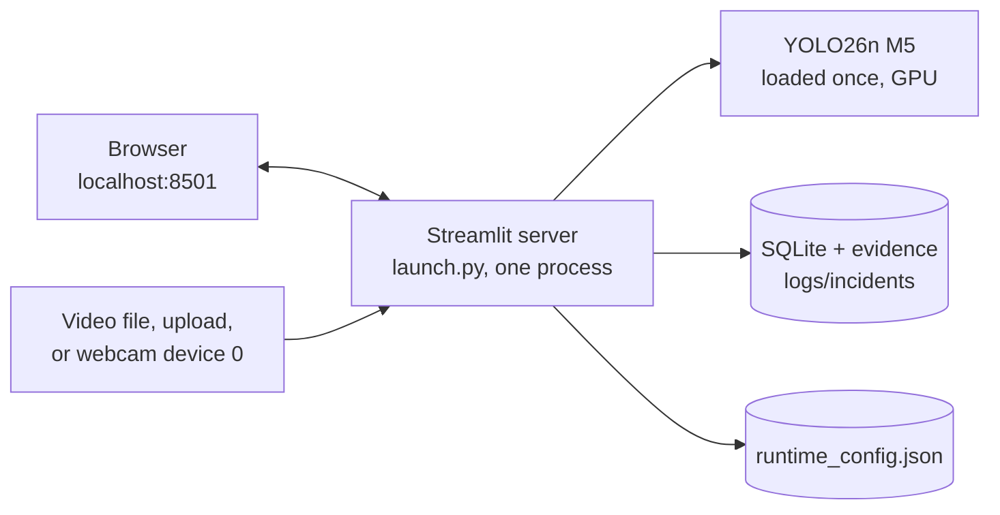

# Deployment

> **SafeSight AI is a research prototype and academic demonstration.** It is not a certified safety product, and it must not be the only safeguard on a site.

## Current deployment (as built)

| Aspect | Current state |
|---|---|
| Topology | One Windows workstation; the server binds to `localhost` only |
| Sources | Video files and one local webcam; one active run at a time (server-wide lock) |
| Users | Anyone with access to the workstation's browser; **no authentication** |
| Storage | SQLite in WAL mode, plus JPEG evidence on local disk; no retention policy |
| Monitoring | The training watchdog only; the app has no health endpoint beyond Streamlit's |
| Network | Offline at runtime (`YOLO_OFFLINE=true`; no external fonts or CDNs) |

## What a real industrial deployment would need

| Area | Required change |
|---|---|
| **Validation** | Evaluate on the site's own cameras, angles, lighting and headwear; re-tune thresholds and zones per camera; measure false-alarm and miss rates over full shifts |
| **Video ingestion** | **Started:** the headless runtime (`python -m runtime`, [runtime_getting_started.md](runtime_getting_started.md)) has per-camera workers and trackers, RTSP with reconnection, bounded frame dropping and camera health. Still needed: testing against real RTSP cameras, ONVIF discovery, service packaging and soak tests |
| **Scale** | A separate inference service (batching several cameras per GPU), and a UI that only reads results |
| **Storage** | A server database (e.g. PostgreSQL), object storage for evidence, backups, and **retention limits** |
| **Security** | Authentication and roles, TLS, audit logs of who reviewed what, network segmentation of camera traffic |
| **Privacy and law** | Consent and signage, a privacy notice, data-protection impact assessment, minimisation (for example blurring non-subjects in evidence), and access controls; works-council or union consultation where applicable |
| **Reliability** | Service supervision for the app (not only training), health checks, alert delivery (e-mail, SMS, site systems) with escalation |
| **Licensing** | A model trained without non-commercial data, or a licence that permits the intended use; review of Ultralytics AGPL-3.0 obligations or a commercial licence |
| **Governance** | A human review step for every incident, documented intended use, and periodic re-evaluation for drift and fairness |

## Configuration reference

| Setting | Default | Where |
|---|---|---|
| Worker (person) confidence | 0.35 | Settings › Detection |
| Helmet confidence | 0.30 | Settings › Detection |
| No-helmet confidence | **0.60** | Settings › Detection |
| Alert confirmation | 0.5 s | Settings › Safety alerts |
| Duplicate-alert cooldown | 30 s (video time) | Settings › Safety alerts |
| Lost-track timeout | 2.0 s | `inference/config.py` |
| Zones | per camera view | Settings › Restricted zones (`models/runtime_config.json`) |
| Tracker | ByteTrack, tuned | `inference/bytetrack_safesight.yaml` |
