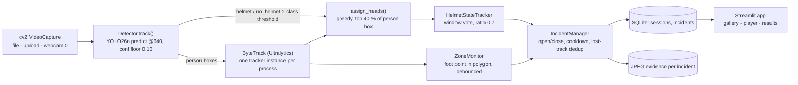

# 01 — Current-state audit

Audit date: 5 November 2026. Scope: the whole repository at `main@6aa177e`, read module by module rather than from the README. Every claim below points at the code or at a frozen report in `reports/`.

## 1. Baseline recorded before any change

| Item | Value |
|---|---|
| Git | `main` at `6aa177e`; one untracked file (`presentation/SafeSight_AI_deck.pdf`), not touched |
| Tests | **32 passed** (`python -m pytest -rs -q`, 120 s) with weights, demo clips and processed data present |
| Lint | `ruff check .` clean |
| Champion model | `models/best.pt`, M5, SHA-256 `E9B2583D…CC3C7534`, matching `models/model_config.yaml` |
| Runtime configuration | `models/runtime_config.json`: two demo zones ("Live rail", "Breaking area"); thresholds at defaults |
| Size of runtime code | `inference/` 340 lines, `database/` 64, `app/` about 1,270, `watchdog_svc/` about 480 |

## 2. Architecture as reconstructed from the code

Key facts that the diagram hides:

- **One process, one camera, one run.** `app/runlock.py` enforces a single active run per server because the detector and its ByteTrack state are cached once per process (`app/components/shared.py`). Multi-camera is not a configuration change; it is an architectural change.
- **The pipeline is synchronous and UI-driven.** `app/views/player.py` reads a frame, calls `Pipeline.process`, and pushes UI updates in the same loop. If the browser tab is closed, the run stops (`finally:` block). There is no headless monitoring service.
- **Incident types are string constants** (`NO_HELMET`, `ZONE_INTRUSION` in `inference/incident_manager.py`). There is no event model, no severity, no hazard taxonomy and no notion of risk. Every incident is equally important.
- **Time is video time.** Cooldowns and confirmation use frame index / FPS, which makes offline results reproducible (a real strength) but means there is no wall-clock scheduling, shift, or calendar context.
- **Configuration is one JSON file** (`models/runtime_config.json`) with global thresholds and zones keyed by clip stem. There is no site, area or camera entity.
- **Storage is append-only SQLite** with two tables. Statuses are free strings (OPEN, CLOSED, REVIEWED, FALSE_ALARM). There is no user, no audit trail of who reviewed what, and no retention.

## 3. Assessment

### 3.1 What works today (verified by tests or frozen reports)

| Capability | Evidence |
|---|---|
| Person detection on worksite imagery | person AP50 0.942 common val, 0.859 SH17 val, 0.813 Construction-PPE test (`docs/evaluation.md`) |
| Bare-head detection at the application threshold | SH17 val no_helmet P/R 0.981/0.615 at 0.60 (`reports/operating_points.json`) |
| Multi-frame helmet state with an explicit UNCERTAIN state | `inference/ppe_association.py`; unit tests `test_no_evidence_stays_uncertain`, `test_violation_needs_multiple_frames` |
| One helmet cannot satisfy two workers | greedy one-to-one assignment; `test_one_helmet_cannot_serve_two_workers` |
| Foot-point zone entry/exit with debouncing | `inference/zone_monitor.py`; `test_zone_entry_exit_debounced` |
| Incident lifecycle: open once per episode, close on clear, cooldown, lost-track duplicate suppression | `inference/incident_manager.py`; five unit tests |
| End-to-end runs on demo clips, evidence on disk, CSV export | `tests/test_pipeline.py` (integration, ran in the baseline) |
| Real-time throughput on one stream | about 52–82 FPS without UI, 41–60 FPS in the app on an RTX 2000 Ada (`reports/runtime/performance.json`) |
| Leakage-aware training and evaluation discipline | near-duplicate removal, leaky-control experiment, test set run once (`docs/evaluation.md` §1) |

### 3.2 What works only under controlled demo conditions

| Capability | Why it is demo-grade |
|---|---|
| Helmet compliance on live cameras | Tuned on 5 demo clips and validated on 10 short public clips. 4/4 true incidents on demo clips and 2 true / 0 false on worksite clips are encouraging but have no confidence interval. All 5–7 distant workers on c09/c10 were missed. |
| Zone intrusion | Polygons were drawn per demo clip. No test of camera shake, PTZ movement, perspective error of the foot point, or occluded feet. |
| Tracking | ByteTrack settings swept on the same demo clips used for the demo (`reports/tracking_sweep/`). 47 IDs for fewer people across ten unseen clips; no ground-truth ID-switch measurement. |
| Webcam monitoring | Device 0 only; no reconnection, no RTSP, no frame-drop accounting. |
| "No false alarms" | True for the demo clips at 0.60. Not a property of the system. False alarms per camera-hour have never been measured on hours of footage. |

### 3.3 Experimentally promising but not validated

| Item | Status |
|---|---|
| Pose-teacher pseudo-labels for person recall | Large effect (person recall at 0.3 from 0.146 to 0.896, M1→M2); a reusable technique for new classes |
| Head-to-worker association geometry | Works for upright workers; untested for crouching, ladders, overhead work, or top-down cameras |
| Broken-track duplicate suppression | Unit-tested; real-world rate of suppressed true repeats unknown |
| Night footage | One clip, good results, n = 1 |

### 3.4 Missing for real industrial deployment

| Area | Gap |
|---|---|
| Ingestion | RTSP/ONVIF, reconnection, per-camera health, timestamps from the camera clock, frame-drop accounting |
| Scale | Multiple cameras per GPU, headless service independent of browser tabs, multiple sites |
| Event model | Typed hazards, severity, risk, exposure duration, uncertainty, acknowledgement, assignment, resolution, corrective action |
| Context | Site, area, shift, schedule, equipment state, permits, authorised personnel |
| Notification | Any channel at all (e-mail, SMS, Teams, PA, stack lights); escalation |
| Security | Authentication, roles, TLS, audit trail, secrets management, encrypted evidence |
| Privacy | Retention limits, blurring of non-subjects, access logging, worker notice, DPIA support |
| Validation | Event-level metrics (false alarms per camera-hour, missed episodes, latency), per-site acceptance tests, drift monitoring |
| Operations | Health endpoint, metrics, logs, model/version registry, remote update |
| Licensing | A model that can be used commercially (see §5) |

### 3.5 What could become a competitive advantage

1. **Honest uncertainty as a product feature.** The UNCERTAIN state, the refusal to infer violations from missing evidence, and the two-threshold discipline are rare in a market that sells "50+ detections". Safety managers lose trust in systems that cry wolf; a system that says "I could not see" is more credible.
2. **Reproducible, evidence-first engineering culture.** Frozen reports, leakage controls and run-once test sets are exactly what a validation file for a pilot site needs.
3. **Local-first deployment.** Everything already runs offline on one workstation. Edge-first is a selling point in privacy-sensitive jurisdictions (EU works councils, India DPDP) and in plants with poor connectivity.
4. **Open-source core.** AGPL-3.0 code with a documented pipeline is unusual in this market and can win researchers, integrators and public-sector buyers, provided the licensing path for commercial models is resolved.

### 3.6 Architectural decisions that block scale

| Decision | Consequence | Recommended direction |
|---|---|---|
| Inference inside the Streamlit script run | Monitoring stops when the browser stops; one run per server | Separate a headless edge runtime (per-camera workers) from the UI; the UI only reads events |
| Single cached tracker | Cannot process two cameras | Per-camera pipeline objects; batching across cameras on one GPU |
| String incident types, no severity | Cannot prioritise; every new detector edits `tracker.py` and the UI | Hazard taxonomy + event schema + risk policy engine (built in this branch, §7) |
| Zones keyed by clip stem with only a name and polygon | No zone semantics (electrical vs. pedestrian-only vs. suspended load) | Typed zones (`kind`), schedules, and later dynamic zones attached to tracked equipment |
| SQLite with free-text statuses | No users, no audit trail, single writer | Keep SQLite on the edge for buffering; PostgreSQL + object storage centrally |
| Ultralytics AGPL-3.0 framework + SH17 NC-SA data | No commercial distribution path for the current model | Commercially licensable data; a decision between an Ultralytics Enterprise licence and an Apache-2.0 detector (RT-DETR / D-FINE / RF-DETR) |

## 4. Tests and CI

- `tests/test_logic.py` (16 tests): association, state machine, zones, incidents, persistence. Pure Python, no GPU.
- `tests/test_watchdog_drills.py`: real watchdog against a dummy trainer.
- `tests/test_pipeline.py` (integration): skipped automatically without weights or clips, which is what CI does.
- CI (`.github/workflows/ci.yml`): Windows, Python 3.11, Ruff, byte-compile, pytest on CPU. Good hygiene; it cannot catch model regressions because CI has no weights.

**Gap:** there is no event-level regression test (for example "this clip must produce exactly these incidents within these time windows"). The integration tests check existence of incidents, not their timing or count against labelled ground truth.

## 5. Licensing and third-party position (summary; detail in `10_PRIVACY_SECURITY_AND_COMPLIANCE.md`)

| Item | Licence | Commercial consequence |
|---|---|---|
| Project code | AGPL-3.0-only | Can be sold or hosted, but network use and distribution require offering the corresponding source |
| Ultralytics library and base weights | AGPL-3.0 or paid Enterprise licence | A closed-source commercial product needs the Enterprise licence or a different framework |
| M5 weights | Bound by AGPL-3.0 (Ultralytics) and CC BY-NC-SA 4.0 (SH17) | **Not commercially usable.** The repository's own analysis (`LICENSING_DECISION.md`) reaches the same conclusion |
| Construction-PPE | AGPL-3.0 | Usable under AGPL terms; an Ultralytics question remains open (U3) |
| Mendeley PPE v6 | CC BY 4.0 | Commercially usable with attribution |
| Demo footage | CC BY-SA (Commons), Mixkit licence | Fine for demos; not training data for a product |

## 6. Known defects and risks found during the audit

| # | Finding | Severity | Where |
|---|---|---|---|
| D1 | Saving a zone in the settings UI rebuilds the zone dict from name and polygon only, so any extra zone fields would be silently dropped. Harmless today (zones have no extra fields) but blocks typed zones. | Low; fixed in this branch | `app/views/settings.py` |
| D2 | `IncidentDB.add` uses wall-clock `datetime.now()` while the incident logic uses video time. Offline runs record the processing time, not the event time. Fine for a demo, misleading for investigations of recorded footage. | Medium for real use | `database/database.py` |
| D3 | `Pipeline._expire` closes incidents when a track is lost for 2 s; a worker who walks behind a pillar inside a zone for 3 s produces two incidents unless the duplicate suppression catches the new ID. | Medium | `inference/tracker.py` |
| D4 | Evidence frames are written unencrypted to `logs/incidents/evidence/` and kept forever. | High for real use (privacy) | `inference/incident_manager.py` |
| D5 | The confidence stored with a zone incident is the person-detection confidence, and for a helmet incident the mean vote confidence. Neither is a probability that the event happened; the UI shows it next to the incident without that caveat. | Low; addressed by separating evidence quality from risk in the new engine | `inference/tracker.py` |

D2–D4 are documented rather than changed: changing them alters stored data and existing behaviour, which the brief asks to preserve. They are scheduled in `12_ROADMAP_AND_PRIORITIZATION.md`.

## 7. What this branch adds (foundations only)

Summary here; specification in `07_SYSTEM_ARCHITECTURE.md` §9 and results in `PROGRESS_LOG.md`.

- `intelligence/taxonomy.py`: a hazard taxonomy with energy source, default severity, sensing modality and implementation status; the two existing incident types are mapped onto it.
- `intelligence/risk.py`: a configurable, explainable risk policy engine (severity × exposure, context modifiers, evidence quality kept separate from risk, policy approval status recorded with every assessment).
- `intelligence/event_metrics.py` and `scripts/evaluation/event_metrics.py`: event-level validation metrics (precision, recall, false alarms per camera-hour, latency, duplicates) against episode ground truth.
- Typed zones (`kind`, optional) with full backward compatibility, a risk assessment row per incident in a new additive table, and exposure-based escalation tracking.

Nothing in the existing detection, tracking, association, alerting or UI behaviour changes for the shipped configuration; the baseline tests still pass (see `PROGRESS_LOG.md`).
