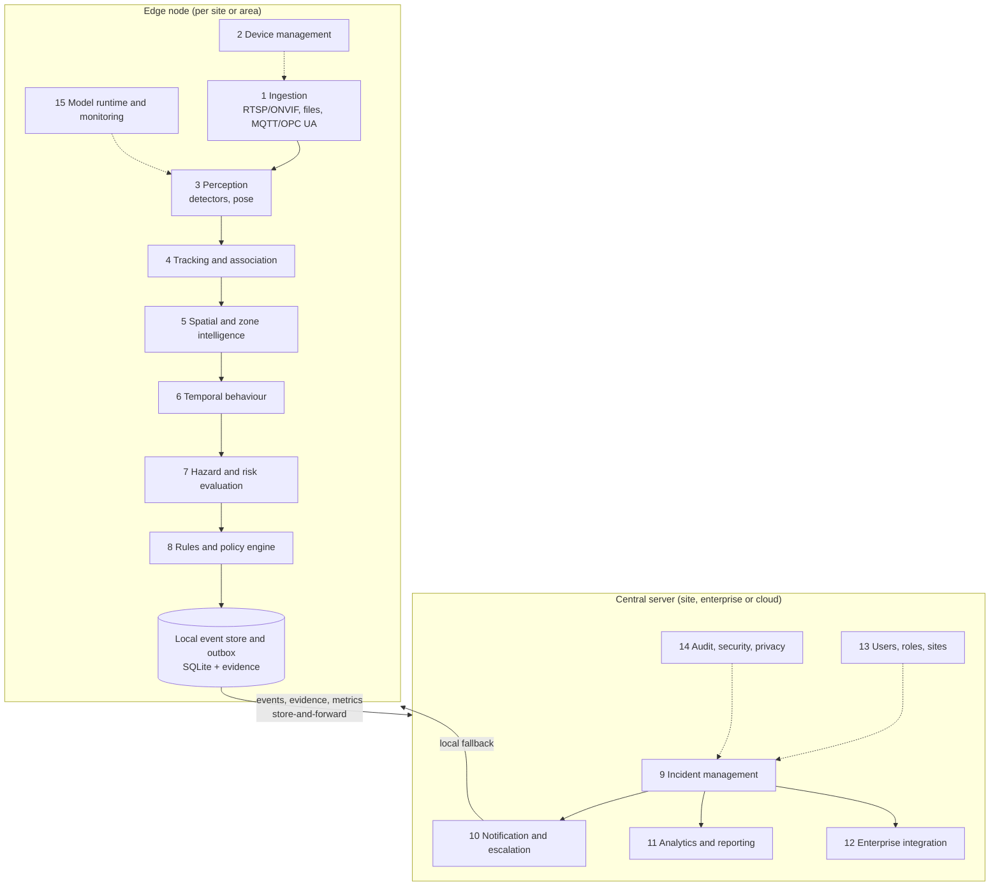
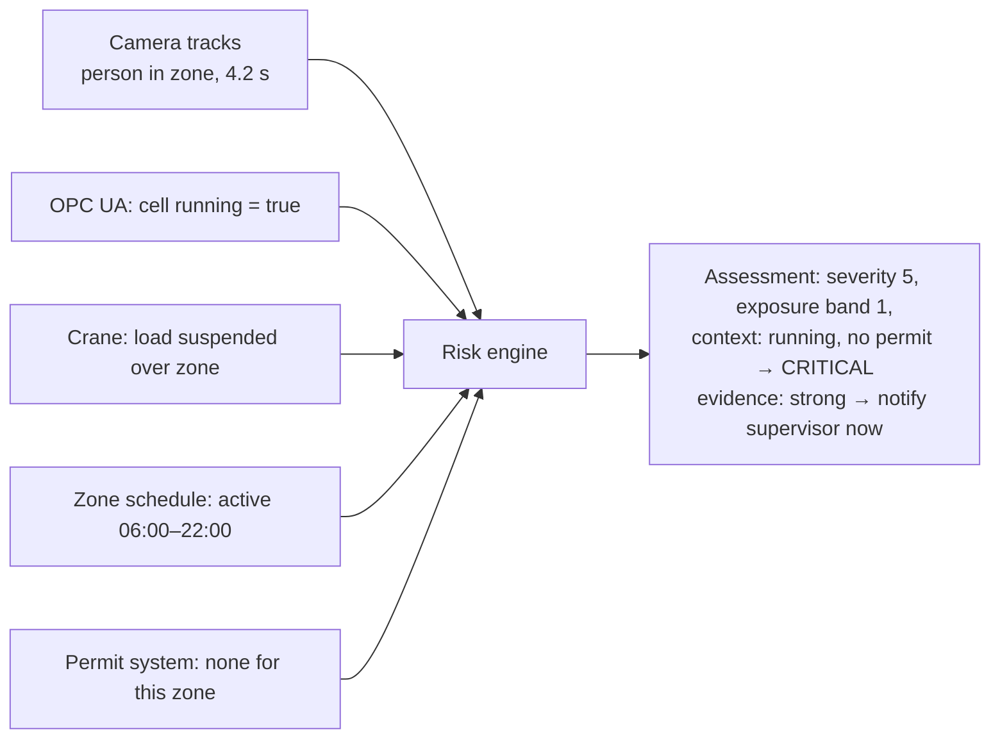

# 07 — System architecture (next generation)

Date: 5 November 2026. This is a target architecture with an incremental path from the current code. Section 9 specifies what is already built in this branch.

## 1. Design principles

1. **Observer, never a safety function.** SafeSight observes and informs. It never sits in a machine's safety circuit, never replaces an interlock, guard, emergency stop or competent person, and its absence of alerts is never a statement that an area is safe.
2. **Edge-first.** Video is processed where it is captured. Only events, small evidence and metrics leave the site by default.
3. **Events are the product.** Detectors produce observations; the platform's value is in typed, risk-assessed, evidenced, reviewable events and the patterns across them.
4. **Context beats confidence.** Severity comes from the hazard and its context (energy source, equipment state, exposure time), not from a model score.
5. **Uncertainty is first-class.** Every observation and event carries evidence quality; "not observable" is a valid output.
6. **Policies are configuration, owned by competent people.** Rules are versioned data with an approval record, not code.
7. **Measure everything that can fail.** Per-camera health, per-hazard false-alarm rates and model drift are product features.

## 2. Layered reference architecture



The edge node can run alone (today's workstation is a one-node edge with a built-in UI). The central server is optional for single sites and required for multi-site.

## 3. Layer specifications

Each layer lists responsibility · interfaces · inputs → outputs · dependencies · expected performance · failure modes · tests · scalability.

### L1 Video and sensor ingestion
- **Responsibility:** acquire frames with trustworthy timestamps; acquire sensor/machine signals.
- **Interfaces:** RTSP (H.264/H.265), ONVIF Profile S/T for discovery and streams, Profile M for camera-side metadata [L13]; MQTT (Sparkplug 3.0 / ISO/IEC 20237) [L14]; OPC UA client [L27]; file input for replay.
- **In → out:** streams/signals → `Frame(camera_id, ts_capture, ts_received, image)` and `Signal(source_id, name, value, ts, quality)`.
- **Dependencies:** OpenCV/FFmpeg or GStreamer; MQTT and OPC UA clients.
- **Performance:** decode at the configured analysis rate (typically 5–15 FPS per camera for safety events, not the native 25–30); reconnect within 10 s.
- **Failure modes:** stream drop, frozen frame, clock skew, codec change, PTZ moved, lens obstructed.
- **Tests:** replay files with injected drops; frozen-frame detector; reconnection timer; timestamp monotonicity.
- **Scale:** one lightweight reader per camera; decode on GPU (NVDEC) when > 8 streams.

### L2 Camera and device management
- **Responsibility:** registry of sites, areas, cameras, sensors, their calibration (homography), zones and health.
- **Interfaces:** configuration API; health heartbeat; **view-integrity check** (compare current frame with a reference to detect a moved or obstructed camera, which silently invalidates zones).
- **Out:** `CameraHealth(fps, drop_rate, last_frame_age, view_shift_score, blur_score)`.
- **Failure modes:** stale configuration after a camera is moved; zones drawn on an old view.
- **Tests:** view-shift detector on synthetic shifts; config schema validation.

### L3 Detection and perception
- **Responsibility:** per-frame observations: persons, heads/PPE, vehicles and mobile plant, loads; optionally pose keypoints.
- **Interfaces:** `Detector.infer(batch[Frame]) -> list[Observation]` with class, box, score, model_id.
- **Dependencies:** model runtime (L15).
- **Performance:** current M5 ≈ 10 ms/frame at 640 px on RTX 2000 Ada; target batched multi-camera throughput to be measured (M1 milestone).
- **Failure modes:** domain shift (lighting, new PPE colours), small/distant people, occlusion, glare, rain, dust.
- **Tests:** per-class AP on site validation sets; regression tests on frozen clips; latency budget tests.
- **Scale:** batch across cameras; one model server per GPU.

### L4 Tracking and worker association
- **Responsibility:** stable anonymous track IDs per camera; associate PPE and pose to tracks; vehicle tracks.
- **Interfaces:** `Tracker.update(observations, ts) -> list[Track]`; association functions (existing `assign_heads`).
- **Performance:** ID switches per 100 track-minutes, measured (never measured so far).
- **Failure modes:** ID fragmentation after occlusion (known), swaps in crowds.
- **Tests:** HOTA/IDF1 on labelled clips; duplicate-incident rate at event level.
- **Privacy:** no re-identification across cameras or days by default; cross-camera association only as an opt-in, documented feature.

### L5 Spatial and zone intelligence
- **Responsibility:** typed zones (static, scheduled, temporary, dynamic), ground-plane calibration, distances and speeds in metres.
- **Interfaces:** `ZoneMonitor.update(track, ts)`; `GroundPlane.to_world(px)`; zone kinds (`restricted`, `machine_exclusion`, `suspended_load`, `electrical`, `confined_space`, `hot_work`, `vehicle_only`, `pedestrian_only`, `excavation`, `keep_clear`).
- **Failure modes:** foot point occluded; perspective error far from the camera; calibration drift.
- **Tests:** synthetic tracks crossing polygons; calibration reprojection error < stated bound.

### L6 Temporal behaviour analysis
- **Responsibility:** dwell time, exposure duration, PPE vote state, closing speed, TTC/PET, immobility, simple pose events.
- **Interfaces:** stateful per-track analysers emitting `Observation → StateChange`.
- **Failure modes:** track breaks reset timers (handled by carrying exposure across a lost-and-reacquired track near the same place, as incident dedup already does).
- **Tests:** deterministic synthetic sequences; event-level metrics on labelled episodes.

### L7 Hazard and risk evaluation
- **Responsibility:** turn a state change into a typed hazard event with severity, exposure, evidence quality and context; compute a risk level.
- **Interfaces:** `RiskEngine.assess(hazard_code, zone_kind, exposure_s, evidence, context) -> Assessment` (built, §9).
- **Rule:** model confidence feeds *evidence quality*, which routes events to review; it never lowers severity.

### L8 Rules and policy engine
- **Responsibility:** site-specific, versioned policies: severity by hazard and zone kind, exposure bands, context modifiers, escalation actions, schedules, required PPE per zone; approval metadata.
- **Interfaces:** JSON policy validated against a schema; status `draft | approved`; every assessment records the policy version and status.
- **Failure modes:** unapproved or stale policy in production → shown on every event and in the UI header.
- **Tests:** schema validation; policy unit tests (golden assessments per policy version).

### L9 Incident management
- **Responsibility:** event lifecycle: `detected → confirmed → acknowledged → investigating → resolved | dismissed (false alarm)`; assignment; corrective actions; links to evidence; deduplication across tracks and cameras.
- **Store:** central PostgreSQL; edge SQLite as buffer.
- **Tests:** state-machine tests; idempotent ingestion (same event delivered twice).

### L10 Notification and escalation
- **Responsibility:** route by risk level, area and schedule: on-screen, e-mail, SMS/voice gateway, Teams/Slack webhooks, PA or stack-light via site I/O; escalate when not acknowledged within the policy window.
- **Rule:** local alerting must work when the WAN is down.
- **Tests:** delivery retries; acknowledgement timeout escalation.

### L11 Analytics and reporting
- **Responsibility:** exposure and near-miss trends, recurring-pattern detection (same zone, same route conflict, shift effects), observed/non-observed PPE fractions, camera health, validation dashboards, report drafts.
- **Tests:** metric definitions unit-tested against fixtures; reports reproducible from the event store.

### L12 Enterprise integration
- **Native:** webhooks (JSON), CSV/Excel export, MQTT publish of events, REST API.
- **Protocol-based:** OPC UA and MQTT Sparkplug for machine state; ONVIF for cameras; syslog for security events.
- **Optional connectors (customer-driven, not speculative):** EHS systems (Intelex, Cority, Enablon, Sphera, VelocityEHS) via their APIs or file import; CMMS (SAP PM, IBM Maximo) for corrective work orders; access control (for authorised-personnel context); VMS (Milestone, Genetec) for bookmarks.
- **Rule:** build a connector only when a paying pilot needs it.

### L13 Users, roles and sites
- **Roles:** site operator, supervisor, safety officer, EHS manager, plant manager, maintenance, administrator, auditor (read-only).
- **Interfaces:** OIDC/SAML SSO centrally; local accounts on standalone edge.

### L14 Audit, security and privacy
- **Responsibility:** append-only audit log (who viewed or changed what), evidence access logging, redaction (faces/bodies of non-subjects), retention enforcement, encryption at rest and in transit, secrets management.
- **Standards:** IEC 62443 practices for industrial networks [L23]; least-privilege network design (cameras on an isolated VLAN, edge node outbound-only to central).

### L15 Model management and monitoring
- **Responsibility:** model registry (hash, training data lineage, licence line *research* vs *product*, validation report), staged rollout per camera, shadow mode, drift monitoring (false-alarm rate per camera, score distributions, image quality).
- **Rule:** a model version cannot be activated on a camera without a validation record for that camera class (`09`).

## 4. Event schema (contract between layers)

```json
{
  "event_id": "EVT-…", "incident_id": "INC-…",
  "site_id": "S1", "area_id": "DOCK-A", "camera_id": "CAM-07",
  "hazard_code": "VEH.PED.CONFLICT", "zone": {"name": "Aisle 4", "kind": "vehicle_only"},
  "track_ids": [12, 31], "ts_start": "…", "ts_confirmed": "…", "ts_end": null,
  "exposure_s": 3.4,
  "evidence": {"quality": "strong", "detector_scores": {"person": 0.88}, "frames": ["…"], "clip": "…", "redacted": true},
  "context": {"machine_state": "running", "permit": null},
  "assessment": {"severity": 5, "exposure_band": 1, "risk_level": "HIGH", "factors": ["…"], "actions": ["notify_supervisor"],
                  "policy_version": "site-12@2026-11-01", "policy_status": "approved"},
  "lifecycle": {"state": "confirmed", "assignee": null, "history": []},
  "model": {"detector": "sha256:…", "tracker": "bytetrack@…"}
}
```

## 5. Deployment options

| Option | Pros | Cons | Verdict |
|---|---|---|---|
| **Edge-first** (inference on site, events up) | Privacy, bandwidth, works offline, low latency | Fleet management of edge boxes | **Default** |
| Cloud-first (video to cloud) | Simple ops, elastic compute | Bandwidth, privacy, latency, data-sovereignty objections | Not recommended for SafeSight's target buyers |
| **Hybrid** (edge inference, central management, optional cloud analytics) | Best of both | More components | **Target for multi-site** |

**Unreliable networks:** the edge keeps a local event store and outbox (store-and-forward with idempotent event IDs); local alerting and UI continue during WAN loss; central dashboards show data freshness per site.

**Multi-camera, multi-facility:** per-camera pipelines on the edge, batched inference per GPU; central server partitions data by site; analytics roll up site → region → enterprise.

**Event storage at scale (analysis):** an event row is about 1–2 KB; even 100 cameras × 200 events/day is 20,000 rows/day, trivial for PostgreSQL. Evidence dominates storage: keep redacted keyframes by default, short clips for high-risk events, with retention limits.

## 6. Should the Streamlit app evolve or be replaced?

**Recommendation: evolve in three steps; do not rewrite now.**

1. **Now (M0–M1):** keep the Streamlit app as the single-workstation edition and demo UI. Extract a **headless edge runtime** (per-camera workers, writing to the same SQLite schema) so monitoring no longer depends on a browser tab. The Streamlit app becomes a reader. This removes the single-run lock limitation without touching the UI design. *(Runtime built on 5 November 2026: `runtime/`, see `15` and `16`; the app does not read its status yet.)*
2. **Next (M2):** add a small central API (FastAPI) over PostgreSQL with authentication and roles; keep Streamlit for configuration and validation tooling where it is productive.
3. **Later (M3+), only when multi-site customers need it:** a dedicated web frontend (TypeScript) for the control-room and incident workflows. Streamlit's rerun model is a poor fit for many concurrent users, role-based views and real-time multi-camera walls, but that problem does not exist until there are such customers.

## 7. What to build natively, what to integrate

| Build natively | Use established protocols | Optional integrations |
|---|---|---|
| Perception, tracking, zones, temporal logic, risk/policy engine, event store, evidence, validation tooling, health monitoring | RTSP/ONVIF, MQTT/Sparkplug, OPC UA, webhooks, OIDC/SAML, syslog | EHS, CMMS, access control, VMS, RTLS, gas detection systems, permit-to-work |

Do not build: a VMS, an RTLS, gas detection hardware, a permit-to-work system, or a generic EHS suite.

## 8. Context integration (the intelligence advantage)



The same camera observation becomes INFO when the PLC reports the cell locked out and an approved maintenance permit exists, and CRITICAL when the cell is running. Unknown context never lowers risk.

## 9. Built in this branch (foundation specification)

| Module | Responsibility | Status |
|---|---|---|
| `intelligence/taxonomy.py` | Hazard registry: stable codes, energy source, default severity, sensing mode, implementation status, required evidence; maps `NO_HELMET` and `ZONE_INTRUSION` | Built, unit-tested |
| `intelligence/risk.py` | Policy schema and validation; risk engine (severity by hazard and zone kind, exposure bands, risk matrix, context modifiers that can only raise risk unless the policy explicitly allows a reduction for a *known* safe state, evidence quality separate from risk, actions, explanation); approval metadata | Built, unit-tested |
| `intelligence/event_metrics.py` | Event-level validation: match predictions to labelled episodes; precision, recall, false alarms per camera-hour, latency, duplicates | Built, unit-tested; CLI `scripts/evaluation/event_metrics.py` |
| `inference/zone_monitor.py` | Optional zone `kind` (default `restricted`, i.e. unchanged behaviour) | Built |
| `inference/incident_manager.py`, `inference/tracker.py` | An assessment is stored for every incident; exposure duration updated on close; exposure-based escalation recorded while open | Built; the alert feed and UI are unchanged except for extra alert keys |
| `database/database.py` | Additive `risk_assessments` table; existing tables, CSV columns and statuses unchanged | Built |

These are deliberately the **contracts** later layers depend on (event typing, risk, validation), not new detectors.
