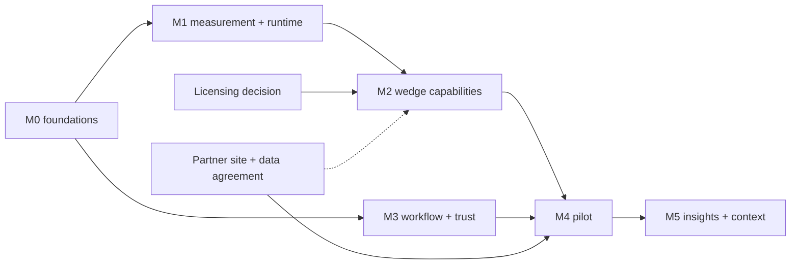

# 12 — Roadmap and prioritisation

Date: 5 November 2026. Scores are **(analysis)**: explicit judgements so they can be challenged and re-weighted, not measurements.

## 1. Prioritisation framework

Each capability is scored 1–5 on ten dimensions. Cost-type dimensions are inverted so that **5 is always good** (5 = low effort, cheap to run, low false-positive risk, easy to validate, no integration needed).

| Dimension | Weight |
|---|---|
| Safety impact (SIF potential addressed) | 0.20 |
| Customer demand | 0.15 |
| Differentiation | 0.10 |
| Technical feasibility | 0.10 |
| Data availability (commercially usable) | 0.10 |
| Development effort (inverted) | 0.08 |
| Runtime cost (inverted) | 0.05 |
| False-positive risk (inverted) | 0.10 |
| Validation difficulty (inverted) | 0.07 |
| Integration requirement (inverted) | 0.05 |

Score = 20 × Σ(weight × score), range 20–100.

| # | Capability | SI | CD | DF | FE | DA | EF | RC | FP | VD | IR | **Score** | **Class** |
|---|---|---|---|---|---|---|---|---|---|---|---|---|---|
| 1 | Hazard taxonomy + risk/policy engine | 4 | 4 | 4 | 5 | 5 | 4 | 5 | 5 | 4 | 5 | **88** | P0 |
| 2 | Typed zones (+ schedules, keep-clear) | 4 | 4 | 3 | 5 | 5 | 4 | 5 | 4 | 4 | 5 | **84** | P0 (typed) / P1 (schedules, keep-clear) |
| 3 | Event-level validation tooling | 4 | 3 | 5 | 5 | 3 | 4 | 5 | 5 | 4 | 5 | **83** | P0 |
| 4 | Headless multi-camera edge runtime, RTSP, camera health | 4 | 5 | 2 | 4 | 5 | 2 | 3 | 5 | 4 | 4 | **79** | P0 |
| 5 | Incident lifecycle, notifications, escalation | 4 | 5 | 2 | 5 | 5 | 3 | 5 | 5 | 4 | 4 | **84** | P1 |
| 6 | Machine-state context via MQTT/OPC UA | 5 | 3 | 5 | 4 | 5 | 3 | 5 | 4 | 3 | 2 | **81** | P1 (generic adapter) / P2 (vendor connectors) |
| 7 | Recurring-pattern and trend analytics | 4 | 4 | 4 | 4 | 4 | 3 | 5 | 4 | 3 | 5 | **79** | P1 |
| 8 | Vehicle–pedestrian conflicts (detection, ground plane, TTC/PET) | 5 | 5 | 4 | 3 | 3 | 2 | 4 | 3 | 2 | 5 | **76** | P1 |
| 9 | Redaction, retention, auth/roles, audit log | 2 | 4 | 3 | 4 | 4 | 3 | 4 | 5 | 4 | 4 | **70** | P1 |
| 10 | Hi-vis compliance | 3 | 4 | 1 | 4 | 3 | 3 | 5 | 4 | 3 | 5 | **67** | P1 |
| 11 | Conformal per-camera threshold calibration | 3 | 2 | 5 | 3 | 3 | 3 | 5 | 4 | 3 | 5 | **67** | P2 |
| 12 | Person under suspended load (with crane data) | 5 | 3 | 4 | 3 | 2 | 2 | 4 | 3 | 2 | 2 | **65** | P2 |
| 13 | VLM incident summaries / natural-language search | 2 | 4 | 3 | 4 | 4 | 3 | 2 | 3 | 2 | 5 | **63** | P2 |
| 14 | Product-line detector on commercially usable data | 3 | 4 | 2 | 3 | 3 | 2 | 4 | 3 | 3 | 5 | **62** | **P1 gate** for any commercial pilot |
| 15 | Fire/smoke (supplemental indicator) | 4 | 3 | 1 | 3 | 3 | 3 | 4 | 2 | 2 | 5 | **60** | P2 |
| 16 | Person-down / prolonged immobility | 4 | 3 | 2 | 3 | 2 | 3 | 3 | 2 | 2 | 5 | **59** | P2 |
| 17 | Cross-camera incident reconstruction | 3 | 3 | 4 | 2 | 2 | 1 | 3 | 3 | 2 | 4 | **58** | P3 |
| 18 | Learned trajectory prediction | 4 | 2 | 4 | 2 | 2 | 2 | 3 | 3 | 2 | 5 | **58** | P3 |
| 19 | Station PPE (face shields, goggles, welding masks) | 3 | 3 | 1 | 3 | 2 | 3 | 4 | 3 | 3 | 5 | **57** | P2 |
| 20 | Harness presence | 5 | 3 | 2 | 2 | 1 | 2 | 4 | 2 | 1 | 5 | **57** | P3 |
| 21 | Ergonomic screening (station trends) | 3 | 3 | 1 | 3 | 2 | 3 | 3 | 3 | 2 | 5 | **55** | P2 |
| 22 | Spill and leak detection | 3 | 3 | 3 | 2 | 1 | 2 | 3 | 2 | 2 | 4 | **50** | P3 |

Not scored because they are excluded: emotion/fatigue/intoxication inference, face recognition, individual productivity scoring (`10` §3, `11` §6).

## 2. Classification

**P0 — Essential foundations.** Taxonomy and risk/policy engine; typed zones; event-level validation; event schema; headless multi-camera edge runtime with camera health. *The first three are built in this branch.*

**P1 — Highest-value next capabilities.** Vehicle–pedestrian conflict analytics with ground-plane TTC/PET; incident lifecycle, notifications and escalation; recurring-pattern analytics; generic machine-state context adapter (MQTT/OPC UA); zone schedules and keep-clear zones; hi-vis; privacy and security controls; shadow mode; **and the product-line detector**, which gates any commercial deployment.

**P2 — Industry extensions.** Suspended-load zones with crane data, person-down, station PPE, ergonomic screening, supplemental fire/smoke, VLM summaries and search, conformal calibration, vendor-specific integrations (EHS, CMMS, VMS), dynamic zones.

**P3 — Advanced research.** Spills, harness, learned trajectory prediction, cross-camera reconstruction, automatic edge and guard detection.

## 3. Recommended wedge

**Initial segment:** indoor, fixed-camera industrial facilities: **warehouses, distribution centres and the material-handling areas of manufacturing plants**, at mid-size operators (1–5 sites, roughly 20–100 existing cameras per site) that either cannot send video to a vendor cloud or find per-camera cloud subscriptions hard to justify. **First geographies:** India (new OSH Code in force since 21 Nov 2025 and DPDP obligations arriving by May 2027 raise both safety and privacy attention; strong cost sensitivity) and the EU/UK (privacy-first buyers, works councils).

**Headline problem:** vehicle–pedestrian interaction, the second-largest cause of port deaths, a top cause in transport and storage, and a top-ten OSHA citation area; measured as objective near misses and exposure, with zones and hi-vis as supporting capabilities.

**Why this wedge (evidence):**
1. Vehicles striking people are among the most frequent fatal mechanisms across industries [S01], [S03], [S06], [S11]; it is a high-energy hazard in SIF terms.
2. Fixed indoor cameras with controlled lighting are where camera analytics are most reliable (`02` §3).
3. Near misses are under-reported and safety managers lack objective exposure data (`02` §3, `04` §5).
4. A commercially usable dataset exists for the key new class (LOCO forklifts) [D11], unlike most construction data.
5. The geometric method (ground plane + tracking + TTC/PET) is explainable and testable, matching SafeSight's evaluation culture.

**Why not construction first:** the current model's weakest case (distant workers), moving cameras, weather, short project lifetimes, and fall-from-height detection that is not yet feasible. Construction is the fourth expansion, reusing zones, vehicles and PPE.

**Expansion path:** Logistics → Manufacturing (adds machine-state context) → Ports (same vehicle/zone core) → Construction (adds temporary zones, crane data, far-field PPE) → Energy and Chemical/Pharma (zone-centric modules) → Oil & Gas and Mining (hardware and integration heavy).

## 4. Milestones

Complexity: S (≤ 2 engineer-weeks) · M (2–6) · L (6–12) · XL (> 12). Estimates, not commitments.

### M0 — Foundations (this branch) · S–M · **done**
- **Delivered:** `intelligence/` (taxonomy, risk engine, event metrics), typed zones, `risk_assessments` table, exposure escalation tracking, CLI, tests, research documents.
- **Acceptance:** baseline tests still pass; new unit tests pass; no behaviour change for the shipped configuration. Results in `PROGRESS_LOG.md`.

### M1 — Measurement and runtime · L
| Item | Modules | Data/model | Tests | Acceptance |
|---|---|---|---|---|
| Episode ground truth for the five demo clips and ten unseen clips | `reports/`, new `data/ground_truth/` (labels only) | Manual labelling, labelled before running | Event-metric regression test per clip in local CI | Baseline event-level report published with intervals |
| Headless edge runtime (per-camera workers, RTSP, reconnection) | **built** as `runtime/` (docs `15`, `16`); `inference/` reused | none | Scenarios A–I; 24 h soak still to do | 8 file streams measured concurrently (`16` §14); dashboard reading `status.json` still to do |
| Camera health and view-integrity | `edge/health.py` | none | Synthetic shift/obstruction | Health visible in UI |
| Event timestamps from video clock; evidence hashing | `database/`, `inference/incident_manager.py` | none | Unit | D2 fixed with migration that keeps old rows |
| Shadow-mode flag | policy + incident manager | none | Unit | Shadow events stored, not alerted |

### M2 — Logistics wedge capabilities · XL
| Item | Notes | Acceptance |
|---|---|---|
| Framework decision | Benchmark RT-DETR / D-FINE / RF-DETR vs. Ultralytics (with Enterprise licence quote) on the same splits | Decision record with numbers |
| Product-line detector | Classes: person, head, helmet, hi-vis, forklift, pallet truck, tugger; data: Mendeley (CC BY), Open Images, LOCO, partner site footage; **no NC data** | Licence ledger complete; per-class AP on site val; event metrics on labelled clips |
| Ground-plane calibration | Four-point homography, reprojection error shown | Error ≤ 0.3 m within the calibrated area (target) |
| Vehicle–pedestrian conflicts | Separation, closing speed, TTC, PET; hazard codes `VEH.PED.CONFLICT`, `VEH.PED_ZONE.ENTRY` | Synthetic-trajectory unit tests; labelled-episode metrics |
| Zone schedules, keep-clear zones | Policy + zone monitor | Unit + clip tests |

### M3 — Workflow and trust · L
Lifecycle states and history, notifications (e-mail/webhook), escalation, authentication and roles, audit log, redaction, retention, review queue, shift report. Acceptance: role-based tests; retention job verified; redaction quality checked on evidence samples.

### M4 — Pilot (shadow → live) · L (calendar-bound)
One partner site, 4–8 cameras, two weeks shadow with labelled episodes, acceptance per `09` §5 stage 3, then live alerting with weekly false-alarm review. **Blocker if no partner site:** every claim stays at "controlled demonstration".

### M5 — Insights and context · L
Recurring-pattern detection, exposure dashboards, MQTT/OPC UA context adapter, manufacturing package, central multi-site server (FastAPI + PostgreSQL).

### Later
P2 items by package demand; P3 as research projects with explicit stop/go criteria.

### After the headless runtime (prepared 5 November 2026)

The runtime is the foundation; the next work is in three tracks. **Recommended next milestone: A1–A4 (measurement)**, because every later claim, threshold and pilot depends on labelled episodes, and the tooling for them already exists (`intelligence/event_metrics.py`).

**A. Real-world validation (next)**

| Step | Work | Output | Acceptance |
|---|---|---|---|
| A1 | Annotation protocol: episode definitions per hazard (start = first frame the condition is true and visible; end = last), zone-entry rules (foot point), "not observable" segments, two annotators on 20 % with agreement measured | `docs/annotation_protocol.md`, label format already defined in `09` §2 | Cohen's kappa / boundary agreement reported |
| A2 | Label the 5 demo clips and 10 unseen clips (labels only, no images published), labelled before running the model | `data/ground_truth/*.json` (git-ignored if derived from restricted footage) | Labels frozen with hashes |
| A3 | Event-level baseline through the runtime in offline mode | Report with precision, recall (Wilson intervals), false alarms per camera-hour (Poisson), latency, misses with images | No tuning on the same clips |
| A4 | Weakest-scenario analysis: distant workers, night, occlusion, headwear, moving camera | Ranked failure list with counts | Feeds the product-line detector (M2) |
| A5 | Pilot evaluation framework: shadow-mode protocol, data agreement template, weekly review form, acceptance criteria from `09` §5 stage 3 | Pilot pack | Reviewed by a safety professional |

**Status after the M2 validation milestone (5 November 2026):**
- A1 is done: the protocol is [`17`](17_ANNOTATION_PROTOCOL.md).
- A2 is done only in provisional form: an AI first pass, locked, not human-verified.
- A3 is done: the baseline is provisional.
- A4 is done: the ranked failures are in [`18`](18_VALIDATION_RESULTS.md) §4.
- A5 is not started.

### After the M2 validation (decision of 5 November 2026)

**Gate: not passed.** The next capability phase (the M2 wedge above: new detector, vehicle–pedestrian conflicts)
stays closed. Two reasons:
- No human-verified ground truth exists.
- The capability with held-out evidence is weak even provisionally: missing head protection had recall 3 of 6, precision 3 of 5, and only 1 in 3 alerts correct. The sample (8 episodes, 4 source groups, 0.24 monitorable h) is below the sufficiency rule.

**Next milestone: PPE reliability and verified measurement.** It comes before any new hazard type. The item numbers refer to [`18`](18_VALIDATION_RESULTS.md) §10.

| Order | Item | Size | Exit criterion |
|---|---|---|---|
| 1 | P0.1 human-verified labels for the 15 clips (two blind annotators, adjudication) | S | κ ≥ 0.6; `m2-verified-v1` locked; same run rescored |
| 2 | P0.2 worker-aware matching, P0.3 head size at model input | S | Unit tests; rescore |
| 3 | P0.5 incident closing hysteresis (exposure time) | S–M | Median absolute duration error ≤ 3 s on verified labels (proposed target) |
| 4 | P1.1 PPE-required areas, P1.2 alert grouping, P1.3 frame-edge rule | S | Measured on footage not used to design them |
| 5 | P0.4 deployment-like evaluation set (fixed cameras, ≥ 10 sites, ≥ 50 PPE episodes, ≥ 10 monitorable h, real restricted zones) | L | Sufficiency rule met for PPE and zone entry |
| 6 | P1.4 headwear data, P1.5 small-head resolution, P1.6 threshold study on development data | M–L | After the licensing decision; held-out evaluated once |

**Gate to reopen the capability phase:** verified labels on the deployment-like set, PPE recall and precision with
lower 95 % bounds above agreed targets (to be set with a safety professional), and false alarms per camera-hour with
an upper bound the pilot site accepts.

### Status after M2.1 — safety reliability engineering (5 November 2026)

Details are in [`19`](19_SAFETY_RELIABILITY_ENGINEERING.md).

| Item | State |
|---|---|
| P0.5 incident lifecycle (exposure, grace, resolution hysteresis, unknown outcomes, cooldown) | **Done**, tested |
| P0.2 worker-aware matching | **Done**: schema 1.1 anchors, `match_identity`, adversarial tests |
| P1.1 PPE-required areas | **Done** as an explicit policy engine; unconfigured means review. Real requirements need a site safety administrator |
| P1.2 alert grouping | **Done**: alert groups, burst-batched notifications, audit trail |
| P1.3 frame-edge rule | **Done** (heads); small-head rule deliberately not added |
| P0.1 human-verified labels | **Prepared, blocked**: packages, instructions, agreement and adjudication tooling ready; needs two reviewers and an adjudicator |
| P0.3 model-input head size | Protocol amended; to be recorded by human reviewers |
| P0.4 deployment-like dataset | Not started |
| P1.4–P1.6 headwear data, small heads, threshold study | Not started (P1.6 now also covers "resolution needs strong compliant evidence", seen on held-out data and therefore not applied) |
| New: view-change detection | **Done** in the headless runtime ([`21_CAMERA_VIEW_CHANGE_DETECTION`](21_CAMERA_VIEW_CHANGE_DETECTION.md)): moves, cuts and blockage end incidents at the last reliable observation; zones need revalidation. Tested on simulated movements only; physical-camera validation still to do |

**Gate: still closed.** The next steps, in order:
1. Two independent human reviews.
2. Adjudicate and lock `m2-verified-v1`.
3. Re-score the frozen M5 baseline with the corrected framework.
4. Compare the old and new incident logic on the verified labels.
5. Decide whether helmet and zone functions are reliable enough to expand.

Forklift–pedestrian risk intelligence stays at requirements ([`20`](20_FORKLIFT_PEDESTRIAN_REQUIREMENTS.md)).

### Status after M3 — verified validation and pilot readiness (6 November 2026)

Details: [`23`](23_INDUSTRIAL_PILOT_READINESS.md) (status matrix, policy review, evaluation audit, Gates A–D),
[`22`](22_INDUSTRIAL_DATA_ACQUISITION_PLAN.md), [`23A`](23A_PHYSICAL_CAMERA_ACCEPTANCE_TEST_PLAN.md),
[`24`](24_FORKLIFT_PEDESTRIAN_RESEARCH.md), decision report [`25`](25_M3_EXECUTIVE_DECISION_REPORT.md).

| Item | State |
|---|---|
| P0.1 human-verified labels | **BLOCKED (human reviewers).** M3 packages `reviewer_1`/`reviewer_2` with completion and blinding checks, exports, extended agreement analysis |
| Evaluation framework | Audited; camera/session scope in both matchers, end outcomes, premature resolutions, same-group duplicates, per-camera/site tables. Historical metrics reproduced exactly |
| PPE policy correctness | Fixed: provisional rules give review items, never confirmed violations |
| Incident acknowledgement | Audit trail (`incident_reviews`) and `python -m runtime incident review` |
| A5 pilot evaluation framework | **Done** as `23` §4–5 (pilot steps, Gates A–D) |
| P0.4 deployment-like dataset | Plan done (`22`): the 10-monitorable-hour minimum was an order of magnitude too low; ≥ 100 h and ≥ 100 episodes per hazard for Gate C |
| C2b physical view-change validation | Plan and harness done (`23A`); **BLOCKED (hardware)** |
| Gate A / B / C / D | Met / **BLOCKED** / not reachable / not reachable |

**Next, in order:**
1. Engage two reviewers and an adjudicator.
2. Lock `m2-verified-v1` and re-score both stored runs.
3. Run `23A` on three camera models.
4. Find one Gate B shadow-pilot site using `22A`.
5. Make the licensing decision for the detector.

Forklift–pedestrian work stays at specification (`24`): **not earned**.

**B. Multi-camera safety intelligence (after A shows per-camera reliability)**

| Step | Work | Note |
|---|---|---|
| B1 | Shared site and zone configuration (site map, cameras placed on it, zones defined once in site coordinates) | Needs ground-plane calibration (M2) |
| B2 | Site-wide exposure and incident heatmaps from `incident_context` across cameras | Aggregation only; no identity |
| B3 | Cross-camera event correlation by time and place (same incident seen by two cameras) | Deduplication, investigation |
| B4 | Multi-camera incident investigation view (synchronised evidence) | UI work (M3) |
| B5 | Camera-to-camera tracking | **Only if** a concrete safety use needs it, after a privacy assessment; default remains no cross-camera identity |

**C. Industrial deployment**

| Step | Work |
|---|---|
| C1 | Service packaging: Windows service / systemd unit with restart policy; 24 h and 7-day soak tests with memory and handle tracking |
| C2 | Dashboard reads `status.json` and runtime databases (camera health page). **Started:** Results › "Runtime cameras" reads `status.json` (connection and view health); runtime databases not yet |
| C2b | Physical view-change validation: re-aim, zoom, cover and vibrate real fixed cameras (and IR day/night switching) on a test rig; tune `max_shift` and confirmation times on that footage |
| C3 | Device onboarding: RTSP URL test, snapshot, zone drawing, calibration, validation checklist |
| C4 | Edge hardware profile: Jetson Orin NX class or small x86 + GPU; TensorRT export with re-validation |
| C5 | Configuration backups and signed configuration changes with audit (who changed which zone or policy) |
| C6 | Remote health monitoring: outbound-only heartbeat to a central server; store-and-forward events |
| C7 | Secure, signed updates of code and models with rollback |

## 5. Dependencies

## 6. Risks

| Risk | Likelihood | Impact | Mitigation |
|---|---|---|---|
| No partner site / footage | High | Blocks validation and any honest claim | Start partner outreach now; offer free shadow-mode pilot with data agreement |
| Licensing path unresolved | Medium | Blocks commercial use | Decide in M2 with numbers; keep research and product lines separate |
| False-alarm rate too high on real cameras | Medium | Loss of trust | Shadow mode, per-camera calibration, review loop, conservative alerting |
| Scope creep into many detectors | High | Nothing validated | Enforce the wedge; P2/P3 only with pilot demand |
| Edge hardware cost and availability (2026 price increases) | Medium | Margin | Support CPU/OpenVINO and multiple GPU tiers; measure streams per device |
| Regulatory timing changes (AI Act, DPDP) | Medium | Compliance work | Design to high-risk standards now; legal review per market |
| Single maintainer capacity | High | Slow delivery | Keep milestones small; prefer integrations over builds |
