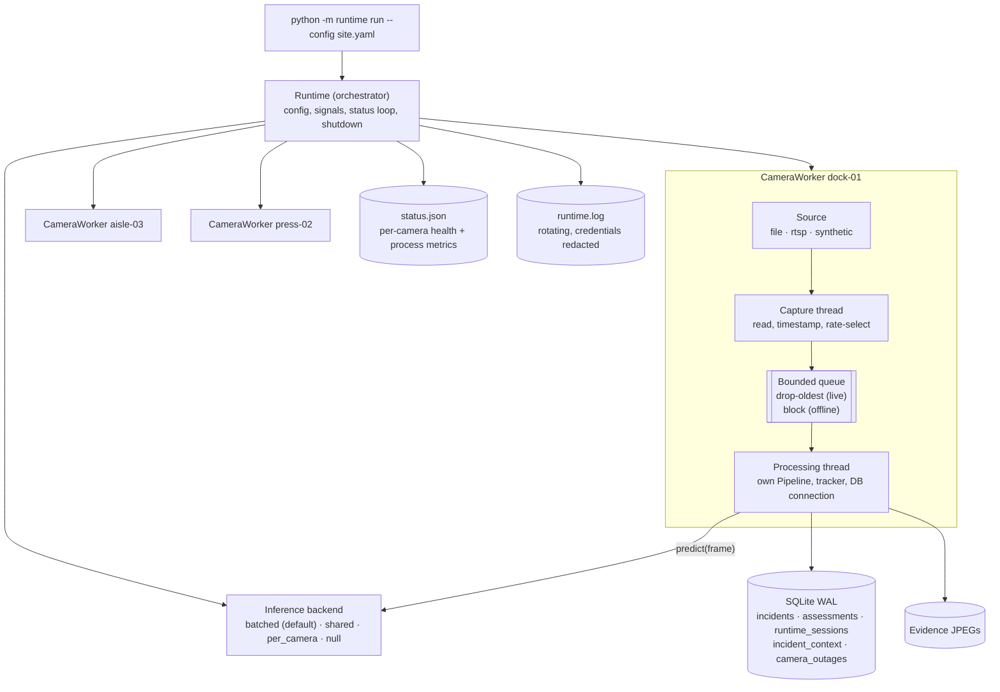

# 15 — Headless multi-camera runtime: architecture and concurrency decisions

Date: 5 November 2026. Written before implementation; implementation results are in `16_HEADLESS_RUNTIME_IMPLEMENTATION.md`. This document follows milestone M1 in `12_ROADMAP_AND_PRIORITIZATION.md` and layers L1–L4 and L15 in `07_SYSTEM_ARCHITECTURE.md`.

## 1. Goal and non-goals

**Goal:** SafeSight monitors several cameras continuously in one long-running process that does not depend on a browser. Each camera has its own lifecycle, health and failure handling, and all of them reuse the existing detection → tracking → PPE → zones → risk → incident pipeline unchanged.

**Non-goals for this milestone:** cross-camera tracking, a new UI, device discovery, cloud services, clustering across machines, any output to machinery or safety systems, any change to the model, weights, thresholds or risk-policy status.

## 2. What the current code does, and what breaks with several cameras

Reconstructed from `inference/`, `database/` and `app/` on 5 November 2026 (baseline: 57 tests passing, Ruff clean, M5 hash `E9B2583D…CC3C7534`).

| Area | Current behaviour | Problem with several cameras |
|---|---|---|
| Inference loop | `app/views/player.py` reads a frame, calls `Pipeline.process`, pushes UI updates in the same Streamlit script run | Monitoring stops when the tab closes; one run per server (`app/runlock.py`) |
| Detector | `Detector` owns the YOLO model **and** a ByteTrack instance | A tracker per camera is required; loading a model per camera is wasteful (see §4) |
| Track IDs | Ultralytics 8.4.197 gives each `BYTETracker` its own ID sequence starting at 1 (`byte_tracker.py`, `reset_id`) | IDs collide across cameras by design; and a tracker reset (needed after a reconnect) restarts at 1 and would **reissue IDs within the same camera session**, so cooldowns, repeat flags and `worker_id` rows could attach to the wrong person |
| Ultralytics `predict` | Not documented as thread-safe for a shared model instance | Concurrent calls on one model must be serialised or funnelled through one thread |
| Time | `t = processed_frames / fps` | Wrong as soon as frames are skipped or a stream stalls; exposure and cooldowns need real elapsed time for live sources |
| Lost-track expiry | Counted in processed frames | A stream outage produces no frames, so tracks are never expired across the gap |
| Database | One `sqlite3` connection per `IncidentDB`, `check_same_thread=False`, WAL, 30 s busy timeout | A connection must not be shared between threads without a lock; separate connections per thread are safe in WAL mode |
| Session IDs | `S%Y%m%d-%H%M%S` | Two cameras starting in the same second get the **same session ID**; `sessions` uses `INSERT OR REPLACE`, so one would overwrite the other |
| Incident IDs | `INC-<date>-<8 hex>` | About a 1-in-10,000 chance per day of a same-day collision at 1,000 incidents/day; a collision raises an `IntegrityError` and loses the incident |
| Timestamps | `started_at`/`ended_at` are local wall-clock time at processing | Not UTC and not the frame's capture time |
| Evidence | Annotated frame for every processed frame | 2.8 ms/frame wasted when nobody watches |

**Reusable without modification:** `ppe_association.py`, `zone_monitor.py`, `intelligence/` (taxonomy, risk, metrics), the evidence and cooldown logic in `incident_manager.py`, and all detection thresholds. **Needs small, backward-compatible changes:** `Detector` (inject a shared model or predict function), `Pipeline` (explicit timestamp, track reset with ID continuity, optional lazy annotation), `IncidentManager` (evidence directory and an event listener), `IncidentDB` (ID-collision retry, additive tables). The app keeps calling everything exactly as before.

## 3. Architecture

### 3.1 Components

| Component | Responsibility |
|---|---|
| `runtime/config.py` | Load YAML/JSON, validate everything before start, resolve credentials from environment variables, redact |
| `runtime/sources.py` | `FrameSource` interface; `file`, `rtsp`, `synthetic` implementations; registry for future types (ONVIF would resolve to an RTSP URI) |
| `runtime/inference.py` | Model loading once per process; serialised or batched access; per-camera detectors that share the model but own their tracker |
| `runtime/worker.py` | One camera: capture thread, bounded queue, processing thread, reconnection, session and event persistence |
| `runtime/health.py` | Per-camera state machine and rolling metrics; process CPU, RAM and GPU metrics |
| `runtime/service.py` | Orchestrator: start enabled cameras, status loop, signals, graceful shutdown |
| `runtime/logs.py` | Console + rotating file logging with credential redaction |
| `runtime/__main__.py` | CLI: `run`, `validate`, `status` |

### 3.2 Threads, not processes (for now)

| Option | Pros | Cons |
|---|---|---|
| **Threads in one process** (chosen) | One CUDA context and one model; cheap batching across cameras; simple shared status | A native crash (OpenCV/CUDA segfault) stops all cameras; Python-level work shares the GIL |
| One process per camera | Crash isolation | A CUDA context per process (hundreds of MB each), no cross-camera batching, IPC for status and DB |
| One process per camera + an inference server process | Isolation and batching | Shared-memory frame transport, much more code |

Most per-frame work releases the GIL (video decode in OpenCV, CUDA kernels, NumPy), measured at ~3.8 ms decode + ~15 ms single-frame inference per 720p frame. Python-level exceptions are contained per thread. **Native crashes are handled at the service level** (Windows service / systemd / the existing watchdog pattern restarts the process; sessions are closed with an end reason on graceful paths and outages are visible). The design keeps the process boundary open: workers talk to the backend only through `predict(frame)`, so the backend can later move behind a socket without changing workers.

### 3.3 Inference sharing (decided by measurement, benchmarked again in `16`)

Profiling on the development machine (RTX 2000 Ada, 720p frames, M5 at 640 px): single-frame `predict` median **15.0 ms**; batched `predict` **8.0 ms/frame at batch 2** and **4.8 ms/frame at batch 4**. Batching therefore roughly triples GPU throughput at four cameras.

| Mode | How | When to use |
|---|---|---|
| `batched` (default) | One inference thread collects the latest pending frame from each camera (up to `max_batch`, waiting at most `batch_wait_ms`), runs one batched `predict`, returns results through futures | Several cameras on one GPU |
| `shared` | One model, a lock around `predict` | Simplest; one or two cameras |
| `per_camera` | A model per camera, no lock | Comparison only; Ultralytics' own guidance for thread safety, at the cost of memory and no batching |
| `null` | No model; no detections | Connectivity and health checks without a GPU (and CI) |

Tracking, association, zones, risk and incidents stay **per camera** in each camera's processing thread; only the stateless model call is shared.

### 3.4 Camera-scoped identity

- **Worker identity is `(camera_id, session_id, worker_id)`.** Raw tracker IDs restart at 1 per camera by design.
- **IDs never repeat within a camera session.** After a track reset (reconnect or loop restart) the pipeline offsets new tracker IDs past the highest ID already issued, so a returning person can never inherit another person's cooldown or history.
- **Session IDs are unique per camera:** `S<local time>-<camera_id>-<4 hex>`.
- Cross-camera re-identification is out of scope (privacy and the roadmap's B-track).

### 3.5 Frame selection and backpressure

1. The capture thread reads **every** frame the source delivers (for RTSP this keeps the decoder current and latency low).
2. **Rate selection:** frames are forwarded on a due-time schedule that averages `max_fps` (media time for offline files, monotonic time for live sources). Skipped frames are counted as `skipped_rate` (by design, not loss). *Refined during implementation:* the decision is made before reading, so skipped frames are only grabbed, never converted.
3. **Bounded queue** (`queue_size`, default 2):
   - **live** sources (RTSP, files in `realtime` mode): when full, the **oldest** queued frame is dropped and counted as `dropped_backpressure`, so the processor always works on the freshest frame and latency stays bounded;
   - **offline** files: the capture thread **blocks**, so every selected frame is processed (deterministic, used for evaluation).
4. Accounting identity checked by tests: `read = processed + skipped_rate + dropped_backpressure + still_queued`.
5. No frame queue is unbounded anywhere; the batched backend holds at most one pending request per camera.

**Events are never dropped by backpressure:** dropping happens before inference, never after a state change. Every incident is written synchronously to SQLite in the processing thread before the next frame; a write failure is logged at ERROR, counted, and turns the camera DEGRADED, so it is never silent.

### 3.6 Time

| Purpose | Clock |
|---|---|
| Exposure, cooldowns, confirmation, latency, uptime | **Monotonic, high resolution** (`time.perf_counter()`), relative to the session start, for live sources; media time for offline files (reproducible). *Changed during implementation:* `time.monotonic()` ticks every ~15.6 ms on Windows with Python 3.11, which quantised every measured latency and frame pacing in the first benchmark |
| Persisted event times (`incident_context.opened_utc/closed_utc`, sessions, outages) | **UTC** wall clock taken **at frame capture**, ISO 8601 with offset |
| Existing `incidents.started_at/ended_at` | Unchanged (local processing time), for backward compatibility |

After a gap longer than `lost_track_seconds` (stream outage) or a content discontinuity (looping file restart), all tracks are closed **at the last observed time**, and tracking restarts with fresh, non-reused IDs. Duplicate suppression of the incident manager then treats a person still in the same place as the same worker, so a reconnect does not produce a duplicate incident.

### 3.7 Persistence

- **One SQLite connection per camera processing thread** (thread-confined), WAL mode, 30 s busy timeout. SQLite serialises writers; incidents are rare relative to frames, so contention is negligible. The Streamlit app can read concurrently.
- **Additive tables only:** `runtime_sessions` (camera, site, sanitised source, start/end UTC, end reason, frame counters), `incident_context` (incident → camera, site, session, worker reference, UTC open/close, frame capture time), `camera_outages` (coverage gaps). Existing tables, columns and the CSV export are unchanged.
- **Incident-ID collisions** are retried with a fresh ID instead of failing.
- **Default database for the runtime is separate** (`logs/runtime/incidents.db`), so automated runs never mix with the dashboard's history; pointing the runtime at `logs/incidents/incidents.db` is a one-line configuration change and uses the same schema.

### 3.8 Health

| State | Meaning | Monitoring effective? |
|---|---|---|
| `CONNECTING` | Opening the source for the first time | No |
| `STREAMING` | Frames arriving and being processed at an adequate rate | Yes |
| `DEGRADED` | Streaming, but processed rate < 80 % of target, drop ratio > 20 %, no processed frame for > 5 s, or persistence errors (thresholds configurable; tightened from 50 %/50 % after the first benchmark showed a camera at 57 % of its rate with 42 % drops still reported as STREAMING) | Partially |
| `RECONNECTING` | Source lost; bounded exponential back-off in progress | No |
| `STOPPED` | Stopped by shutdown or end of a non-looping file | No |
| `ERROR` | Retries exhausted, missing credentials, or the inference pipeline failed repeatedly | No |

A camera is reported as monitoring **only** in `STREAMING` (and partially in `DEGRADED`). "No incidents" is shown only together with a healthy state; a stale `status.json` (older than three status intervals or a dead PID) is reported as "runtime not running". These four situations are therefore distinguishable: no violations (STREAMING, 0 incidents), disconnected (RECONNECTING/ERROR), running but inadequate (DEGRADED), inference failed (ERROR with reason).

### 3.9 Lifecycle

Start: validate config → load the model once (fail fast with exit code 3 if it cannot load) → start enabled cameras (a camera that cannot open does not stop the others) → write `status.json` every `status_interval_s`.

Stop (SIGINT, SIGTERM, SIGBREAK on Windows, or `Runtime.stop()`): stop capture → processing threads drain their queues (≤ `queue_size` frames each) → each pipeline closes open incidents and saves its session → runtime sessions closed with `end_reason` → inference backend stopped → final status (`STOPPED`) → logs flushed → exit code 0. A second signal forces exit. All threads are daemon threads joined with a timeout, so no orphan threads survive the process.

### 3.10 Security

- Credentials **never** appear in configuration: RTSP sources name environment variables (`username_env`, `password_env`); URLs with inline credentials are rejected by validation.
- Every log record passes a redaction filter (URL userinfo and every resolved secret value replaced by `***`); sources describe themselves without credentials.
- The runtime makes **no outbound network connections** other than to the configured cameras, uploads nothing, and has **no output to machinery, PLCs or safety systems**.
- Config is validated strictly; unknown keys are errors (typos must not silently disable a setting).

## 4. How this scales to industrial deployments

| Step | Change | Unchanged |
|---|---|---|
| One edge box, 4–16 cameras | Tune `max_fps`, `max_batch`, TensorRT export (later) | Worker, source, health, persistence design |
| Several edge boxes per site | Each runs this runtime; a central server collects events (store-and-forward outbox, M5) | Event schema, IDs scoped by camera and session |
| Crash isolation needed | Move the backend behind a local socket; one worker process per camera group | Workers call `predict(frame)` only |
| Fleet operations | Service manager, remote config, signed updates, central health (roadmap C-track) | `status.json` fields become the health API |

## 5. Decisions summary

| # | Decision | Reason |
|---|---|---|
| D1 | Threads in one process, backend behind a narrow interface | Measured batching gain; simplest robust design for one edge box; isolation can be added later |
| D2 | Batched inference as default, `shared`/`per_camera` kept for comparison | 3× per-frame GPU efficiency at batch 4 (profiled) |
| D3 | Per-camera tracker, pipeline and DB connection | No shared mutable tracking state; SQLite connections are not shared across threads |
| D4 | Drop-oldest bounded queues for live sources; blocking for offline | Bounded memory and latency live; determinism offline |
| D5 | Monotonic time for durations, UTC at capture for records | Correct exposure under drops and outages; auditable times |
| D6 | Track reset after gaps with ID continuity | Prevents ID reuse and stale tracks; dedup prevents duplicate incidents |
| D7 | Additive tables, separate default database | Backward compatibility; tests and automation never touch the dashboard history |
| D8 | Credentials only from environment variables; redaction filter | No secrets in config or logs |
| D9 | No dependency added | PyYAML and psutil are already pinned; GPU utilisation is read from `nvidia-smi` when present |
