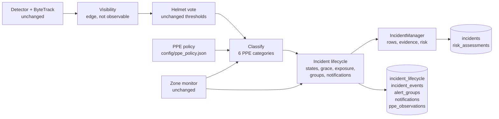

# 19 — Safety reliability engineering (milestone M2.1)

Incident lifecycle, PPE requirement policy, visibility, alert grouping, identity-aware evaluation and the human review
process. 5 November 2026, branch `research/platform-foundations`, all changes uncommitted.

> **Every number here is diagnostic.** The labels are still the provisional AI first pass (`m2-provisional-v1`, plus
> anchors in v1.2). Nothing below is a validated measurement, and **no performance improvement is claimed**: rules
> were corrected, the model was not, and the formal gate stays blocked until the frozen model is re-scored against
> independently verified labels. The M5 model and its thresholds are unchanged (SHA-256 `E9B2583D…CC3C7534`).

## Summary

| Return item | Short answer |
|---|---|
| What was wrong | See the root-cause list below the table. |
| What was fixed | See the list of fixes below the table. |
| Architecture | A new lifecycle module sits between the detector and incident persistence; there is a new PPE policy engine; there are five additive tables; the legacy incident API is unchanged (§10). |
| Before/after | Same recorded traces, frozen M2 logic against new logic (§8). Per-event timing becomes right: median duration error falls from 7.4 s to 0.6–0.7 s. The white-suited worker's incident runs 27.8 s instead of 4.0 s, against 29.4 s labelled. The frame-edge false alarm is gone. Counts barely move: 5 of 8 found, 2 false alarms, recall unchanged, because the model is unchanged. |
| New tests | 51 (29 lifecycle and policy, 11 identity matching, 11 review and agreement); the 115 existing tests still pass (§13). |
| Limitations | §12. The lifecycle follows the classifier faithfully, so a soft cap read as a helmet still "resolves" an incident. Edited footage with cuts allows false re-association by position. A camera interruption ends incidents rather than bridging them. |
| Needs humans | Two independent reviewers and a third adjudicator for all 15 clips (`reports/validation/human_review/`); a site safety administrator to set real PPE requirements. |
| Gate | **Not met.** The engineering defects found in M2 are fixed and tested. Detection performance is unchanged and still unverified. Forklift–pedestrian work stays at requirements only ([`20`](20_FORKLIFT_PEDESTRIAN_REQUIREMENTS.md)). |

**What was wrong.** Root causes were measured on traces of the frozen model:

1. One compliant vote resolved an incident. Helmet votes count from 0.30 confidence and no-helmet votes from 0.60, so ambiguous headwear flips the vote briefly.
2. The 30 s cooldown started at that closure and hid the violation that continued (302 VIOLATION frames in the 30 s after one closure).
3. Exposure was measured from open to close, not from evidence. Uncertain frames and a 2 s lost-track wait counted as exposure.
4. There was no grace period for occlusion, and no PPE-requirement context.
5. A no-helmet detection on a head cut off by the frame counted as a violation.
6. The scorer matched without identity.
7. Detector closure overwrote an operator's review status.

**What was fixed.**

- The incident lifecycle: hysteresis on resolution, a grace period, outcomes recorded as unknown when unknown, exposure bounded by observation, and a cooldown that never suppresses a new violation after a confirmed resolution.
- Explicit PPE requirements: unconfigured means review, never a confirmed violation.
- Frame-edge visibility.
- Alert groups with burst batching.
- Identity-aware matching.
- Operator status preserved through detector closure.
- An audit trail for every decision.
- Blinded human review packages.

## 1. What was wrong (measured, not assumed)

The frozen model's per-frame tracker and head outputs were recorded for all 15 clips
(`scripts/validation/record_traces.py`). The M2 logic was then replayed on them (`scripts/validation/replay.py`). The
replay reproduces M2's incident open times exactly on 12 of 15 clips; the other three differ by fractions of a second
because of batched versus single-frame inference numerics. Every incident was traced to the code path that closed it:

| Incident (M2 logic) | Open–close | Closed by | What followed in the next 30 s |
|---|---|---|---|
| c01 white-suited worker | 201.0–205.0 s | first COMPLIANT vote state | track visible 724 frames: **302 VIOLATION**, 383 uncertain, 39 compliant; no new incident (cooldown) |
| c01 pink suit, first episode | 46.9–47.9 s | first COMPLIANT vote state | 11 compliant, 90 uncertain; never re-raised |
| c01 dark-helmet worker | 241.3–245.2 s | first COMPLIANT vote state | 130 VIOLATION frames, suppressed by cooldown |
| c02 dark-helmet false alarm | 318.0–333.3 s | end of stream | 30 VIOLATION frames in 15.3 s; **exposure 15.3 s from 1 s of evidence** |
| c00 frame-edge false alarm | 237.0–240.0 s | compliant vote | head box at y = 0 in every frame: the helmet was outside the image |
| c11 office | 16–27.6 s | track lost (2 s) | shot cut; correct |

Root causes:

1. **Resolution on a single vote.** The state machine closed an incident on the first frame the 15-frame vote reached COMPLIANT. Helmet votes count from 0.30 confidence and no-helmet votes need 0.60, so ambiguous headwear produces brief COMPLIANT states.
2. **The cooldown started at closure** and keyed on the track, so the continuing violation was invisible for 30 s.
3. **Exposure came from timestamps, not observation.** UNCERTAIN frames kept an incident open and counted as exposure, and a lost track added the 2 s wait.
4. **No grace period, no notion of unknown outcome.** Track loss after 2 s closed the incident as if it had ended.
5. **No PPE context.** The rule applied to every person everywhere.
6. **Frame edge.** A head cut off by the top of the image read as bare.
7. **Scoring** matched without identity (M2 §4.4).
8. **Persistence.** `close_incident` set `status=CLOSED` even when an operator had already marked an open incident REVIEWED or FALSE_ALARM.

## 2. Incident lifecycle (`inference/incident_lifecycle.py`)

| State or end | Meaning | Entered when |
|---|---|---|
| ACTIVE | The condition is observed now | Confirmed VIOLATION vote where a requirement applies; or a person inside an alert zone (debounced) |
| UNOBSERVED | Open, but not observed | Head not judgeable, or track missing. Persisted and audited once it lasts ≥ 1 s |
| RESOLVED | Positive evidence it ended | COMPLIANT held for `resolve_seconds`; a debounced zone exit; or the worker left the area where the PPE requirement applies |
| OBSERVATION_LOST | Outcome unknown | Nothing observed for `grace_seconds` |
| CAMERA_INTERRUPTED | Outcome unknown | Stream gap longer than `lost_track_seconds`, or the file looped (the tracker restarts) |
| SESSION_END | Outcome unknown | Shutdown or end of stream with the incident open |
| CLASSIFICATION_CHANGED | Superseded | The same worker's alert changes meaning (e.g. walks from an unconfigured area into a required one); a new incident follows |

Rules:

- **Time.** An incident *ends* at the last time the condition was observed (`ended_t`). The decision time is stored separately (`closed_t`). Video time is media time for files and monotonic time for live streams (`perf_counter`, unchanged from M1). UTC is stored at the database boundary.
- **Exposure** = confirmation time + (last observation − opening). It never runs past the evidence.
  - `observed_s` is the time actually observed (one missed frame still counts as continuous).
  - `unobserved_s` is the bridged gaps inside the exposure, each shorter than the grace period and closed by a later observation.
  - The risk engine escalates on this exposure, through `IncidentManager.exposure_fn`.
- **Cooldown.** A confirmed resolution clears the cooldown and the lost-track memory, so a new violation by the same worker opens a new incident at once, notified as a *recurrence*.
- **After an unknown-outcome end.** A re-observation of the same worker (same track, or same place with the old track gone) within `cooldown_seconds` is recorded against the alert group: when it started, how long it lasted, and that it came after an unknown end. It is not a duplicate incident or notification. If it is still going on when the cooldown ends, a new incident opens in the same group, without a new notification.
- **Fragmented tracks.** A new track continues an UNOBSERVED incident only if:
  - the old track is not visible;
  - the condition and zone match;
  - it is within one box height of the last position;
  - it is within `grace_seconds`.

  This is recorded as `reassociated`, with the basis "position (same place, old track gone)". A visible worker can never take over another worker's incident (tested).
- **Camera interruption** ends incidents immediately, with outcome unknown, at their last observation. This is decision D4.

Settings live in `inference/config.py` and can be overridden per camera in the runtime. They were fixed from first principles before any diagnostic ran, and were never tuned on labels:

| Setting | Default | Reason |
|---|---|---|
| `grace_seconds` | 10 | Covers short occlusions; a third of the cooldown |
| `resolve_seconds` | 2.0 | Four times the confirmation time, because helmet votes count from the lower PPE threshold |
| `burst_seconds` | 10 | Notification batching window |
| `edge_margin_px` | 2 | Boxes are clipped to the image; within 2 px of the border means cut off |

## 3. PPE requirement policy (`intelligence/ppe_policy.py`)

The policy is a JSON file (`config/ppe_policy.json`; documented example in `config/ppe_policy.example.json`, runtime
key `runtime.ppe_policy`). Each entry gives:
- site, camera (or `*`) and optional zone;
- PPE items (`head` today; `hi_vis`, `footwear` and others are accepted for the future);
- `required` true or false;
- `status`: `confirmed` (must name `established_by`) or `provisional`;
- `active`, and effective times in UTC;
- a basis.

The policy document itself is `draft` or `approved` (approved needs an approver and a date).

| Situation | Requirement | PPE category | Incident |
|---|---|---|---|
| No policy file, or no entry for this camera (**the default**) | unconfigured | requirement not configured | Review item (`requires_review`): risk assessment marked `requires_review`, dashboard shows "review (no PPE rule configured)". **Never a confirmed violation** |
| Inside a zone, or camera-wide, with `required: true` | required (confirmed or provisional status kept) | confirmed violation / compliance / uncertain / not observable | Violation incident when the helmet vote confirms a violation |
| Outside every zone with an entry | not required | not applicable | None; an open violation resolves when the worker leaves the required area |
| Entry inactive or outside its effective period | inactive | not applicable | None |
| Feet cut off by the frame bottom (zone membership unknown), or conflicting entries at the same scope | ambiguous | uncertain | Review item |
| Crossing a zone boundary (entry or exit not yet debounced) | ambiguous (transient) | uncertain | Waits for the debounced decision, so entering a zone opens one incident, not a review then a violation |

- **Precedence.** A zone-scoped entry beats a camera-wide one. At the same scope, required and not-required together are ambiguous.
- **Zones** used only for PPE scoping take the new zone kind `work_area`, which never raises zone-entry alerts. Restricted-zone monitoring is unchanged (tested by the existing suite).
- **Reporting.** Worker-seconds per category (`ppe_observations` table) feed reports that never collapse into compliant against non-compliant.
- **Who decides.** Final PPE requirements must be set by competent site safety personnel under the rules and procedures that apply to the site. SafeSight does not infer a requirement from the image.

## 4. Visibility (`inference/ppe_association.py`, `inference/tracker.py`)

| Case | Handling | Evidence |
|---|---|---|
| Head box touching the top, left or right border | A no-helmet detection there is not counted as evidence (vote kind `edge`); a helmet detection still counts | c00: head box at y = 0 throughout the false alarm; removed in the replay. Tests cover both directions |
| No usable head evidence in the window (occluded, too small, cut off) | `NOT_OBSERVABLE`, reported apart from `UNCERTAIN` (evidence that exists but disagrees); `state()` keeps its old values | 370 of 1,836 worker-seconds were not observable in the diagnostic |
| Feet below the frame | Zone membership treated as unknown for PPE scoping (restricted-zone alerts unchanged) | Tested |
| Small heads | **No rule added.** No false alarm from small heads was observed, and a size cut-off without evidence could only cost recall. Model-input head size goes into the labels (`17` §12 A2) so recall can be reported by size | M2 §4.2 |
| Thresholds, weights | Unchanged | — |

## 5. Alert grouping, duplicates and notifications

- **Incident.** One worker's one continuous condition as far as evidence allows (detector level, a row in `incidents`).
- **Alert group** (`alert_groups`). Incidents believed to be the same worker's same violation: a re-association, or a continuation after an unknown end. Groups carry exposure, observed and re-observed time, and risk on the group's exposure.
- **Notification** (`notifications`). What an operator would be told:
  - a new group (`alert`);
  - a group after a confirmed resolution (`recurrence`);
  - an unconfigured or ambiguous requirement (`review`).

  Same-kind notifications on one camera within `burst_seconds` are **batched into one notification that lists every group**. Different workers stay separate incidents and groups (tested). Nothing is silently dropped.
- **Audit** (`incident_events`, append-only). Every decision is recorded: opened, observation lost, re-observed with gap length, reassociated with its basis, re-observed after an unknown end, ended with its reason, notification created or batched, group continued.
- **Acknowledgement is separate.** Detector closure no longer overwrites an operator's REVIEWED or FALSE_ALARM status (`database.close_incident`, tested). Lifecycle state lives in `incident_lifecycle`; operator status stays in `incidents.status`.
- **Future channels.** `IncidentLifecycle.drain_notifications()` and the event table are the interface for notification channels. No external notification is implemented.

## 6. Identity-aware evaluation (`intelligence/event_metrics.py`)

- **Labels.** Schema `safesight.labels/1.1` adds optional identity anchors to events: `{t, x, y}`, a normalised point on the labelled worker.
- **Predictions** carry the worker's track boxes over time. Runtime runs now store a 0.5 s path per incident; the replay takes boxes from the traces. They also carry camera and session.
- **Pairs.** Each episode–prediction pair is CONSISTENT (the anchor falls in the box), INCONSISTENT (the worker was elsewhere at that time) or UNKNOWN. Inconsistent pairs can never match, nor count as duplicates of each other. Unknown pairs fall back to time and are counted (`matched_unknown`). Different cameras or sessions never match.
- **Assignment** is global and deterministic: consistent before unknown, required before optional, containment, nearest start, then time and id.
- **Tests (11)** cover: two workers violating at once; two workers in one zone; a reused tracker ID on another person; the same ID on another camera; a chain fragmented by occlusion or reset; occlusion at the anchor time; workers crossing; several incidents of one hazard; input-order independence; and equivalence to the time-only matcher without identity data.
- **v1.2** is v1 plus anchors for the 16 events where people could be confused. They were read by eye from plain frames with a grid (`scripts/validation/anchor_sheet.py`), never from model boxes. No time or state changed.
- `run_evaluation.py score --identity` scores runtime runs with this matcher.

## 7. Measurement integrity

| Safeguard | State |
|---|---|
| v1 and v1.1 label sets and locks | Byte-identical lock files before and after this milestone; both verify (`5FA81F00…`, `0BC85D6F…`). v1.2 locked separately (`34F4633D…`) |
| Historical result files | `score` refuses to overwrite existing results without `--overwrite`; `run` no longer replaces `reports/validation/evaluation_manifest.json`. All M2.1 numbers are in `reports/validation/m2_1_diagnostics/` |
| Before side of comparisons | `scripts/validation/legacy_m2/` is the M2 post-detector code, byte-identical to the hashes in the M2 evaluation manifest, except that its imports point at each other. Never imported by the product |
| Traces | One recording of the frozen model's tracker and head output per clip (`reports/validation/traces/`, git-ignored); both logics replay the same inputs. Faithfulness: 12 of 15 clips reproduce M2's open times exactly |
| Development and held-out | Every table keeps them apart. Zone entry exists only on development clips (20 s) and is never presented as validation |
| Tuning | No threshold, weight or lifecycle setting was chosen or changed after looking at diagnostic scores. A finding that suggests a change (§12, soft caps) is recorded as a hypothesis for new data |

## 8. Before/after diagnostic (`reports/validation/m2_1_diagnostics/`)

Variants on identical traces, scored against v1 episodes (v1.2 adds anchors only):

| Variant | Logic | PPE policy | Matcher |
|---|---|---|---|
| A | M2 (frozen copy) | — | time only (reproduces M2) |
| B | M2 | — | identity-aware |
| C | new | camera-wide provisional head requirement (the M2 assumption, made explicit) | identity-aware |
| D | new | none (shipped default) | identity-aware |

**Missing head protection, held-out (6 episodes, 2 source groups). Every row is insufficient by the M2 rule.**

| | A | B | C | D |
|---|---|---|---|---|
| Detected | 3/6 | 3/6 | 3/6 | 3/6 |
| False alarms (0.231 monitorable h) | 2 | 2 | 2 | 2 |
| Duplicates | 0 | 0 | 2 | 2 |
| Alerts where the rule does not apply | 5 | 5 | 5 | 5 |
| Unscorable | 4 | 4 | 2 | 2 |
| Identity: matched consistent / unknown / excluded pairs | n/a | 3 / 0 / 2 | 3 / 0 / 3 | 3 / 0 / 3 |
| Confirmed violations raised | 14 (no concept) | 14 | 14 (provisional requirement) | **0** (all 14 are review items) |

**Timing, all 9 required matches (PPE and zone).**

| | A | B | C |
|---|---|---|---|
| Median latency | 0.48 s | 0.48 s | 0.48 s |
| Median absolute duration error | 7.38 s | **0.60 s** | 0.70 s |
| Maximum absolute duration error | 25.4 s | 25.4 s | 29.1 s |

**Per episode** (alert duration against labelled duration; B attributes by worker):

| Episode | Labelled | B (M2 logic) | C (new logic) | What changed |
|---|---|---|---|---|
| c01-E04 white suit, dark cap | 200.5–229.9 | 201.0–205.0 (−25.4 s) | 201.0–228.9 (**−1.6 s**) | Brief compliant flips no longer resolve it; the cooldown no longer hides it |
| c01-E01 pink suit, navy soft cap | 41.0–58.0 | 46.9–47.9 (−16.0 s) | 46.5–56.1 (−7.5 s) | Continues across a track fragment (tracks 8 → 10) |
| c01-E03 pink suit, navy soft cap | 200.5–229.9 | 211.3–215.3 (−25.4 s) | 211.3–211.6 (−29.1 s), then a second incident 223.1–225.5 | The model reads her soft cap as a helmet for 2 s, so it "resolves": the lifecycle follows the classifier (§12) |
| helmet_put_on-E01 | 0.0–1.4 | 0.46–2.42 (+0.56 s) | 0.46–1.92 (**+0.06 s**) | Ends at the last observed violation, not at the decision |
| roadworks_night-E06 (zone) | 0.0–4.4 | 0.43–5.44 (+0.6 s) | 0.43–3.44 (−1.4 s) | Ends at the last frame seen inside; the old time included the 2 s lost-track wait |
| c02 dark-helmet false alarm | — | 318.0–333.3 (15.3 s exposure) | 318.0–327.7 (exposure 10.2 s, observed 0.9 s) | Exposure no longer includes uncertain frames after the last evidence |
| c00 frame-edge false alarm | — | 237.0–240.0 | **none** | Visibility rule |

Why the counts barely move:
- The two genuine false alarms in C are the dark-helmet worker's misclassification (c02, and c01 at 253 s). That second c01 incident replaced the frame-edge one: the old cooldown used to hide it.
- The two duplicates are the pink worker's second incident after her false "resolution", and an alert the matcher could not attribute (no anchor near its time), which the fallback counts as a possible duplicate.
- Detection recall is a model property and did not change: 3/6.

Alerts and notifications on all 15 clips:

- **Variant C:** 22 incidents (18 helmet, 4 zone) in 22 groups gave **15 notifications**:
  - 11 helmet alerts;
  - 2 helmet recurrences after a confirmed resolution;
  - 2 zone alerts (roadworks_night's three zone entries batched into one).

  M2 notified all 22.
- **No PPE policy (D):** **zero confirmed violations**. The 18 helmet incidents give 12 review notifications, the zone alerts are unchanged, and all 1,836 worker-seconds fall in "requirement not configured".

With the assumed camera-wide requirement (C), worker-seconds split as:

| Category | Worker-seconds |
|---|---|
| Confirmed compliance | 1,044 |
| Confirmed violation | 94 |
| Uncertain | 329 |
| Not observable | 370 |

**End-to-end through the real runtime** (run `m2-provisional-v1.2_20261105-195803`, shipped default with no PPE
policy; scored with `--identity` into `reports/validation/m2_1_runtime_check/`):
- 15 cameras and 46,002 frames in 8 min 10 s, no stuck camera.
- 24 incidents (20 helmet, 4 zone), all CLOSED, each with a lifecycle record, an end reason and a worker path.
- 14 notifications: 12 review, 2 zone alerts.
- 0 confirmed helmet violations.
- 1,836.5 worker-seconds, all "requirement not configured".
- Audit events: 31 observation lost, 13 re-observed, 5 re-associated, 3 re-observations after an unknown end.
- Held-out helmet results: 3 of 6 found, 2 false alarms, 2 duplicates, 7 alerts where the rule does not apply. That is the replay's result; the runtime's batched inference produced two more office incidents in c11, as in M2.

The original dashboard database was not written by M2.1. Its files keep their earlier timestamps, and it contains none
of the M2.1 tables; the dashboard itself was checked in-process against a temporary database.

## 9. Human review: prepared, not done

`reports/validation/human_review/` contains:
- two blinded packages: empty label sets, each reviewer in a different clip order, no split, no model output;
- reviewer instructions, the adjudication workflow, and `progress.csv`;
- the tools (`scripts/validation/human_review.py`): prepare, status, agreement, adjudicate, lock-verified.

The annotator gains:
- a reviewer mode scoped to one package (no status or review controls);
- identity anchors;
- a native-resolution zoom.

Agreement measures (`intelligence/agreement.py`) are matched to the decision:

| Decision | Measure |
|---|---|
| Interval states | Cohen's kappa on 0.5 s samples, plus per-state specific agreement |
| Events found | Raw counts and positive specific agreement (kappa is undefined here, because the "neither" cell does not exist) |
| Boundaries | Seconds |
| Event attributes | Percent agreement; kappa only with ≥ 10 pairs |

Every sub-target measure is flagged. `lock-verified` refuses until:
- two different named humans have finished every clip;
- a third person has decided every disagreement;
- no event is pending.

**Gate status: blocked.** No reviewer has been engaged in this session, and I did not and will not act as one.

## 10. Architecture changes

| Module | Change |
|---|---|
| `inference/incident_lifecycle.py` (new) | State machine, exposure, re-association, groups, notifications, audit, worker path |
| `intelligence/ppe_policy.py` (new) | Requirement policy and validation |
| `intelligence/agreement.py` (new) | Inter-annotator agreement |
| `inference/tracker.py` | Classification, policy, visibility and lifecycle wiring; PPE category time; summary counts incidents raised |
| `inference/incident_manager.py` | Additive: `raise_incident(check=False)`, `end()`, `rekey()`, `exposure_fn`, `assessor_iid`. The legacy API and its cooldown semantics are unchanged |
| `inference/ppe_association.py` | `head_truncated`, edge votes, `detail()` with NOT_OBSERVABLE |
| `inference/zone_monitor.py` | Read-only `crossing()` |
| `intelligence/taxonomy.py` | Zone kind `work_area` (no entry alert) |
| `intelligence/event_metrics.py` | `match_identity`, `identity_relation`, `duplicate_rate`; `evaluate(identity=…)` |
| `intelligence/annotations.py` | Schema 1.1 with anchors |
| `database/database.py` | Five additive tables; `close_incident` keeps operator review |
| `runtime/` | `runtime.ppe_policy` (validated at start), policy status in `status.json`, notification logging |
| `app/theme.py` | Review alerts labelled as such |
| `inference/config.py` | Four lifecycle settings |

## 11. Decisions

| # | Decision | Alternatives rejected | Why |
|---|---|---|---|
| D1 | The lifecycle is a new layer over `IncidentManager`, whose API stays | Rewrite the manager | 115 tests and the dashboard depend on the manager's behaviour |
| D2 | An incident ends at the last observation; the decision time is stored apart | End at the decision time | Exposure must not include time after the evidence |
| D3 | Resolution needs positive evidence held for `resolve_seconds`; loss of observation is never resolution | Close on the vote | The vote flips on ambiguous headwear (§1) |
| D4 | A camera interruption ends incidents (outcome unknown); a re-observation within the cooldown is recorded against the group, and still going after it opens a linked incident | Bridge the gap with the grace period | After a gap the tracker restarts and the view may have changed. The existing reconnection test (one incident, ended before the outage) encodes this |
| D5 | After a confirmed resolution, no cooldown | Keep the cooldown | A cooldown must not hide a new violation |
| D6 | Unconfigured requirement means a review item, not silence and not a violation | Suppress, or treat as required | Neither nuisance alarms nor false reassurance; the person who owns the requirement decides |
| D7 | Crossing a boundary waits for the debounced decision | Review during the crossing | Otherwise one entry makes two incidents and two notifications |
| D8 | Edge rule for heads only; no small-head rule | Size cut-off | Evidence existed for the edge case only |
| D9 | Bursts batch notifications, never incidents | Merge simultaneous incidents | Different workers are independent events |
| D10 | Identity: inconsistent pairs excluded; unknown pairs fall back to time and are counted | Require identity | Identity is often unobservable; a fallback that is reported is more honest than discarding data |
| D11 | Lifecycle defaults set from first principles before any diagnostic; no change after seeing scores | Tune on the replay | The labels are the held-out evaluation set |

## 12. Failure modes and known limitations

- **The lifecycle follows the classifier.** For the pink-suited worker in c01, the model reads her navy soft cap as a helmet for more than 2 s, so her incident "resolves" and a second one opens later. Requiring compliant evidence as strong as violation evidence (helmet confidence of at least 0.60 before a resolution counts) may help. **This was observed on held-out data, so it is not applied.** It is a hypothesis to test on new development data (P1 in `18` §10).
- **Longer correct incidents also mean longer wrong ones.** The dark-helmet false alarm in c01 now lasts 14.2 s, then recurs. Before, the cooldown hid it.
- **Edited footage.** In c11, new tracks after a film cut re-associate with the office workers by position, extending those incidents past the cut. Fixed cameras have no cuts, but PTZ moves and knocks do. View-change detection, which would end incidents as a camera interruption, is needed (roadmap C-track: camera health and view integrity).
- **Camera interruption** ends incidents even after a one-second outage. The violation's exposure is split between the incident and a recorded re-observation (D4).
- **Position re-association is an inference.** Two workers swapping places during an occlusion could be merged. It is limited to the same place, an old track that is no longer visible, and the grace period, and it is recorded.
- **Policy time** for recorded files is the processing time, not the recording time (live streams are unaffected).
- **Identity fallback.** Alerts the scorer cannot attribute (no anchor near their time) count as possible duplicates. More anchors from human reviewers reduce this.
- **The vote window** delays state changes by up to about 0.5 s in both directions (measured in the tests).
- **Not built.** Notification delivery, acknowledgement workflows, view-integrity detection, and long soak tests of the new tables under load.

## 13. Tests

New test files:
- `tests/test_lifecycle.py` (29): the ten scenarios from the brief, plus grouping, operator status, visibility, PPE policy decisions and validation, and category reporting.
- `tests/test_identity_matching.py` (11): the adversarial identity cases.
- `tests/test_human_review.py` (11): agreement measures, blinded packages, refusal conditions, and the annotator's reviewer mode.
- `tests/test_validation.py`: unchanged count (18).

The original 115 tests pass without changes to any of them. The final counts are in the progress log.

## 14. Gate decision

**The reliability gate for the next capability phase is not met.** What this milestone could do autonomously is done
and tested:
- incidents stay open while violations continue;
- exposure is bounded by evidence;
- PPE requirements are explicit;
- unconfigured requirements never become confirmed violations;
- scoring respects identity;
- duplicates and bursts are handled;
- every decision is auditable;
- the review process is ready.

What it cannot do is establish that SafeSight is reliable: that needs the verified labels, a re-score of the frozen
model with the corrected framework, a comparison of old and new logic on those labels, and then a deployment-like
dataset (`18` §10 P0.4).

Forklift–pedestrian risk intelligence stays at research and data requirements
([`20_FORKLIFT_PEDESTRIAN_REQUIREMENTS.md`](20_FORKLIFT_PEDESTRIAN_REQUIREMENTS.md)); no detector work has begun.
