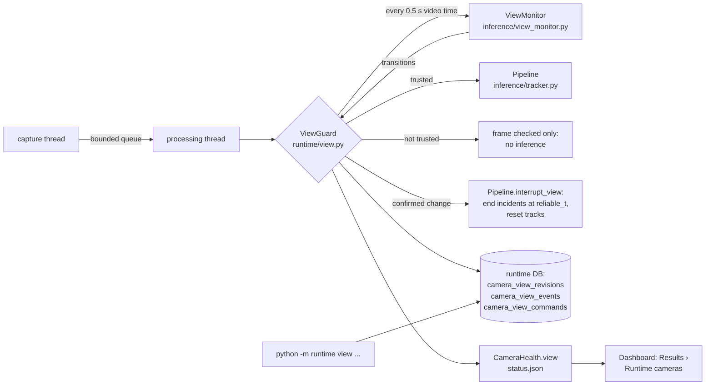
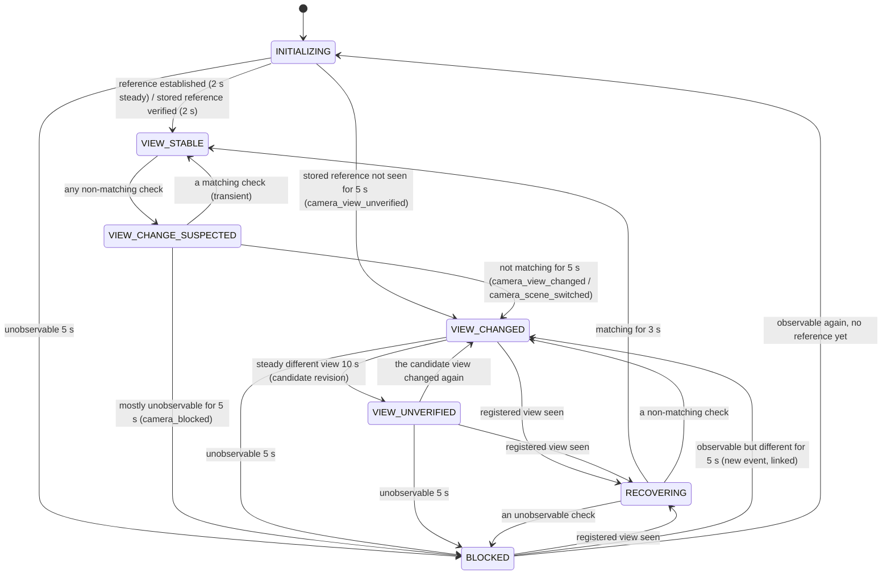

# 21 — Camera view-change detection and incident lifecycle integration

Dates: **5–6 November 2026**. Branch `research/platform-foundations`, uncommitted (the maintainer commits). Model,
detection thresholds and the risk policy are unchanged.

> Number note: the milestone brief named this file `20_CAMERA_VIEW_CHANGE_DETECTION.md`, but `20` was already
> `20_FORKLIFT_PEDESTRIAN_REQUIREMENTS.md` (referenced elsewhere). This document was therefore renumbered 21; the
> forklift document and its links are unchanged.

**What was tested and what was not.** Every camera movement in the tests is *simulated*: a virtual camera panning,
tilting, rotating or zooming over a procedural scene, crop-shifts and splices of real demo footage, or frames replaced
by a covered or defocused image. No physical camera was moved, covered or re-aimed, and no RTSP camera was used. The
thresholds were set on these simulations and on the demo clips, not on deployment footage.

## 1. What it does, in one paragraph

Every camera keeps a registered reference view. About twice a second the runtime compares a small grey copy of the frame
with it. If the camera is covered, defocused, re-aimed, zoomed, rotated or switched to another scene, and the evidence
persists for 5 s, the camera's open incidents end **at the last check that still matched the registered view**, with
the reason `camera_view_changed`, `camera_scene_switched` or `camera_blocked`, never as "resolved". Tracks are reset (new
IDs), and safety analysis stops for that camera: no detection, no incident, no zone alert. It resumes only when the
registered view is seen again for 3 s, or when an operator accepts the new view as a new revision. Zones of an accepted
new view stay unverified (no zone alerts) until an operator says they were checked. Connection health and view health
are reported separately: a camera that streams perfectly with its lens covered shows `STREAMING` / `BLOCKED`, monitoring
**no**. Other cameras are unaffected.

## 2. Architecture



| Part | File | Role |
|---|---|---|
| View monitor | `inference/view_monitor.py` | Pure OpenCV/NumPy. One check per call; the state machine (§5). No threads, no I/O, no new dependency |
| View guard | `runtime/view.py` | Per camera: loads/stores the reference revision, applies transitions (incident interruption, events, snapshots), operator commands, status |
| Worker integration | `runtime/worker.py` | Guard before the pipeline; untrusted frames are checked but not analysed; a failing check fails safe |
| Lifecycle | `inference/incident_lifecycle.py` | `interrupt(..., reason, until, detail)`: ends at the last reliable observation; view reasons are never position-linked |
| Pipeline | `inference/tracker.py` | `interrupt_view()`, `set_zones_active()`; unverified zones give no zone events and make zone-dependent PPE requirements ambiguous |
| Health | `runtime/health.py` | `view` beside the connection `state`; untrusted view → monitoring `no`, zones under review → `partial` |
| Persistence | `database/database.py` | Three additive tables (§8) |
| Operator CLI | `runtime/__main__.py` | `view list | accept | verify-zones | acknowledge`; `status` and `validate` show the view |
| Dashboard | `app/views/insights.py` | Results tab "Runtime cameras": reads `status.json` only |
| Configuration | `runtime/config.py` | `view_monitor:` under `defaults` and per camera, validated; on for file and RTSP sources, off for the synthetic test pattern |

The dashboard's own player (uploads, webcam) does not run view monitoring; it is a runtime feature (§13).

## 3. Algorithms considered

| Technique | Cost at 320 px | Verdict |
|---|---|---|
| Frame-to-frame pixel difference | < 0.1 ms | Rejected as evidence: a forklift, a worker or a light switching on looks the same as a camera move |
| Histogram comparison | < 0.1 ms | Rejected: blind to pan and rotation of a similar scene; triggered by lighting |
| SSIM against a reference | ~1 ms | Rejected as primary: drops with any foreground object and with lighting; no geometry |
| Perceptual hash | < 0.1 ms | Rejected: detects "different", cannot say how much the image moved, so cannot judge zone error |
| Phase correlation (global shift) | ~0.5 ms | Rejected as primary: translation only (no rotation or zoom), pulled by large moving objects |
| Dense optical flow | 5–20 ms | Rejected: frame-to-frame motion, so a slow drift and a moving object are hard to separate; too costly for 8 cameras |
| **ORB features + RANSAC similarity fit against a temporal-median reference** | **~2.5 ms** | **Chosen** for geometry: measures shift, rotation and zoom of the *background*; moving objects fall out as outliers |
| Full homography | ~2.5 ms | Considered; the 4-parameter similarity is steadier with few inliers. Strong perspective change still fails the fit and is caught as "no match" |
| Laplacian variance (sharpness) | 0.2 ms | **Chosen**, divided by contrast (std²) so brightness and gain do not change it |
| Grey-level std / information | < 0.1 ms | **Chosen** for "uniform" (covered lens, black, white) |
| Background consistency | — | **Chosen** in the form of the temporal-median reference and the "steady new view" test |

No model was added. The only new code dependency is OpenCV, already required.

## 4. One check

On a grey copy of the frame resized to 320 px wide (`width`):

1. **Observability.** Grey-level std below `blank_std` (6) → `unobservable` ("uniform image: covered, dark or blank").
   With a reference: ORB features *and* relative sharpness both below `structure_ratio` (25 %) of the reference's →
   `unobservable` ("structure lost: covered, out of focus or obstructed"). Both are contrast-normalised: a dimmer scene
   keeps its structure.
2. **Geometry.** 300 ORB features on a CLAHE-equalised image (equalisation keeps features through lighting changes),
   matched to the reference (ratio test 0.8), similarity transform by RANSAC (3 px). Fewer than `min_inliers` (20) →
   `no_match`. Otherwise the transform is applied to the four corners and the centre; the largest displacement as a
   share of the width is `shift`. Zones are stored in the same normalised coordinates, so `shift` is directly the error
   a zone polygon would have. `shift ≤ max_shift` (2 %) → `match`, else `shifted`.
3. **Continuity** with the previous check (same fit), only when the check is not a match or the view is untrusted: used
   to tell a cut (nothing in common with half a second ago) from movement, and to see a new view settle.

The transform is reported as camera motion: `dx` (+ the camera turned right), `dy` (+ tilted down), `angle_deg`,
`scale` (> 1 zoomed in), plus a plain-language `movement` list (pan, tilt, rotation, zoom).

### Why a worker or a forklift is not a camera move

The reference is the **temporal median** of the first steady seconds, so people and vehicles that were moving are not in
it. Features on a worker or forklift in the current frame have no counterpart in the reference and are rejected by the
ratio test or by RANSAC; the background features, which all move together only when the *camera* moves, decide the
fit. A large object can hide enough background to make one check `no_match`, but it does not persist: one matching
check clears the suspicion. Measured (synthetic, defaults): 4–8 walking workers for 60 s, a forklift a third of the
width crossing every 8 s for 60 s, and an object covering ~75 % of the view for 1.5 s produced no confirmed change
(§12).

## 5. State machine

| State | Trusted (analysed) | Meaning |
|---|---|---|
| `INITIALIZING` | only when bootstrapping (no stored reference) and nothing has gone wrong; never after a blockage at start, never with a stored reference to verify | Establishing a reference, or verifying the stored one |
| `VIEW_STABLE` | yes | Matches the registered reference |
| `VIEW_CHANGE_SUSPECTED` | yes (evidence after `reliable_t` is discarded if confirmed), **except** when the suspicion began at a stream gap (reconnect, loop restart): then not analysed | At least one check did not match |
| `VIEW_CHANGED` | no | Confirmed change or cut; the new view is not steady (or not yet known) |
| `BLOCKED` | no | Confirmed unobservable |
| `VIEW_UNVERIFIED` | no | A steady view that is not the registered one: a candidate revision waits for an operator |
| `RECOVERING` | no | The registered view is seen again; waiting for the recovery window |
| `CHECK_FAILED` (guard only) | no | View checks raised 5 times in a row (§5.3) |



Plus one operator transition from any state to `VIEW_STABLE`: **accept** a candidate revision that the camera is
showing now. The reference never changes any other way. Allowed transitions are a table in code (`ALLOWED`) and every
transition is asserted against it.

### 5.1 Evidence and timestamps

Each transition records: `t` (decision), `suspected_t` (first non-matching check), `reliable_t` (last matching check),
`cause`, the `kind` (event type) when trust is lost, and evidence: number of checks, outcome counts, span, median
inliers, first and last check, and the last fitted transform. **Evidence quality** of a confirmed event: `high` when
≥ 90 % of at least 5 checks disagreed with the reference, `medium` at ≥ 70 %, else `low`.

### 5.2 Classification

- **Blocked:** at least half the checks since the suspicion are unobservable, for `blocked_confirm_s`.
- **Scene switched:** the first bad check was `no_match` *and* had no continuity with the previous check, and no check
  since was a measurable `shifted`. A whip pan faster than one check interval looks the same and is reported as a
  scene switch.
- **View changed:** everything else that persists for `confirm_s`, with the measured movement when a fit exists.
- **Unverified at start:** the stored reference was not seen for `confirm_s` after a (re)start (`camera_view_unverified`).
- **After a stream gap** no continuity is measured, so a different view after a reconnect is a `camera_view_changed`
  ("registered view no longer recognised"), never a scene switch.

### 5.3 Startup, blockage before a reference, reconnection

- **No reference yet, view observable:** the first 2 s of steady view (temporal median) become revision 1. Before a
  reference exists there is nothing to compare with, so absolute floors decide whether a frame may be used: grey-level
  std ≥ `min_reference_std` (12) **and** ≥ `min_features` (40) ORB features. A covered lens with a light leak measured
  std 7.8 (but ~130 features, because contrast equalisation amplifies sensor noise), so both floors are needed. An
  obstructed image can therefore never become the reference; a very dark scene cannot either (§14).
- **Blocked from the first frame:** after `blocked_confirm_s` a `camera_blocked` event is recorded with
  `previous_revision` empty and `last_reliable_t` empty. An incident raised on those startup frames (bootstrap
  analysis) ends at its own opening: exposure is the confirmation time only, flagged `opened_after_last_reliable_view`.
  When the scene becomes visible, that check is the first of the 2 s reference window; nothing is analysed until the
  reference exists; then the event is closed (`observable again; reference established`) and analysis starts with new
  track IDs.
- **Stored reference:** verified for 2 s before any frame is analysed.
- **Reconnect or loop restart:** the next frame is checked immediately. If it matches, nothing changes. If it does not,
  analysis stops at once (a suspicion that began at a gap is untrusted) and resumes only on a match; otherwise the change
  is confirmed after 5 s like any other.

### 5.4 Failure behaviour

A check that raises is logged and counted. After 5 in a row the view is `CHECK_FAILED`: a `camera_view_unverified`
event is recorded, open incidents end at the last reliable observation, analysis stops and monitoring is `no`. The
camera keeps running; when a check succeeds again the event is closed (`view checks working again`) and analysis
resumes only if that check found the view trusted. Nothing is silently assumed valid, and other cameras are unaffected
(each guard belongs to one camera's processing thread). A database error while recording a view event is reported like
any persistence error (health `persist_errors`).

## 6. Thresholds and hysteresis (defaults)

| Setting | Default | Why |
|---|---|---|
| `check_interval_s` | 0.5 | 2 checks/s: a 5 s confirmation rests on ~10 checks; cost ≈ 1 % of a core per camera |
| `width` | 320 | Enough features for the fit; 1.5 ms ORB |
| `init_s` | 2.0 | Reference from ≥ 4 steady checks (median removes movers); also the stored-reference verification time |
| `confirm_s` | 5.0 | Longer than a person or vehicle passing close to the lens (1–3 s); short enough that little false evidence accrues |
| `blocked_confirm_s` | 5.0 | Same reasoning (a hand waved past the lens, a flash) |
| `recover_s` | 3.0 | The registered view must hold before trust returns |
| `unverified_after_s` | 10.0 | A new view must be steady before it is offered as a candidate |
| `max_shift` | 0.02 | 2 % of the width ≈ 38 px at 1080p: the largest zone error accepted as "the same view" |
| `min_inliers` | 20 | Below this a fit is not trusted |
| `blank_std` | 6 | Covered lens/black frame: std 1–3 measured; night footage 40–70 |
| `structure_ratio` | 0.25 | Covered or defocused: features and relative sharpness both collapse |
| `min_reference_std` / `min_features` | 12 / 40 | Floors for a view to become a reference (no reference to compare with yet, §5.3) |
| `focus_ratio` / `jitter_shift` | 0.5 / 0.008 | Warnings only (§7) |

All can be set under `defaults.view_monitor` or per camera, validated with ranges; unknown keys are errors.
`geometry: false` checks blockage only (a camera meant to move); configuration refuses it together with zones.

## 7. Instability is a warning, never a relocation

Over the checks since the view last became trusted: shift spread (std) above `jitter_shift` → "vibration: the view is
shaking"; six or more flips between match and not-match → "unstable view: repeated changes"; six matching checks all
below `focus_ratio` of the reference's sharpness → "focus degraded"; no steady view for 5 × `init_s` while
bootstrapping → "no steady view yet". Warnings appear in status and on the dashboard; they never end incidents or
change the reference. Simulated vibration of ~1.3 % of the width every frame raised the warning and no event.

## 8. Incident lifecycle integration

### 8.1 What happens to an open incident

When a change is confirmed at time `t` (event ID `VE-<camera>-<hex>`), `Pipeline.interrupt_view` calls
`IncidentLifecycle.interrupt(t, reason, until=reliable_t, detail={view_event_id})`. For each open incident:

| Field | Value |
|---|---|
| `opened_t` | unchanged (original start) |
| `last_observed_t` = `ended_t` | `min(last observation, reliable_t)`: observations after the last matching check are not evidence |
| `closed_t` | `t`, the decision time (≈ `reliable_t` + confirm_s) |
| `end_reason` | `camera_view_changed`, `camera_scene_switched`, `camera_blocked` or `camera_view_unverified` |
| `exposure_s` | confirmation time + `ended_t − opened_t`; never extended past `reliable_t` |
| `observed_s`, `unobserved_s` | capped to the shortened span |
| `incident_events` "ended" detail | `view_event_id`, `risk_before` (level before the interruption), `observed_until_t` (when later observations were discarded), `opened_after_last_reliable_view` (if it opened during the suspicion) |
| `incidents` row | `status` CLOSED (the dashboard's meaning), evidence image kept; an operator's REVIEWED/FALSE_ALARM is preserved |
| `risk_assessments` | re-assessed at the capped exposure; the earlier escalation time is kept |
| `incident_context.closed_utc` | the UTC of `ended_t` |

### 8.2 Five different endings

| Ending | Recorded as | Outcome |
|---|---|---|
| Confirmed resolution (compliance held, zone exit) | `resolved` | Known: the condition stopped |
| Camera view interruption | `camera_view_changed` / `camera_scene_switched` / `camera_blocked` / `camera_view_unverified` | **Unknown**: the camera stopped being able to see |
| Camera disconnection or stream restart | `camera_interrupted` (and a `camera_outages` row) | Unknown |
| Loss of observability of the worker | `observation_lost` | Unknown |
| Operator decision | `incidents.status` REVIEWED / FALSE_ALARM (unchanged mechanism) | Human |

### 8.3 After recovery

Tracks were reset at the interruption, so new IDs continue past every ID already issued. View interruptions are
**excluded** from the position-based re-observation link (`UNKNOWN_OUTCOME` keeps its meaning; `VIEW_INTERRUPTION` is
separate): after a view change the same pixels may be another place, so a worker seen after recovery is a new incident
in a new alert group, raised only after fresh confirmation. Interrupted incidents are never reopened.

## 9. Zone geometry and calibration

- Every reference is a **revision** (`camera_view_revisions`) storing its fingerprint, how it was established, and the
  zone status for that view: `assumed` (revision 1 at first start: zones drawn for this view as before this feature,
  not operator-verified), `verified` (an operator said so, recorded with name and time) or `requires_review`.
- Zones are used only when the view is trusted **and** the revision's zones are `assumed` or `verified`. Otherwise the
  pipeline runs with zones inactive: no zone events, no zone intrusion, nothing drawn, and every PPE requirement that
  depends on zone membership becomes *ambiguous* (a review item, never a confirmed violation). Camera-wide PPE
  requirements are unaffected.
- A confirmed view change suspends zones with everything else. If the registered view returns, its zones are valid
  again (same revision). A new view accepted **without** `--zones-reviewed` becomes `requires_review`; `verify-zones`
  restores zone monitoring.
- Editing a camera's zones in the configuration after they were checked against a revision makes them
  `requires_review` at the next start (zone hash comparison).
- Zone definitions are never deleted, transformed or rewritten; old revisions stay (`superseded`, `expired`).

**Automatic compensation was investigated and not applied.** The fit already gives the similarity transform (with
inliers) and it is stored with the event, so a small shift could in principle be compensated by transforming the
polygons. It is not done because: a similarity fitted on image features does not model perspective, so a polygon on
the floor moves differently from features on walls; the transform is measured on background features, not on the floor
plane the zones live on; and a wrong compensation is silent. Within `max_shift` (2 %) the view counts as unchanged;
beyond it an operator decides. The stored transform is there to help that decision.

## 10. Reference views and the operator workflow

| Situation | Behaviour |
|---|---|
| First start, no stored reference | The first 2 s of steady, observable view (temporal median, above the §5.3 floors) becomes revision 1 (`auto`); analysis runs meanwhile, as before this feature |
| First start, lens covered | `camera_blocked` event without a revision; nothing analysed until a reference is established from the visible scene (§5.3) |
| Later start | The stored reference is verified for 2 s **before** any frame is analysed |
| Reconnection or looping file restart | Forces a check against the reference: a match changes nothing; a mismatch stops analysis at once (§5.3) |
| Camera never settles (moving vehicle, PTZ patrol) | No reference; a warning; use `geometry: false` (no zones allowed) |
| Camera moved intentionally | It becomes `VIEW_CHANGED`, then `VIEW_UNVERIFIED` with a candidate revision and snapshots; the operator reviews and accepts |

```
python -m runtime view list --config <file>                          # revisions, events (with snapshot paths), commands
python -m runtime view acknowledge --config <file> --camera dock-01 --event VE-dock-01-1A2B3C4D --by "J. Shah"
python -m runtime view accept --config <file> --camera dock-01 --revision 2 --by "J. Shah"            # zones stay unverified
# edit the zones in the configuration if needed, restart, then:
python -m runtime view verify-zones --config <file> --camera dock-01 --by "J. Shah"
```

Commands are rows in `camera_view_commands`; the running worker applies them within about a second (or at the next
start) and records the result. `accept` is rejected unless the camera is showing that revision now.

## 11. Operational events and storage

`camera_view_events` (one row per confirmed event): `event_id`, `camera_id`, `site_id`, `session_id`, `event_type`,
`cause`, `state`, `previous_revision`, `candidate_revision`, `accepted_revision`, `first_suspected_t/utc`,
`last_reliable_t/utc`, `confirmed_t/utc`, `recovered_t/utc`, `outcome` (`original_view_restored`,
`new_view_accepted by …`, `observable again; reference established`, `view checks working again`, `superseded by …`,
`open when monitoring stopped`), `evidence_quality`, `evidence` (JSON),
`affected_incidents` (JSON), `snapshots` (JSON paths), `linked_event`, `acknowledged`, `acknowledged_by/utc`.

**Database migration:** additive only. Three `CREATE TABLE IF NOT EXISTS` (`camera_view_revisions`,
`camera_view_events`, `camera_view_commands`); no existing table or row is altered. An existing database gains the
empty tables the first time a new version opens it. The original dashboard database was not opened by this work.

**Snapshots:** per event at most four grey PNGs at analysis width (320 px, ~30–60 kB each): `reference`,
`last_reliable`, `confirmed`, `candidate`, in `<evidence_dir>/view/<camera>/`. At this size people are a few pixels
tall. They follow the evidence directory's retention; `snapshots: false` disables them. Reference fingerprints are
the same small grey images.

## 12. Tests

`tests/test_view_monitor.py` (39 tests; deterministic, no model or footage; the dashboard test needs Streamlit) and
`tests/test_view_monitor_footage.py` (6 tests on the demo clips, `integration`). Movements are simulated (see the note
at the top). The 45 passed three times in a row on 6 November (no flaky test).

**Final verification (6 November 2026, after the last change):**

| Check | Result |
|---|---|
| Full suite (`python -m pytest`), weights, clips and data present | **211 passed**, 0 skipped, 0 failed (the 166 that existed before this milestone plus 45 new) |
| CI simulation (PyTorch, Ultralytics, Streamlit absent; whole `tests/`) | 193 passed, 5 skipped (two real-model integration modules, three Streamlit app tests) |
| Real-model runtime integration (`tests/test_runtime_integration.py`) | 4 passed within the full suite: runtime incidents still equal the original pipeline's on three demo clips with view monitoring on |
| `ruff check .`; `compileall` as in CI | Pass; pass |
| Concurrent first opens of a new database (8 threads × 60) | 0 errors; multi-camera startup tests 0 failures in 8 repeats |
| `models/best.pt` SHA-256 | `E9B2583D…CC3C7534`, unchanged (matches `models/model_config.yaml`) |
| Original `logs/incidents/incidents.db` | Not written: main file 2 November, write-ahead log 5 November 09:54 (before this milestone); none of the new tables present (checked read-only, `immutable=1`) |

| Scenario | Test | Result |
|---|---|---|
| A stable scene, workers moving | `test_a_…` 60 s | No event |
| B pan 15 % | `test_bcde_…[b_pan]` | `camera_view_changed`, movement pan, `dx` 0.15, reliable_t = last check before the move, quality high |
| C tilt 12 % | `[c_tilt]` | Detected, tilt |
| D rotation 6° | `[d_rotation]` | Detected, rotation |
| E zoom 1.3× | `[e_zoom]` | Detected, zoom |
| F cut | `test_f_…`, footage cut to another clip and to a moving-camera clip | `camera_scene_switched` |
| G covered / object against the lens | `test_g_…` (2 cases), footage covered | `camera_blocked` |
| H brief occlusion (75 % of the view, 1.5 s) | `test_h_…` | Suspected, cleared, no event |
| I lighting to 35 % with gamma; lights off 10 s | `test_i_…` | No event; lights off is `camera_blocked` (never relocation) and recovers by itself |
| J 8 workers | `test_j_…` 60 s | No event |
| K forklift (⅓ width) every 8 s | `test_k_…` 60 s | No event |
| L original view returns | `test_l_…` | Recovering, stable after 3 s, no operator |
| M active incident when the camera moves | `test_m_…` (2) | Ended at 10.0 s (last reliable), decided at 15.5 s, `camera_view_changed`, evidence and start kept, not resolved; after recovery a new incident with new track IDs |
| N zones after a change | `test_n_…` | Suspended; accepted view without review → `requires_review`, no zone alert though the person stands in the old zone pixels; `verify-zones` restores them |
| O multi-camera isolation | `test_o_…` (runtime, 3 cameras) | Steady camera untouched; moved and blocked cameras each end their own incident |
| Blocked before any reference, then visible | `test_blocked_at_start_…` | Event stored without a revision; no reference from the covered image; event closed and revision 1 made from the scene at 10.0 s; nothing analysed in between |
| Incident raised on obstructed startup frames | `test_incident_raised_on_an_obstructed_start_…` | Ends at its own opening (exposure 0.5 s); the next incident is new, with new track IDs |
| Restart after a startup blockage | `test_reconnect_after_a_blockage_at_start_…` | The reference made after the blockage is verified; no new revision |
| Reconnect to a different view / the same view | `test_reconnecting_to_a_different_view_…` | Different: not one frame analysed, incident ended at the last reliable check; same: trusted at once |
| Covered, then uncovered pointing elsewhere | `test_uncovered_on_a_different_view_…` | A second, linked event, confirmed 5 s after it became visible (no carried-over evidence) |
| Camera that never settles | `test_a_camera_that_never_settles_…` | Zones not used ("no steady view") |
| Check failures | `test_view_checks_that_keep_failing_fail_safe` | `camera_view_unverified` event with the incident it ended; analysis off; closed when checks work again |
| Vibration, small shift, loop restart, stored reference, blockage-only mode, transition table, cost, accept rejected, CLI, dashboard, demo configurations, configuration | 14 more | As described above |
| Real footage, steady clip played twice | footage | No event across the loop restart |
| Real footage, simulated 12 % pan | footage | Detected, `dx` 0.12 |
| Real moving-camera clip | footage | No reference established; warning |

The existing suites pass unchanged, including the real-model runtime tests that require runtime incidents to equal the
original single-camera pipeline on three demo clips (view monitoring on by default for those file sources).

### 12.1 What the demo clips showed

| Clip | Camera | Measured shift against its own reference (share of width) |
|---|---|---|
| `framing_bare_head` | tripod-steady | median 0.0003, max 0.0009 |
| `mixkit/mixkit-1459` | the same footage, another encoding | median 0.0004, max 0.0006 |
| `helmet_put_on` | hand-held | median 0.009, p95 0.025; looping it, a view change is confirmed even at 6 % tolerance |
| `track_work_day` | hand-held, slow drift | median 0.023; by its end the view no longer matches its start (`no_match`) |
| `roadworks_night` | hand-held | median 0.010, p95 0.052 (vibration warning) |
| `ballast_train` | moving | never steady: no reference |

The measurement is precise on a steady camera; the "static" stock clips are not fixed cameras.

### 12.2 Demo configurations (decision)

The detector was **not** relaxed to make hand-held footage look stable. Instead:

| Configuration | Cameras | View monitoring | Zones | Reported monitoring |
|---|---|---|---|---|
| `config/runtime.demo.yaml` (fixed-camera demo) | `framing_bare_head` and its second encoding | Full, default thresholds (nothing relaxed) | None (no dashboard zones exist for this scene) | `yes` while the view is stable |
| `config/runtime.demo_handheld.yaml` | The four hand-held/moving clips | Blockage only (`geometry: false`) | None: refused by validation on a blockage-only camera, so the dashboard's "Live rail" and roadworks zones are not used | Always `partial`: "camera position not validated" |

The hand-held configuration writes to `logs/runtime_handheld/`, so its sessions never mix with the fixed-camera
reference views. An earlier draft of this milestone relaxed `max_shift` to 0.06 for the demo; that was withdrawn because
it weakened the guard and still did not hold for `track_work_day` and `helmet_put_on`.

```powershell
python -m runtime run --config config/runtime.demo.yaml
python -m runtime run --config config/runtime.demo_handheld.yaml
python -m runtime status --config config/runtime.demo.yaml
```

## 13. Performance

Measured 6 November 2026 with `scripts/benchmark/view_monitor_benchmark.py` (raw results:
`reports/runtime/view_monitor_benchmark.json`). Workstation: NVIDIA RTX 2000 Ada, Intel CPU with 36 logical cores,
Python 3.11.18, OpenCV 5.0.0, the M5 model on the batched backend. Video files on one machine stand in for cameras.

**Method.** Every camera replays `framing_bare_head` (the only fixed-view demo scene) so that no view change can occur
and both arms do the same work. Each configuration is run with view monitoring off, then on, back to back in fresh
processes with identical inputs, model, frame selection and camera settings (8 s warm-up, 20 s window), and the whole
matrix is repeated twice. A run counts only if, at every one-second sample, every camera with monitoring on was
`VIEW_STABLE` and no frame was withheld from inference; otherwise it is repeated. **All 24 runs were clean at the
first attempt** (0 suspended frames; inferred frames per second equal processed frames per second in every run), so
both arms performed the same inference work.

**Per-check cost** (one thread, no runtime, real frame): 4.0 ms at 640 × 360, 5.2 ms at 1280 × 720, 6.0 ms at
1920 × 1080, 11.7 ms at 3840 × 2160 (p50). Inside the runtime, with inference threads competing, the p50 was 5–16 ms.

**Paired results** (inferred frames per second summed over cameras; "live" = paced at the clip's 24 FPS, analysis capped
at 15 FPS per camera; "throughput" = every frame, as fast as possible):

| Mode | Cameras | Rep | Inferred FPS off → on | Δ | CPU % off → on | RSS MB off → on | e2e p50 ms off → on | Dropped off / on | View check p50 / p95 ms | GPU SM clock MHz, mean (min–max) off / on |
|---|---|---|---|---|---|---|---|---|---|---|
| live | 1 | 1 | 15.0 → 15.0 | +0.0 % | 58.9 → 55.5 | 1400 → 1508 | 31.4 → 32.0 | 0 / 0 | 8.5 / 17.1 | 1087 (240–2130) / 917 (210–2130) |
| live | 1 | 2 | 15.0 → 15.0 | +0.0 % | 61.0 → 60.8 | 1400 → 1494 | 33.8 → 34.5 | 0 / 0 | 8.7 / 14.9 | 211 (210–225) / 219 (210–330) |
| live | 4 | 1 | 49.7 → 50.3 | +1.2 % | 170.1 → 144.2 | 1715 → 1817 | 127.0 → 134.3 | 199 / 193 | 10.2 / 19.0 | 462 (390–600) / 757 (390–2130) |
| live | 4 | 2 | 51.1 → 47.1 | −7.8 % | 161.8 → 168.8 | 1720 → 1823 | 128.4 → 143.5 | 175 / 256 | 10.4 / 20.7 | 481 (390–570) / 511 (360–870) |
| live | 8 | 1 | 72.6 → 71.7 | −1.2 % | 213.8 → 235.6 | 2144 → 2228 | 192.8 → 201.6 | 958 / 993 | 12.3 / 33.3 | 699 (480–855) / 791 (600–1080) |
| live | 8 | 2 | 66.8 → 71.8 | +7.5 % | 223.6 → 245.7 | 2130 → 2228 | 198.3 → 196.4 | 1061 / 964 | 11.9 / 25.8 | 786 (420–1335) / 733 (570–930) |
| throughput | 1 | 1 | 50.4 → 49.5 | −1.8 % | 117.2 → 117.0 | 1411 → 1530 | 114.2 → 116.5 | 0 / 0 | 5.7 / 9.4 | 690 (480–1125) / 677 (495–1035) |
| throughput | 1 | 2 | 49.9 → 50.4 | +1.0 % | 112.2 → 120.9 | 1425 → 1509 | 115.1 → 115.8 | 0 / 0 | 5.3 / 9.5 | 665 (495–1080) / 1256 (630–2130) |
| throughput | 4 | 1 | 72.3 → 71.7 | −0.8 % | 144.0 → 146.4 | 1758 → 1854 | 278.1 → 280.8 | 0 / 0 | 9.2 / 19.4 | 1492 (900–2130) / 1035 (525–2130) |
| throughput | 4 | 2 | 59.0 → 54.7 | −7.3 % | 152.4 → 159.8 | 1774 → 1852 | 303.0 → 338.2 | 0 / 0 | 11.2 / 20.8 | 588 (330–885) / 742 (360–2130) |
| throughput | 8 | 1 | 79.8 → 78.3 | −1.9 % | 186.0 → 189.9 | 2197 → 2299 | 529.9 → 539.7 | 0 / 0 | 15.5 / 39.7 | 701 (525–810) / 725 (555–945) |
| throughput | 8 | 2 | 80.3 → 78.9 | −1.7 % | 180.1 → 192.3 | 2196 → 2299 | 523.7 → 523.8 | 0 / 0 | 15.5 / 161.9 | 911 (630–1260) / 747 (480–930) |

Means of the two repeats:

| Mode | Cameras | Inferred FPS off → on | Δ | Noise: the "off" arm's own repeat-to-repeat spread |
|---|---|---|---|---|
| live | 1 | 15.0 → 15.0 | 0.0 % | 0.0 % |
| live | 4 | 50.4 → 48.7 | −3.4 % (+1.2, −7.8) | 2.8 % |
| live | 8 | 69.7 → 71.8 | +2.9 % (−1.2, +7.5) | 8.7 % |
| throughput | 1 | 50.1 → 50.0 | −0.4 % (−1.8, +1.0) | 1.0 % |
| throughput | 4 | 65.7 → 63.2 | −3.7 % (−0.8, −7.3) | 22.5 % |
| throughput | 8 | 80.0 → 78.6 | −1.8 % (−1.9, −1.7) | 0.6 % |

**Reading.**

- **GPU clock variation dominates.** The GPU's power management moved the SM clock between 210 and 2130 MHz within and
  between runs (clock settings were not changed, as required). At 4 cameras the same "off" configuration differed by
  up to 22.5 % between repeats, more than any on/off difference, so the 4-camera and live-mode differences are within
  noise and are not evidence of overhead either way.
- **The one consistent signal:** at 8 cameras in throughput mode (GPU-saturated) both repeats lost 1.7–1.9 % of
  aggregate throughput, against 0.6 % repeat noise. Treat **~2 % of saturated throughput at 8 cameras** as the measured
  cost. At 1 camera there is no measurable throughput cost (15.0 → 15.0 live; −0.4 % throughput, within 1 % noise).
- **CPU:** process CPU changed between −26 and +22 percentage points per pair; for 8 cameras the mean change was +8
  points (throughput) and +22 points (live), at most about a quarter of one of the 36 logical cores, consistent with
  ~2 checks per second per camera at 5–16 ms each. At 1 and 4 cameras the changes were within noise.
- **Memory:** +78 to +119 MB RSS with monitoring on, independent of the number of cameras (1 camera +84 to +119 MB,
  8 cameras +84 to +103 MB): a fixed process cost, most likely OpenCV's feature-detection and threading buffers, not
  per-camera state (per camera the monitor keeps two 320 × 180 images, descriptors and 40 check summaries, well under
  1 MB). This was not profiled further.
- **Latency:** end-to-end p50 changed by −2 to +35 ms per pair, within the same noise; the check is in the frame's path
  only twice a second.
- **Live mode at 4 and 8 cameras did not reach the 15 FPS target in either arm** (GPU-bound at the low clocks seen),
  and dropped similar numbers of frames in both arms.

An earlier, invalid run of this benchmark (5 November, hand-held clips) is kept only as a diagnostic: in it monitoring
suspended inference on cameras whose view genuinely changed, so the arms did different work. Its single clean pair
(8 cameras, throughput: 68.3 → 64.4 FPS) is not a final result and is superseded by the table above.

Design choices: the check runs in the camera's own processing thread, every 0.5 s of video time, on a 320 px grey copy.
At 5–16 ms per check (measured above) and 2 checks per second it costs about 1–3 % of one core per camera, so a
separate thread (and its synchronisation and an extra queue) was not justified; the capture thread is never involved and queues stay bounded.
While a view is untrusted, frames are checked but **not sent to inference**, which lowers model load. Memory per camera:
the reference and the previous check's fingerprint (two 320 × 180 images and 300 descriptors each) plus up to 40 check
summaries: well under 1 MB.

## 14. Known limitations

1. **No physical validation.** All movement, blockage and lighting cases are simulated; RTSP cameras, real PTZ drift,
   IR switching at dusk, rain on the lens, condensation, and real vibration have not been tested.
2. **Thresholds are not tuned on deployment footage.** `max_shift` 2 % assumes a fixed mount; wind-loaded poles may need
   more, which also widens the tolerated zone error.
3. **Featureless or repetitive scenes** (blank walls, uniform racking) give few distinct features: a fit may fail
   (reported as a change) or lock onto a repeated pattern. Not tested.
4. **Large parked objects:** a vehicle parked in front of the camera for longer than `confirm_s` and covering most of the
   background is reported as a view change or blockage. That is the safe answer (the zones are not visible) but it
   interrupts incidents; recovery is automatic when it leaves.
5. **Slow scene change** (stock moved, construction progress, seasons) gradually reduces matches; the reference never
   updates itself, so this eventually needs an operator to accept a new revision.
6. **Total darkness** is reported as `camera_blocked` (not observable), which is correct for safety but is not
   distinguished from a covered lens in the event type; the cause text says "uniform image".
7. **Whip pans** faster than one check interval are reported as scene switches.
8. **Bootstrap trust:** with no stored reference, the first steady view is assumed to be the one the zones were drawn
   on (`assumed`), exactly as before this feature. An operator should run `verify-zones` once.
9. **Zone compensation** is not applied (§9).
10. **The dashboard's own player** (uploaded videos, webcam) does not run view monitoring; the dashboard only displays
    the runtime's status.
11. **Accept needs the runtime running** (or a restart) to take effect; commands are applied by the camera worker.
12. **Very dark or very low-contrast scenes** (std < 12) cannot become a reference: such a camera stays `BLOCKED` at
    first start until there is more light or an operator lowers `min_reference_std` for it.
13. **Recovery after check failures** needs only one successful check that finds the view trusted, not the 3 s recovery
    window (the failure was of the checker, not evidence of a change).
14. **Single fixed-view demo scene:** only one demo scene comes from a fixed camera, so the benchmark and the
    fixed-camera demo replay it on every camera.

## 15. Other change made on the way

`IncidentDB` now retries `PRAGMA journal_mode=WAL` briefly. Switching a new database to WAL ignores SQLite's busy
timeout, so when several cameras open a fresh database at the same moment one of them could fail with "database is
locked" and stop (seen once in `tests/test_runtime.py`; reproduced 14 times in 480 concurrent opens; 0 in 960 after the
fix). The bug predates this milestone; the three extra tables made it slightly more likely.
