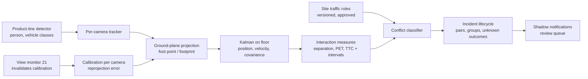

# 24 — Forklift–pedestrian risk intelligence: research and technical specification

Milestone M3, 6 November 2026. **Research only: no detector, calibration code, rule or model for this capability was
written, trained or downloaded.** This document extends the requirements in
[`20_FORKLIFT_PEDESTRIAN_REQUIREMENTS.md`](20_FORKLIFT_PEDESTRIAN_REQUIREMENTS.md) into a technical specification
that could be built once its gate opens (§11). SafeSight remains advisory: it does not control vehicles, does not
replace engineered controls, and is never presented as a collision-avoidance system.

Sources: the register in `14` (papers P20, P21, P33, P36, P43–P45; datasets D11, D19; vendor C08) plus the searches
listed in §12, done on 6 November 2026.

## 1. The question

Detecting a forklift and a person in the same frame is easy and useless: in a working warehouse it is true most of
the day. The goal is to identify **interactions that were genuinely dangerous**, with a method a safety officer can
audit and a measurement that says how often it is right. That needs four things the current system does not have:
metric positions on the floor, motion estimates with uncertainty, a site-defined notion of "dangerous", and labelled
interactions to measure against.

## 2. What existing models can and cannot detect

| Need | State of the art (evidence) | SafeSight today |
|---|---|---|
| Person detection in warehouses | Mature; the M5 model detects people, but far-field and occluded people are its weakest case (`18` §4) | Yes (research-licensed model) |
| Forklift / pallet-truck / tugger detection | Public detectors and datasets exist, but warehouse vehicle classes are thin: an evaluation of LOCO found pallets and small load carriers detected far better than pallet trucks and forklifts, and concluded more vehicle annotations are needed [R1]. Several community forklift datasets are listed under CC BY 4.0 on aggregator sites; each licence must be checked before use [R2] | **No vehicle class.** M5 is research-only (SH17, CC BY-NC-SA) and cannot be extended for a product (`10` §6) |
| Vehicle footprint and heading | Box detectors give image boxes, not footprints; heading needs either oriented boxes, keypoints or motion over time | No |
| Driver vs pedestrian | A person *on* the forklift must not be a pedestrian. The one directly relevant fixed-camera paper adds a "driver filter" for exactly this reason [P36] | No |
| Forks raised / load carried, reversing | Not reliably visible from a ceiling camera at distance; reversing is inferable from motion relative to heading only if heading is known | No |
| Near-miss detection from fixed CCTV | One 2026 conference paper (YOLOv8 + geometric distance + driver filter) reports perfect results on a single held-out sequence [P36]; vendors sell proximity alerts without independent validation [C08]. On-vehicle systems (time-of-flight camera, UWB tags, radar) measure distance directly and compute time to collision on the truck [R3] | No |

**Conclusion:** a product-line detector with vehicle classes (person, forklift, reach truck, pallet truck, tugger, plus
a "person on vehicle" relation) is a prerequisite, and it must be trained on commercially usable data (gate G5 in `20`).

## 3. Is trajectory estimation required?

Yes, but **short-horizon kinematic tracking, not learned trajectory prediction**:

- Separation alone cannot distinguish a pedestrian walking beside a parked forklift from one stepping into the path of
  a moving one. Closing speed and heading are what separate them.
- Velocity comes from tracked footprints on the ground plane (a constant-velocity or constant-turn Kalman filter),
  with its covariance kept, so every derived quantity carries an uncertainty.
- Learned predictors (Social LSTM, Trajectron++ [P43, P20]; layout-aware construction work [P33]) are justified only if
  they beat constant velocity on site data at the 1–3 s horizons that matter. Over such short horizons they often do
  not, and they are harder to audit. They stay a P3 research item (`12`).

## 4. Can time to collision be estimated reliably?

| Quantity | Definition | Reliability from a fixed monocular camera |
|---|---|---|
| Separation *d* | Distance between pedestrian foot point and the vehicle footprint polygon on the floor | Good inside a calibrated area if feet are visible; degrades with distance from the camera and when feet are occluded (racking, loads) |
| Closing speed *v* | Rate of decrease of *d*, from filtered velocities | Noisy: differentiating noisy positions amplifies error. Pedestrian speed errors of 0.7–1.7 m/s (MAE/RMSE) are reported for camera-based estimation in road settings [R4], which is comparable to walking speed itself |
| Time to collision TTC = *d* / *v* (when *v* > 0) | The classical surrogate safety measure [P45] | **Unstable when *v* is small** (division by a noisy small number) and meaningless when paths do not actually intersect. Must be computed on predicted paths with uncertainty, reported as an interval, and suppressed when the interval is too wide |
| Post-encroachment time (PET) | Time between one party leaving a conflict area and the other entering it [P45, R5] | **More robust**: needs only *when* each party occupies a fixed floor area (e.g. a marked crossing), not speeds. Ideal for designated crossings and aisle ends |
| Minimum separation during an interaction | Smallest *d* while the vehicle is moving | Robust, simple, auditable; misses "near" situations where separation stayed moderate but closing speed was high |

**Specification:** report all three (minimum separation while moving, PET at configured conflict areas, TTC with an
interval), alert only on rules the site sets, and never alert on TTC when its 90 % interval spans more than a
configured width. TTC thresholds quoted informally (for example "below 1.5 s is critical") have no verified source for
indoor industrial traffic and are **not** used as defaults.

Learned monocular TTC exists [P21] but was trained on egocentric driving video; for fixed cameras, geometric TTC on a
calibrated floor is simpler, auditable and testable.

## 5. Camera geometry: must it be calibrated?

**Yes, per camera, and it must be monitored.**

- Metric separation and speed need a floor homography: four or more surveyed floor points per camera, with the
  reprojection error reported and a target of ≤ 0.3 m inside the calibrated area (`12` M2, `20` G4). Positions outside
  the calibrated area are reported as unknown, not extrapolated.
- **The homography assumes the point is on the floor.** Using a person's box centre or head projects to the wrong place;
  only the foot point (bottom-centre of the box, visible feet) is valid, and when feet are occluded the position must
  be flagged as estimated [R5].
- Vehicles are not points: the footprint must be estimated (box bottom edge plus a per-class footprint model, or
  oriented detection). The forks extend beyond the body.
- Calibration is invalidated by any camera movement. The view-change monitor (`21`) already ends incidents and
  disables zones when the view moves; for conflicts it must also mark calibration `unverified` until an operator
  re-verifies it. This dependency is why view monitoring was built first.
- Multi-camera fusion (several cameras on one floor plan) is not required for the first version; each camera is scored
  on its own calibrated area.

## 6. Forklift state and sensor integration

| Signal | From video alone? | From the vehicle (telematics) |
|---|---|---|
| Moving / stationary | Yes, from tracking, with lag and noise | Yes, exactly |
| Speed | Approximately (calibrated, noisy) | Yes |
| Direction of travel, reversing | Partly (needs heading) | Yes |
| Load carried / forks raised | Unreliable at distance | Some fleets |
| Operator identity | **Must not** be inferred from video | Fleet systems hold it; SafeSight should not need it |
| Proximity to tagged pedestrians | No | UWB / RFID systems [C08] |

**Specification:** version 1 is video-only and treats speed and motion as estimates with uncertainty. A telematics
adapter (generic MQTT, `12` item 6) is an **optional** improvement that replaces estimated vehicle motion with measured
motion where the site has it; it must not be required, because most target sites (`12` §3) do not have connected
fleets. Pedestrian tags are out of scope: they are a different product category.

## 7. Normal proximity vs genuinely dangerous interaction

The model must not decide what is dangerous; **the site's traffic rules do**, configured by the site safety lead (gate
G6 in `20`), versioned and approved like the PPE policy (`intelligence/ppe_policy.py` is the pattern).

| Situation | Example | Classification |
|---|---|---|
| Expected proximity | Picker beside a stationary or slowly approaching order-picker truck in a designated pick aisle | Not an event (rule: pick aisle, vehicle speed below a site limit) |
| Rule breach without conflict | Pedestrian walks in a vehicle-only aisle with no vehicle nearby | `VEH.PED_ZONE.ENTRY` (zone rule; already built, never evaluated) |
| Close approach | Moving vehicle within the site's separation distance of a pedestrian outside a designated interaction area | Candidate conflict |
| Conflict at a crossing | PET at a marked crossing below the site threshold | Conflict (analytic; alert only if the site asks) |
| Imminent conflict | Predicted paths intersect, TTC interval entirely below the site threshold, vehicle moving | Alert candidate (shadow mode first) |
| Driver, passenger, or person loading the vehicle | Person on or attached to the vehicle | Excluded (driver filter) |

Every candidate carries its measured values (minimum separation, closing speed, PET or TTC with intervals) so a
reviewer can see *why*, and the rule version that classified it.

## 8. How near misses are labelled

Labels follow `17` with an extension for pairs, designed before any labelling:

1. **Interaction episode:** a pedestrian and a vehicle both in the calibrated area, with the vehicle moving and the
   separation below a generous screening distance. Start and end times, identity anchors for **both** parties, vehicle
   type, area type (aisle, crossing, dock, open floor).
2. **Measured quantities**, computed from labelled positions on sampled frames through the calibration (not from the
   model): minimum separation, time of minimum separation, PET where a conflict area is defined. Reviewers mark foot
   points; the tool computes metres.
3. **Expert judgement, separately:** two reviewers with warehouse safety experience answer "would a safety officer
   record this as a near miss under the site's rules?" (yes / no / cannot tell), blind to the model and to each other.
4. **Observability:** `clear`, `partial` (one party partly occluded), `low`; intervals where either party is
   unobservable are `unobservable`, never "safe".
5. **Not labelled:** intent, attention, blame, operator identity.

Agreement is measured on both the measured quantities (in metres and seconds) and the judgement (positive specific
agreement, with κ only on sampled time units, as in `intelligence/agreement.py`). The measured quantities define the
primary episodes; the judgement is reported beside them so that the rule can be compared with expert opinion.

## 9. Evaluation of false alarms and missed dangerous interactions

- **Unit:** an interaction episode (pedestrian–vehicle pair). Matching is identity-aware for both parties: the
  M2.1/M3 matcher (`intelligence/event_metrics.py`) extended so a match needs the right pedestrian **and** the right
  vehicle. Camera and session scope apply as now.
- **Primary measures:** recall of dangerous interactions (by rule and by expert judgement, reported separately), false
  alarms per monitorable camera-hour, duplicate rate and notifications per hour (operator burden), latency from onset
  with "late" = after the minimum-separation time (an advisory alert after the moment has passed is late, not found).
- **Measurement accuracy:** median and 90th-percentile error of minimum separation (m), PET and TTC (s) against the
  labelled values, by distance band from the camera.
- **Censoring:** an interaction whose observation was interrupted (occlusion, view change) is reported as censored,
  never as resolved (the same rule M3 applies to PPE incidents).
- **Statistics:** cluster-aware intervals by site; minimums from `22` §2.4 (≥ 60 dangerous interactions per main
  stratum, several hundred monitorable hours, ≥ 10 sites).
- **Shadow mode first:** alerts recorded, not delivered, with weekly safety-officer review, before any live use.

## 10. Proposed architecture (for when the gate opens)

The lifecycle, grouping, audit, view interruption and evaluation layers already exist and would be reused; the new
parts are the detector, calibration, floor tracking, measures and traffic-rule policy.

## 11. Gate, and the answer to "have we earned it?"

| Gate condition (`20` §1) | State on 6 November 2026 |
|---|---|
| G1 Helmet and zone functions re-scored against independently verified labels | **Blocked**: human review packages ready (`reports/validation/human_review/reviewer_1`, `reviewer_2`), no reviewer engaged |
| G2 Deployment-like evaluation set from fixed cameras at several sites | **Not started**: plan in `22`, no site |
| G3 View-integrity detection | **Built, simulated only** (`21`); physical acceptance plan in `23A`, not run |
| G4 Ground-plane calibration | Not started (specified in §5) |
| G5 Licensing decision for a commercial detector line | Open |
| G6 Site traffic rules from a site safety lead | Needs a partner site |

**We have not earned the right to *implement* forklift–pedestrian intelligence.** The research and specification
are done and can continue (calibration design, synthetic-trajectory unit tests for the measures, label tooling for
pairs), because none of that depends on the gate. Building the detector or alerting logic before G1, G2 and G5 would
add an unvalidated feature on an unvalidated base, which is what this milestone exists to prevent.

Recommended order once a partner site exists: (1) site traffic rules and calibration survey during the Gate B pilot
(`23`); (2) record interaction footage passively in shadow mode; (3) licensing decision and product-line detector;
(4) measures and rules; (5) evaluate on held-out sites.

## 12. Sources consulted for this document

- [R1] Critical Evaluation of LOCO dataset with Machine Learning, arXiv 2209.13499 — https://arxiv.org/pdf/2209.13499
- [R2] Community forklift datasets listed under CC BY 4.0 (e.g. Roboflow Universe "forklift-1", "Forklift Project");
  licences not verified — https://universe.roboflow.com/phantom/forklift-1
- [R3] On-vehicle warning system combining vision and a time-of-flight camera with per-class TTC thresholds (Springer,
  2018) — https://link.springer.com/10.1007/978-3-319-91397-1_50
- [R4] Deep-learning road-safety analysis reporting pedestrian speed MAE 0.71 m/s, RMSE 1.7 m/s, with TTC and PET
  (via search summary; to be read in full before citing numbers) — https://arxiv.org/html/2503.09807v1
- [R5] Multi-camera homography and PET at an intersection; notes the ground-level assumption of homography projection,
  arXiv 2511.12018 — https://arxiv.org/pdf/2511.12018
- [P36] Kaina, Azmani, Amami, ICAIIS 2026 — https://www.avestia.com/EECSS2026_Proceedings/files/paper/ICAIIS/ICAIIS_122.pdf
- OSHA 29 CFR 1910.178: no fixed pedestrian distance or speed; (n)(4) slow down and sound the horn at cross aisles and
  obstructed locations; (n)(8) speed that permits a safe stop; ANSI/ITSDF B56.1 §4.3.2 stopping-distance formula is the
  referenced consensus method (via OSHRC and secondary summaries) — https://www.oshrc.gov/wp-content/uploads/80-0607.html,
  https://jjkellercompliancenetwork.com/regsense/what-is-a-recommended-speed-for-forklifts-and-other-powered-industrial-trucks-operating-within-a-manufacturing-or-warehousing-facility

The regulatory point matters for §7: because there is no universal numeric threshold, separation and time thresholds
must come from the site's own traffic rules and risk assessment, not from SafeSight.
