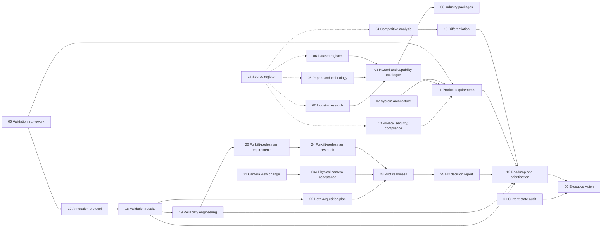

# Product research: SafeSight as an industrial safety intelligence platform

Research and strategy carried out on 5 November 2026 on branch `research/platform-foundations`. Start with **[00_EXECUTIVE_VISION.md](00_EXECUTIVE_VISION.md)**; it answers the central question in two pages and links to the evidence.

## How the documents fit together

| # | Document | Read it when you need to know… |
|---|---|---|
| 00 | [Executive vision](00_EXECUTIVE_VISION.md) | The answer, the decisions and the next 90 days |
| 01 | [Current-state audit](01_CURRENT_STATE_AUDIT.md) | What works, what is demo-grade, what blocks scale, the recorded baseline |
| 02 | [Industry research](02_INDUSTRY_RESEARCH.md) | How eight industries operate and what kills people in them |
| 03 | [Hazard and capability catalogue](03_HAZARD_AND_FEATURE_CATALOG.md) | The industry-to-hazard matrix and build/research/integrate/don't-build verdicts |
| 04 | [Competitive analysis](04_COMPETITIVE_ANALYSIS.md) | Who sells what, what customers still struggle with, where SafeSight can win |
| 05 | [Papers and technology](05_RESEARCH_PAPERS_AND_TECHNOLOGY.md) | 40+ papers by problem, with feasibility and licences |
| 06 | [Dataset register](06_DATASET_REGISTER.md) | Which datasets are usable, and for which model line |
| 07 | [System architecture](07_SYSTEM_ARCHITECTURE.md) | The 15-layer target architecture, deployment options, and what is built |
| 08 | [Industry packages](08_INDUSTRY_PRODUCT_PACKAGES.md) | Core vs. package-specific models and integrations |
| 09 | [Validation framework](09_SAFETY_VALIDATION_FRAMEWORK.md) | Event-level metrics, acceptance criteria by stage, statistical honesty |
| 10 | [Privacy, security, compliance](10_PRIVACY_SECURITY_AND_COMPLIANCE.md) | Standards, EU AI Act, GDPR/DPDP, licensing, security, items for legal review |
| 11 | [Product requirements](11_PRODUCT_REQUIREMENTS.md) | Roles, information architecture, functional and non-functional requirements with status |
| 12 | [Roadmap and prioritisation](12_ROADMAP_AND_PRIORITIZATION.md) | Scored priorities, the wedge, milestones, dependencies and risks |
| 13 | [Differentiation and innovation](13_DIFFERENTIATION_AND_INNOVATION.md) | 18 opportunities classified as novel, differentiated or parity |
| 14 | [Source register](14_SOURCE_REGISTER.md) | Every source, its type, date and reliability notes |
| 15 | [Headless runtime architecture](15_HEADLESS_RUNTIME_ARCHITECTURE.md) | Multi-camera design, concurrency and identity decisions (milestone M1) |
| 16 | [Headless runtime implementation](16_HEADLESS_RUNTIME_IMPLEMENTATION.md) | Modules, configuration, health, tests, benchmark results, limitations |
| 17 | [Annotation protocol](17_ANNOTATION_PROTOCOL.md) | How evaluation labels are made, reviewed, locked and scored (milestone M2) |
| 18 | [Validation results](18_VALIDATION_RESULTS.md) | The first event-level measurement of the frozen model (provisional), error analysis, P0–P3 priorities, and the go/no-go decision |
| 19 | [Safety reliability engineering](19_SAFETY_RELIABILITY_ENGINEERING.md) | Incident lifecycle, PPE requirement policy, visibility, alert grouping, identity-aware evaluation, human review process; before/after diagnostics (milestone M2.1) |
| 20 | [Forklift–pedestrian requirements](20_FORKLIFT_PEDESTRIAN_REQUIREMENTS.md) | Gate, definitions, data and evaluation needed before the next capability may start |
| 21 | [Camera view-change detection](21_CAMERA_VIEW_CHANGE_DETECTION.md) | Detecting camera movement, cuts and blockage; view state machine; incident interruption at the last reliable observation; zone revalidation; operator workflow; overhead (simulated movements only) |
| 22 | [Industrial data acquisition plan](22_INDUSTRIAL_DATA_ACQUISITION_PLAN.md) | Why the demo footage cannot establish reliability; per-hazard minimums (sites, episodes, camera-hours); footage, annotation, privacy and legal requirements (milestone M3) |
| 22A | [Site data collection checklist](22A_SITE_DATA_COLLECTION_CHECKLIST.md) | The printable checklist for a site visit: authorisation, security, survey, camera inventory, recording plan, sign-off |
| 23 | [Industrial pilot readiness](23_INDUSTRIAL_PILOT_READINESS.md) | Audited status matrix, safety-policy review, evaluation audit, pilot steps and Gates A–D |
| 23A | [Physical camera acceptance test plan](23A_PHYSICAL_CAMERA_ACCEPTANCE_TEST_PLAN.md) | RTSP and view-integrity tests on real cameras: hardware needed, 28 cases, procedure, criteria (not yet run) |
| 24 | [Forklift–pedestrian research](24_FORKLIFT_PEDESTRIAN_RESEARCH.md) | Technical specification: detection, trajectories, TTC/PET, calibration, near-miss labelling, evaluation, gate |
| 25 | [M3 executive decision report](25_M3_EXECUTIVE_DECISION_REPORT.md) | What is ready, what is blocked on people or hardware, and whether forklift–pedestrian work is earned |
| — | [Progress log](PROGRESS_LOG.md) | Baseline, phases, discoveries, decisions, changes, tests |

## Conventions

- **Source IDs** in square brackets (for example [S01], [L02], [P24]) resolve in `14_SOURCE_REGISTER.md`.
- **(analysis)** marks the authors' own reasoning or scoring, as opposed to sourced facts.
- **⚖** marks items that need qualified legal review.
- Vendor outcome figures are always labelled as vendor claims.
- No result in these documents was fabricated; where a measurement does not exist yet, the documents say so.

## Code that accompanies this research

| Path | What it is |
|---|---|
| `intelligence/taxonomy.py` | Hazard taxonomy |
| `intelligence/risk.py` | Risk policy engine and default (draft) policy |
| `intelligence/event_metrics.py` | Event-level validation metrics |
| `scripts/evaluation/event_metrics.py` | Command-line evaluation against labelled episodes |
| `tests/test_intelligence.py` | Unit tests for the above and their pipeline integration |
| `runtime/` | Headless multi-camera runtime (`python -m runtime`) |
| `tests/test_runtime.py`, `tests/test_runtime_integration.py` | Runtime scenarios A–I (synthetic, and real model on demo clips) |
| `scripts/benchmark/runtime_benchmark.py` | Multi-camera benchmark (`--clips` for the evaluation workload) |
| `intelligence/annotations.py` | Label format: validation, locking, conversion to scoring inputs |
| `scripts/validation/` | M2 tools: `inventory.py`, `review_frames.py`, `annotator.py` (local labelling app), `labels_m2_provisional_v1*.py`, `run_evaluation.py`, `render_failures.py`, `probe_detections.py` |
| `tests/test_validation.py` | Label rules, scoring categories, locking, annotator smoke test |
| `inference/incident_lifecycle.py`, `intelligence/ppe_policy.py`, `intelligence/agreement.py` | Incident lifecycle, PPE requirement policy, inter-annotator agreement (M2.1) |
| `scripts/validation/record_traces.py`, `replay.py`, `legacy_m2/`, `m2_1_diagnostics.py` | Model traces, deterministic replay, the frozen M2 logic, before/after comparison |
| `scripts/validation/human_review.py`, `anchor_sheet.py` | Blinded human review workflow; frames with a grid for identity anchors |
| `tests/test_lifecycle.py`, `tests/test_identity_matching.py`, `tests/test_human_review.py` | M2.1 tests |
| `reports/validation/human_review/`, `reports/validation/m2_1_diagnostics/` | Review packages and instructions; diagnostic comparison |
| `scripts/validation/freeze_baseline.py`, `reports/validation/m3_baseline/` | Engineering baseline record and integrity verifier (M3) |
| `scripts/validation/camera_acceptance.py` | Physical camera / RTSP acceptance harness (M3; not yet run on a camera) |
| `tests/test_evaluation_integrity.py`, `tests/test_policy_safety.py`, `tests/test_camera_acceptance.py` | M3 tests: matching audit, policy correctness and audit trail, acceptance harness |
| `reports/validation/` | Manifest, locked labels, evaluation manifest, metrics, error analysis (`validation_summary.md`) |
