# Training

This page covers how M5 and its predecessors were trained, and how to reproduce the pipeline. Reproduction needs the datasets ([datasets_and_licensing.md](datasets_and_licensing.md)), an NVIDIA GPU and several hours.

## Pipeline

```mermaid
flowchart LR
    A["Download<br/>data/raw"] --> B["Audit<br/>audit_dataset.py · find_near_duplicates.py"]
    B --> C["Leak-free splits<br/>prepare_data.py cppe / merged"]
    C --> D["Pseudo-labels and masks<br/>pseudo_label.py · audit_pseudo.py"]
    D --> E["Train M2<br/>train.py (watchdog)"]
    E --> F["Box harmonisation and SH17 subset<br/>add_sh17.py · audit_sh17_labels.py · reject_sh17.py"]
    F --> G["Fine-tune M4, then M5"]
    G --> H["Validate<br/>common_val.py · pr_curves.py · operating_points.py"]
    H --> I["Unseen footage<br/>scripts/evaluation/unseen_compare.py"]
    I --> J["Freeze<br/>models/best.pt + model_config.yaml"]
    J --> K["Test, once<br/>evaluate.py"]
```



## Experiment configurations (`training/configs/`)

| Config | Starts from | Data | Budget | Optimiser |
|---|---|---|---|---|
| `b0_cppe_y26n.yaml` | COCO `yolo26n.pt` | Construction-PPE, leak-free | 120 epochs, patience 30 | Ultralytics default |
| `b0_leaky_control.yaml` | COCO `yolo26n.pt` | Construction-PPE official (leaky) splits; control only | 120 / 30 | default |
| `m1_merged_raw_y26n.yaml` | COCO `yolo26n.pt` | Construction-PPE + Mendeley union | 120 / 30 | default |
| `m2_merged_clean_y26n.yaml` | COCO `yolo26n.pt` | Union + pseudo-persons + masked heads | 120 / 30 | default |
| `m3_shwd_y26n.yaml` | COCO `yolo26n.pt` | M2 data + SHWD (train only) | 120 / 30 | default |
| `m4_harmonised_ft.yaml` | M2 `best_good.pt` | Construction-PPE boxes extended to full heads | 40 / 15 (stopped at epoch 29) | AdamW, lr0 5e-4, lrf 0.1, warmup 1, close_mosaic 8 |
| `m5_sh17_ft.yaml` | M4 `best_good.pt` | M4 data + audited SH17 subset | 40 / 15 (stopped at epoch 19) | AdamW, lr0 5e-4, lrf 0.1, warmup 1, close_mosaic 8 |

**Common to all runs:** 640 px, batch 32, 8 workers, AMP, seed 42, RAM cache, a snapshot every 10 epochs.

## Checkpoints and the watchdog

`training/train.py` wraps Ultralytics training. Every 15 s it writes a heartbeat file (`heartbeat.json`) with the epoch, batch, loss and a count of consecutive non-finite losses. On every save, it **atomically copies and verifies** two checkpoints:
- `last_good.pt`: the resume point.
- `best_good.pt`: the best on validation.

Training is normally started through the watchdog, so a crash resumes automatically:

```powershell
python watchdog_svc\supervisor.py start                     # launch the watchdog, detached
python watchdog_svc\supervisor.py submit --exp m5_sh17_ft --config training\configs\m5_sh17_ft.yaml --data data\processed\merged_h_sh17\dataset.yaml
python watchdog_svc\supervisor.py status                    # health summary
python scripts\watch_training.py                            # live terminal view
```

**On failure,** the watchdog restarts from `last_good.pt`. The failures it handles are a dead process, a stale heartbeat, non-finite loss, and disk, RAM or GPU limits. Consecutive failures step down a ladder that halves the batch size and reduces data-loader workers. After five failures the job stops and a report is written.

**Keeping the watchdog alive:** `supervisor.py install-task` adds a per-user scheduled task that runs `ensure` every 5 minutes, restarting the watchdog if it died while work remains. Architecture: [architecture.md](architecture.md#8-training-watchdog-and-checkpoint-recovery).

## Reproducing M5

1. Download the datasets into `data/raw/` (Construction-PPE, Mendeley PPE v6, SH17).
2. Build the splits and labels:

   ```powershell
   python training\prepare_data.py cppe            # B0 baseline set
   python training\prepare_data.py merged_raw      # M1 union
   python training\pseudo_label.py                 # pose-teacher person boxes and head regions
   python training\prepare_data.py merged_clean    # M2 set
   python training\add_sh17.py                     # merged_h (M4), merged_h_sh17 (M5), sh17_val
   ```

   Each script's docstring lists its exact inputs and outputs.
3. Train M2, then M4, then M5 with the configs above, each starting from the previous `best_good.pt`.
4. Evaluate with `training\common_val.py`, `training\pr_curves.py` and `training\operating_points.py`.

**Expected result:**
- **A retrained model will not be byte-identical to M5.** Seeds fix sampling, but GPU kernels are not bitwise deterministic. Expect similar, not equal, metrics.
- **The data preparation scripts were run once on the development machine** and have not been re-run from a clean checkout.
